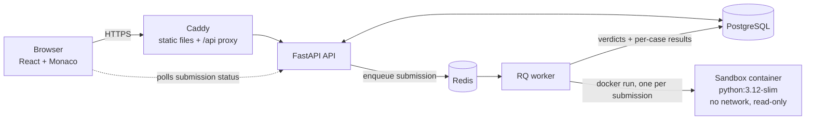

# AlgoForge: Project Overview

AlgoForge is a coding practice platform for data structures and algorithms, organized by **topic**. Each topic opens with a notes page (concepts, built-in functions, a worked example), followed by its problems. Every problem has a LeetCode-style editor that runs your code in a locked-down Docker sandbox and judges it against visible and hidden test cases. Every problem also has a solution guide with a brute-force and an optimized approach, line-by-line notes, a dry run and a flowchart.

- **Repository:** https://github.com/Alkarim786/algoforge
- **Demo video:** [docs/media/algoforge-demo.mp4](docs/media/algoforge-demo.mp4) (67 seconds)
- **Author:** Karim (Mohamed Karimullah), final-year B.Tech CSE

---

## 1. At a glance

| | |
|---|---|
| Topics | 10: Array, Binary, Dynamic Programming, Graph, Interval, Linked List, Matrix, String, Tree, Heap |
| Problems | 75, each with an original statement |
| Test cases | 681, visible and hidden, all verified against reference solutions |
| Solution guides | 150 approaches (brute force + optimized for every problem), with Mermaid flowcharts |
| Languages | Python (C++ and Java are planned) |
| Automated tests | 662 backend tests (pytest) |
| Roles | Student and Admin, with separate sign-in portals |
| Themes | Light, Dark, System ("Aurora" design, Electric blue accent) |

---

## 2. Features

### For students
- **Landing page.** Hero section, feature tour, the study path and how it works.
- **Dashboard.** Solved count, current and best streak, recent submissions, and progress per topic.
- **Problems page.** A card grid with one card per topic. Each card shows a progress ring and a preview of its problems, with "Show all", search, and Expand/Collapse all.
- **Topic pages.** Markdown notes covering the concept, built-in functions and a worked example, with a table of contents and the topic's problem list.
- **Workspace (the editor).**
  - Split pane: the description on the left, the Monaco editor on the right, and a resizable divider between them.
  - **Run** judges the visible cases and any custom input you type. **Submit** judges every case, including the hidden ones. Both go through the same pipeline.
  - The bottom panel has two tabs. **Testcase** lets you edit your own inputs. **Result** shows each case's verdict, output, expected output, stdout, runtime and memory.
  - Previous/next buttons follow the study path, and a slide-in **problem drawer** lets you jump to any topic or problem.
  - Starter code is generated from each problem's signature, and you can reset your code to it.
- **Solution guide.** A "How to think" section, then a toggle between brute force and optimized. Each approach shows highlighted code, synced line-by-line notes, time and space complexity, a dry-run table and a Mermaid flowchart.
- **Profile.** Appearance setting (Light/Dark/System) and a password change form.
- **Friendly validation.** Every form error is plain English, for example "Enter an email address like name@example.com." instead of a regex dump.

### For admins
- A separate **Admin sign-in** (a Student/Admin switch on the sign-in page). Students are refused at the admin portal.
- **Students.** A list of every user with a role filter, and a per-student evaluation page: scores per topic, strengths, weak spots and submission history. Admins can promote or demote other users, but never themselves.
- **Problems.** Create and edit problems: details, markdown statement, constraints, examples and function signature.
- **Test cases.** Add, edit and delete them. Each case is checked against the function signature before it's saved.
- **Solution guides.** Write the brute-force and optimized approaches in the browser, then use **"Test against all cases"** to check the code before saving.

---

## 3. Architecture



**How a submission flows**
1. The browser sends `POST /submissions` with the code, the language and whether it's a Run or a Submit.
2. The API stores a `Pending` submission, puts a job on the Redis queue and returns at once.
3. An RQ worker picks up the job. It wraps the user's code in a **driver**, which turns the JSON test input into real arguments: linked lists, trees, graphs, or a class with a series of method calls. It then starts a fresh sandbox container.
4. Inside the container, the harness drops privileges, forks a child for each test case with resource limits, runs the code, and returns the output, stdout, runtime and memory.
5. The judge compares the actual output with the expected output. It parses both as JSON and compares the structures, so formatting differences don't matter. Floats compare with a tolerance of 1e-5, `True` and `1` are never treated as equal, and problems whose answers can come in any order are normalized by sorting first. The worker then stores a verdict for each case and one overall verdict.
6. The browser polls `GET /submissions/{id}` until the status is final, then shows the results.

**Verdicts:** Accepted, Wrong Answer, Time Limit Exceeded and Runtime Error (running out of memory counts as a Runtime Error), plus "Finished" for custom inputs, which have no expected output. The overall verdict comes from the first case that fails.

---

## 4. Tech stack

| Layer | Technology |
|---|---|
| API | FastAPI 0.115, Pydantic 2, Uvicorn |
| Database | PostgreSQL, SQLAlchemy 2.0, Alembic (5 migrations) |
| Queue | Redis 5 + RQ 2 |
| Execution | Docker, one fresh container per submission; optional gVisor (`SANDBOX_RUNTIME=runsc`) |
| Auth | JWT (PyJWT), bcrypt, rate limiting on sign-in held in Redis |
| Frontend | React 18, Vite 5, React Router 6, Monaco editor, react-markdown, Mermaid 11, lucide-react icons |
| Fonts | Plus Jakarta Sans (UI), JetBrains Mono (code), self-hosted |
| Web server | Caddy 2.8 (automatic HTTPS, compression, security headers) |
| Hosting | Docker Compose; Cloudflare Tunnel for hosting from a home PC; a guide for Oracle Cloud's free tier |
| Demo video | Playwright + ffmpeg, plus a soundtrack generated with numpy |

---

## 5. Sandbox security

User code **never** runs in the API or worker process. Each submission runs in a container started with:

| Protection | Setting |
|---|---|
| No network | `--network none` |
| Memory | 256 MB per case (`RLIMIT_AS`), 384 MB for the container, swap disabled |
| CPU | 1 CPU; 2 CPU-seconds per case (`RLIMIT_CPU`), with double that as the wall-clock limit |
| Fork bombs | `--pids-limit 128`, `RLIMIT_NPROC 64` |
| Filesystem | `--read-only` root, plus a 16 MB `/tmp` mounted `noexec,nosuid,nodev`; files capped at 1 MB |
| Privileges | `--cap-drop ALL` (only SETUID and SETGID are added back, so the harness can drop to an unprivileged user), `no-new-privileges`, `--ipc none` |
| Hard kill | The worker enforces an overall timeout and then **kills the container by name**. Killing only the docker client would leave the container running. |
| Output | Stored output is capped at 10,000 characters; Docker logging is off |

The platform tells its own failures apart from the user's: a `SandboxError` means "our fault, try again", while `SandboxKilled` means the memory limit killed the harness, which only the user's code can cause.

---

## 6. Database schema

```
users              id, username, email, password_hash, role (student|admin), created_at
topics             id, name, slug, order, notes_content (markdown)
problems           id, topic_id, title, slug, difficulty, description, constraints, examples (json),
                   order_within_topic, is_flagship, entry (function signature json), thinking (markdown)
test_cases         id, problem_id, input, expected_output, is_hidden
submissions        id, user_id, problem_id, language, code, kind (run|submit), status, custom_inputs,
                   created_at
submission_results id, submission_id, test_case_id, custom_input, passed, verdict, actual_output,
                   stdout, stderr, runtime_ms, memory_kb
solutions          id, problem_id, approach_type (brute_force|optimized), title, code, explanation
                   (markdown, includes the dry run), line_notes, time_complexity, space_complexity,
                   flowchart_mermaid, order
```

Hidden test cases live in their own table. Run and Submit share one pipeline and only pick a different set of cases.

---

## 7. API endpoints

| Area | Endpoints |
|---|---|
| Auth | `POST /auth/signup`, `POST /auth/login?portal=student\|admin`, `GET /auth/me`, `POST /auth/change-password` |
| Topics | `GET /topics`, `GET /topics/{slug}` (notes + ordered problems), plus admin `POST`/`PATCH`/`DELETE` |
| Problems | `GET /problems`, `GET /problems/{slug}`, `GET /problems/{slug}/solutions`, plus admin `POST`/`PATCH`/`DELETE` |
| Submissions | `POST /submissions`, `GET /submissions/{id}`, `GET /submissions` (history) |
| Me | `GET /me/dashboard`, `GET /me/progress` |
| Admin | `GET /admin/users`, `GET /admin/users/{id}/evaluation`, `PATCH /admin/users/{id}/role`, `GET /admin/problems`, `GET /admin/problems/{slug}`, test-case CRUD, `PUT`/`DELETE /admin/problems/{slug}/solutions/{approach}` |

The interactive docs are at `/docs` (Swagger UI).

---

## 8. Project structure

```
algoforge/
├── backend/
│   ├── app/
│   │   ├── main.py               FastAPI app, error handlers (friendly validation messages)
│   │   ├── models.py             SQLAlchemy models
│   │   ├── schemas.py            Pydantic request/response models
│   │   ├── security.py           JWT, bcrypt, current user, require_admin
│   │   ├── rate_limit.py         Sign-in lockout held in Redis
│   │   ├── routers/              auth, topics, problems, submissions, me, admin
│   │   ├── sandbox.py            Starts and kills the Docker sandbox
│   │   ├── drivers.py            Wraps user code: builds lists/trees/graphs, generates starter code
│   │   ├── judge.py              Output comparison and verdicts
│   │   ├── worker.py / jobs.py   RQ job that judges a submission
│   │   ├── progress.py           Dashboard, streaks, per-topic progress
│   │   ├── evaluation.py         Per-student strengths and weaknesses for admins
│   │   ├── content_checks.py     Validates test cases against a problem's signature
│   │   ├── seed.py               Loads backend/content into the database (idempotent)
│   │   └── create_admin.py       `python -m app.create_admin <username> <email>`
│   ├── alembic/versions/         0001–0005 migrations
│   ├── content/                  ALL learning content as data files
│   │   ├── topics.json
│   │   ├── entries.json          Function signature for each problem (used to call user code)
│   │   ├── notes/*.md            10 topic notes
│   │   ├── problems/*.json       75 problems with test cases
│   │   └── solutions/*.md        75 solution guides (2 approaches each)
│   ├── scripts/                  Content-authoring helpers
│   └── tests/                    662 pytest tests
├── sandbox/python/               Sandbox image + harness.py (privilege drop, rlimits, per-case fork)
├── frontend/
│   ├── src/                      App, Home, TopicPage, Workspace, ProblemDrawer, SolutionPanel,
│   │                             Mermaid, Profile, AdminPortal, AdminContent, validation, theme
│   ├── Dockerfile                Node build, then Caddy
│   └── Caddyfile                 HTTPS, /api proxy, SPA routing, caching, security headers
├── scripts/                      deploy.sh, backup.sh, init_env.py
├── tools/demo-video/             record.py (app capture), cinema.py (cinematic edit), music.py
├── docs/media/                   Demo video
├── docker-compose.yml            Development stack
├── docker-compose.prod.yml       Production stack
├── docker-compose.tunnel.yml     Cloudflare quick tunnel
├── README.md · DEPLOY.md · CLAUDE.md
```

---

## 9. Running it

**Development** (hot reload; needs Docker and Python 3):
```bash
python scripts/init_env.py
docker compose up -d --build
docker compose exec api python -m app.seed
```
The app runs at http://localhost:5173 and the API docs at http://localhost:8000/docs.

**Production:** see [DEPLOY.md](DEPLOY.md). It covers `docker-compose.prod.yml` behind Caddy with automatic HTTPS, `scripts/deploy.sh` and `scripts/backup.sh`, hosting from your own PC through Cloudflare Tunnel, and Oracle Cloud's free tier.

**Tests:**
```bash
docker compose exec api pytest -q
```

---

## 10. Engineering decisions worth talking about

- **Content is data, not code.** Notes, problems, test cases and solution guides are markdown and JSON files in `backend/content/`. Re-running the seed updates rows in place, so editing content never needs a migration.
- **Every test case is verified.** A test runs both reference solutions (brute force and optimized) against all 681 cases. A wrong expected output fails CI instead of failing a student.
- **One pipeline for Run and Submit.** They differ only in which cases they include, so "it passed Run but failed Submit" can only ever mean a hidden case failed.
- **Language-neutral test data.** Inputs and outputs are JSON. The driver builds linked lists, trees, graphs and class problems that take a series of method calls (`MedianFinder`, `Trie`, `WordDictionary`), so the same cases will work for C++ and Java later.
- **Two layers of limits.** Docker limits the container and `setrlimit` limits each test case, so one slow case can't use up another case's time.
- **Errors explain themselves.** Pydantic errors are rewritten into sentences on the server, and the forms check fields with the same rules on the client.
- **Fonts and caret.** Monaco measures font width when it starts. The editor re-measures once the web font loads, so the caret lands where you click. The editor is also uncontrolled, so fast typing never drops a keystroke.

---

## 11. Suggested new features

Grouped by what they add. **Effort** is a rough guess: S = a day or less, M = a few days, L = a week or more.

### A. Core judge and languages
| Feature | Why | Effort |
|---|---|---|
| **C++ and Java** sandbox images | The data model is already language-neutral; it's the main gap in the original plan | L |
| **Live results over WebSocket** (or Server-Sent Events) instead of polling | Faster feedback and less load on the API; good to show in an interview | M |
| **A separate Memory Limit Exceeded verdict** (today it shows as Runtime Error) | Clearer feedback; the sandbox already detects it | S |
| **Runtime and memory percentiles** ("faster than 82% of Python submissions") | Gives students a reason to optimize after Accepted | M |
| **Custom checkers** for problems with many valid answers | Today any-order answers are handled by sorting; a checker also covers "any valid answer" problems | M |
| **Stress-test mode:** generate random inputs and compare against the brute-force solution | Finds edge cases the visible tests miss; makes a unique learning tool | M |
| **Write your own test cases** that count toward a "test author" score (planned as a differentiator in CLAUDE.md) | Teaches students to think about edge cases | M |

### B. Learning experience
| Feature | Why | Effort |
|---|---|---|
| **Step-through visualizer** for arrays, pointers, linked lists and trees, driven by the dry-run tables you already have | Turns the solution guides into animations; very visual for a demo | L |
| **Progressive hints:** 3 levels before the full solution | Students don't jump straight to the answer | S |
| **Spaced repetition:** "Revisit Coin Change, you solved it 7 days ago" | Builds lasting recall, not just a solved count | M |
| **Personal notes per problem**, saved with your submissions | Your own revision sheet | S |
| **Bookmarks and custom lists** ("Interview in 2 weeks") | Basic but expected | S |
| **Pattern tags** (sliding window, two pointers, monotonic stack) with a page per pattern | Teaches the reusable idea, not just the problem | M |
| **Complexity quiz** after Accepted: "What's the time complexity of your solution?" | Practices the thing interviewers actually ask | S |

### C. AI features (useful for an AI/ML resume)
| Feature | Why | Effort |
|---|---|---|
| **AI code review after Accepted:** a Claude model comments on style, complexity and a cleaner approach | A clear LLM integration with a real purpose | M |
| **"Why is it wrong?" helper on Wrong Answer:** explains the failing visible case without giving away the solution | High value for learners; strict prompt design is part of the work | M |
| **Mock interview mode:** a timed problem plus an AI interviewer that asks follow-up questions | Stands out on a resume | L |
| **Personalized study plan** built from the admin evaluation data (weak topics come first) | Uses data you already compute | M |

### D. Engagement and community
| Feature | Why | Effort |
|---|---|---|
| **Contests:** timed sets with a leaderboard | Classic and motivating; your college could run one | L |
| **Discussion threads per problem** | Students explain approaches to each other | M |
| **Badges and achievements** (first Hard, 7-day streak, topic mastered) | Cheap motivation that builds on your streak data | S |
| **Public profile page** with a heatmap calendar, like GitHub's contribution graph | Shareable on LinkedIn | M |
| **Shareable solution links** (read-only view of an Accepted solution) | Spreads the platform | S |

### E. Admin and teaching tools
| Feature | Why | Effort |
|---|---|---|
| **Classrooms:** a teacher assigns problem sets with deadlines and sees the class's progress | Fits a college use case directly | L |
| **Plagiarism check** that flags near-identical Accepted solutions (token similarity) | Needed if it's used for graded work | M |
| **Bulk import/export of problems** (JSON/ZIP) from the admin portal | Faster content authoring | S |
| **Test-case coverage report:** which hidden cases catch which wrong solutions | Shows whether your tests are strong (a goal in CLAUDE.md) | M |
| **Analytics:** the most-failed problems and the cases that fail most often | Shows where the notes need work | M |

### F. Platform and production
| Feature | Why | Effort |
|---|---|---|
| **CI on GitHub Actions:** run pytest, build the frontend, build the sandbox image | A green badge on the repository; recruiters check this | S |
| **Refresh tokens and email verification** (password reset by email) | Expected for real accounts | M |
| **Warm container pool** for the sandbox (pre-started, used once, then replaced) | Cuts the ~0.5 s container start time | M |
| **Observability:** Prometheus metrics (queue length, judge time) + a Grafana dashboard | Strong DevOps signal | M |
| **Kubernetes manifests or a Helm chart**, with the worker scaled on queue length | Shows you can scale it out | L |
| **Frontend tests** (Vitest + Playwright end-to-end) | The recorder already drives Playwright, so reuse it | M |
| **Mobile-friendly workspace** (stacked panes, read-only on small screens) | The rest of the site already works on phones | M |
| **A named Cloudflare Tunnel with your own domain** | A stable URL instead of a random `trycloudflare.com` one | S |

### Suggested order
1. **CI on GitHub Actions** and a **named tunnel**: small effort, and the project immediately looks more professional.
2. **AI code review** and the **"Why is it wrong?" helper**: the strongest additions for AI/ML roles.
3. **C++ and Java**: finishes the original plan.
4. **Step-through visualizer** or **contests**: the big feature that stands out in a demo.
