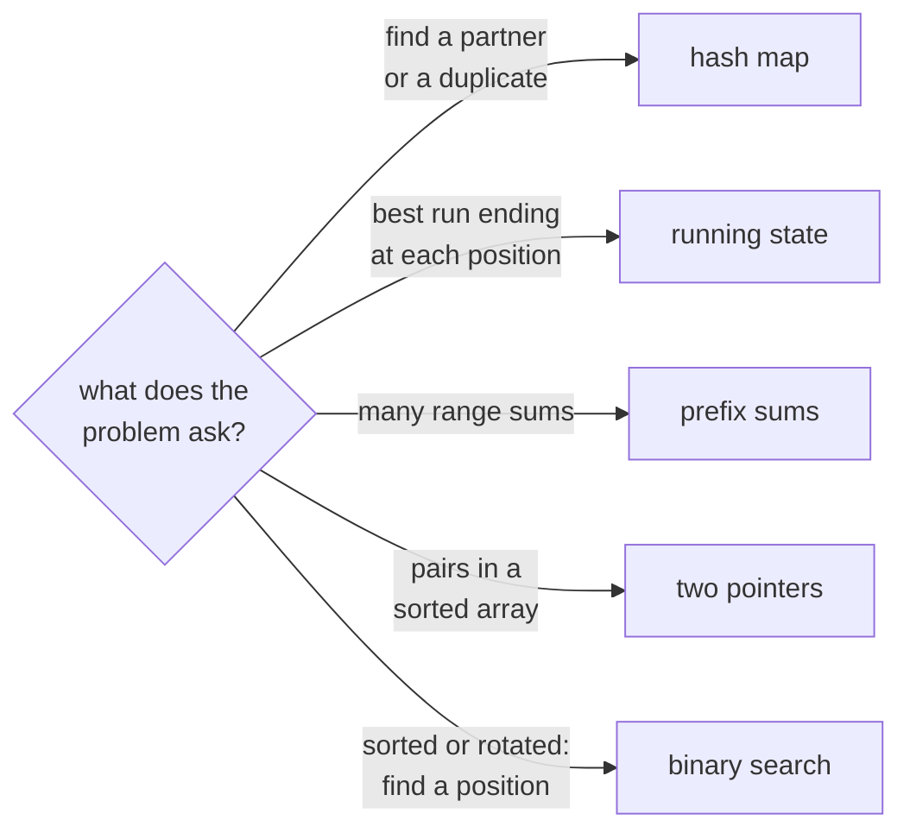

## The idea

An array stores elements side by side in one block of memory. Because every element has the same size, the address of element `i` is `start + i × size`, so reading or writing any position takes **O(1)** time, no matter how long the array is.

That one property explains almost everything else:

- **Indexing is free**, so algorithms can jump around (binary search, two pointers moving from both ends).
- **Inserting or deleting in the middle is expensive**, because every element after that point has to shift by one.
- **Growing is cheap on average.** Python lists, C++ `vector` and Java `ArrayList` reserve extra capacity and double it when full. A single append is occasionally O(n), but n appends cost O(n) in total, so each one is **amortized O(1)**.

| Operation | Cost | Why |
|---|---|---|
| Read or write `a[i]` | O(1) | Address is computed directly |
| Append at the end | O(1) amortized | Spare capacity, occasional resize |
| Insert or delete at position `i` | O(n − i) | Later elements shift |
| Search for a value (unsorted) | O(n) | Must look at each element |
| Search for a value (sorted) | O(log n) | Binary search halves the range |
| Copy a slice of length k | O(k) | Each element is copied |

## Core patterns

Most array problems are one of a handful of patterns. Recognizing which one applies is most of the work.



**Hash map for lookups.** When you find yourself asking "have I already seen a value that pairs with this one?", a hash map turns an O(n) scan into an O(1) lookup, at the cost of O(n) memory. This is the key to **Two Sum**.

**Running state (one pass).** Some answers can be built left to right by keeping a small summary of everything seen so far, such as the best total ending at the current position. This is the idea behind **Maximum Subarray** and **Best Time to Buy and Sell Stock**.

**Prefix sums.** Precompute `prefix[i] = a[0] + … + a[i-1]`. Then the sum of any range `a[l..r]` is `prefix[r+1] − prefix[l]`, in O(1). The worked example below is built on this.

**Two pointers.** On a sorted array, one pointer at each end can move inward based on a comparison, covering every useful pair in O(n) instead of O(n²). See **3Sum** and **Container With Most Water**.

**Sliding window.** Keep a window `[left, right]` and expand or shrink it while maintaining some property. This is the array version of a pattern you'll meet again in the String topic.

**Binary search on structure.** Binary search works on anything where you can tell which half the answer is in, not only on fully sorted arrays. **Find Minimum in Rotated Sorted Array** and **Search in Rotated Sorted Array** use this.

## Built-in functions

| Task | Python | C++ | Java |
|---|---|---|---|
| Create, size n, filled with 0 | `a = [0] * n` | `vector<int> a(n, 0);` | `int[] a = new int[n];` |
| Dynamic list | `a = []` | `vector<int> a;` | `List<Integer> a = new ArrayList<>();` |
| Append | `a.append(x)` | `a.push_back(x);` | `a.add(x);` |
| Length | `len(a)` | `a.size()` | `arr.length` / `list.size()` |
| Sort ascending | `a.sort()` or `sorted(a)` | `sort(a.begin(), a.end());` | `Arrays.sort(arr);` / `Collections.sort(list);` |
| Sort descending | `a.sort(reverse=True)` | `sort(a.rbegin(), a.rend());` | `list.sort(Collections.reverseOrder());` |
| Reverse in place | `a.reverse()` | `reverse(a.begin(), a.end());` | `Collections.reverse(list);` |
| Sum | `sum(a)` | `accumulate(a.begin(), a.end(), 0LL)` | `Arrays.stream(arr).asLongStream().sum()` |
| Min / max | `min(a)`, `max(a)` | `*min_element(a.begin(), a.end())` | `Arrays.stream(arr).min().getAsInt()` |
| First index ≥ x in sorted array | `bisect.bisect_left(a, x)` | `lower_bound(a.begin(), a.end(), x) - a.begin()` | `Arrays.binarySearch(arr, x)` (see pitfalls) |
| Copy a range `[i, j)` | `a[i:j]` | `vector<int>(a.begin() + i, a.begin() + j)` | `Arrays.copyOfRange(arr, i, j)` |
| Hash map | `d = {}` / `defaultdict(int)` | `unordered_map<int, int> d;` | `Map<Integer, Integer> d = new HashMap<>();` |
| Hash set | `s = set()` | `unordered_set<int> s;` | `Set<Integer> s = new HashSet<>();` |

Sorting is O(n log n) in all three. Python's `sort` and Java's object sorts (`Collections.sort`, `Arrays.sort` on objects) are **stable**: equal elements keep their order. C++ `sort` is not stable; use `stable_sort` when that matters.

## Pitfalls

**Python: building a 2D grid with `*` shares rows.** The outer `*` copies references to the same inner list.

```python
wrong = [[0] * 3] * 2
wrong[0][0] = 1
assert wrong == [[1, 0, 0], [1, 0, 0]]  # both rows changed

right = [[0] * 3 for _ in range(2)]
right[0][0] = 1
assert right == [[1, 0, 0], [0, 0, 0]]
```

**C++ and Java: integer overflow.** A sum of 10⁵ values up to 10⁹ needs 64 bits. Use `long long` in C++ (and `0LL` as the start value of `accumulate`, which otherwise sums in `int`) and `long` in Java (where `Arrays.stream(arr).sum()` on an `int[]` also returns an `int`). Python integers never overflow.

**Java: `Arrays.binarySearch` on a missing value** returns `-(insertion point) - 1`, not `-1`. The array must already be sorted, or the result is meaningless.

**Slices copy.** `a[i:j]` in Python allocates a new list. Slicing inside a loop quietly turns an O(n) algorithm into O(n²).

## Worked example: count subarrays with a given sum

> Given an array of integers `nums` (which may include negatives) and a target `k`, count the contiguous subarrays whose elements add up to exactly `k`.

**Brute force.** Try every start `i`, extend the end `j`, keep a running total, and count each time it equals `k`. That checks every subarray once: **O(n²)** time, O(1) space.

**Using prefix sums.** Let `P[j]` be the sum of the first `j` elements, with `P[0] = 0`. The subarray from index `i` to `j - 1` sums to `P[j] − P[i]`. So a subarray ending just before `j` sums to `k` exactly when some earlier prefix equals `P[j] − k`.

Walking left to right, keep a hash map from each prefix value to how many times it has appeared. At each step, look up `P[j] − k` and add its count to the answer. Each element is handled once, so this is **O(n)** time and O(n) space. Negative numbers are why a sliding window doesn't work here: the window sum doesn't grow or shrink predictably.

**Trace** for `nums = [2, 1, -1, 3, 1]`, `k = 3`:

| Step | Value | Prefix | Looking for (prefix − 3) | Times seen | Count | Map afterwards |
|---|---|---|---|---|---|---|
| start | | 0 | | | 0 | {0: 1} |
| 1 | 2 | 2 | −1 | 0 | 0 | {0: 1, 2: 1} |
| 2 | 1 | 3 | 0 | 1 | 1 | {0: 1, 2: 1, 3: 1} |
| 3 | −1 | 2 | −1 | 0 | 1 | {0: 1, 2: 2, 3: 1} |
| 4 | 3 | 5 | 2 | 2 | 3 | {…, 5: 1} |
| 5 | 1 | 6 | 3 | 1 | 4 | {…, 6: 1} |

The four subarrays are `[2, 1]`, `[1, -1, 3]`, `[3]` and `[-1, 3, 1]`.

```python
from collections import defaultdict


def count_subarrays_with_sum(nums, k):
    seen = defaultdict(int)
    seen[0] = 1  # the empty prefix, so subarrays starting at index 0 are counted
    prefix = count = 0
    for value in nums:
        prefix += value
        count += seen[prefix - k]
        seen[prefix] += 1
    return count


assert count_subarrays_with_sum([2, 1, -1, 3, 1], 3) == 4
assert count_subarrays_with_sum([3, 4, -7, 3, 1, 3, 1, -4], 7) == 3
assert count_subarrays_with_sum([0, 0], 0) == 3
```

Note the order inside the loop: look up first, then record the current prefix. Recording first would let a prefix pair with itself, which counts an empty subarray whenever `k = 0`.
