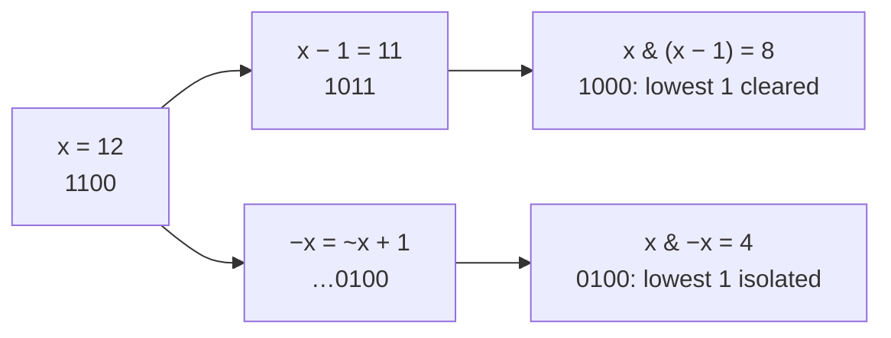

## The idea

Every integer is stored as a row of bits. In an unsigned 8-bit number, `13` is `00001101`: bit 0 (the rightmost) is worth 1, bit 1 is worth 2, bit 2 is worth 4, and so on, so `13 = 8 + 4 + 1`.

Bit manipulation means working on those bits directly. The operations are single CPU instructions, so they're as fast as arithmetic, and they let you pack a set of yes/no flags into one integer.

**Negative numbers use two's complement.** To negate `x`, flip every bit and add 1. In 8 bits, `-13` is `11110011`. Two consequences show up constantly:

- The highest bit acts as the sign: 1 means negative.
- `-x` equals `~x + 1`, which is why `x & -x` isolates the lowest set bit (see the tricks below).

## The operators

| Operator | Meaning | Example (8-bit) |
|---|---|---|
| `a & b` | AND: 1 where both are 1 | `1100 & 1010 = 1000` |
| `a \| b` | OR: 1 where either is 1 | `1100 \| 1010 = 1110` |
| `a ^ b` | XOR: 1 where they differ | `1100 ^ 1010 = 0110` |
| `~a` | NOT: flip every bit | `~00001100 = 11110011` |
| `a << n` | Shift left: multiply by 2ⁿ | `0011 << 2 = 1100` |
| `a >> n` | Shift right: divide by 2ⁿ, rounding down | `1100 >> 2 = 0011` |

For negative numbers, `>>` keeps the sign bit (an *arithmetic* shift) in Python and Java, and in C++ on every common compiler (guaranteed since C++20). Java also has `>>>`, which fills with zeros (a *logical* shift). In C++, shift an `unsigned` value to get the zero-filling behaviour.

## Tricks worth memorizing

| Goal | Expression | Example with x = 12 (`1100`) |
|---|---|---|
| Is bit i set? | `(x >> i) & 1` | i = 2 → 1 |
| Set bit i | `x \| (1 << i)` | i = 0 → `1101` = 13 |
| Clear bit i | `x & ~(1 << i)` | i = 3 → `0100` = 4 |
| Toggle bit i | `x ^ (1 << i)` | i = 1 → `1110` = 14 |
| Lowest set bit | `x & -x` | `0100` = 4 |
| Clear lowest set bit | `x & (x - 1)` | `1000` = 8 |
| Power of two? | `x > 0 and x & (x - 1) == 0` | 12 → no |

The two "lowest set bit" tricks side by side, for x = 12:



**XOR facts.** `a ^ a = 0`, `a ^ 0 = a`, and XOR is commutative and associative, so the order of operations doesn't matter. Values that appear an even number of times cancel out. The worked example uses this.

**Clearing the lowest set bit counts bits fast.** Repeating `x = x & (x - 1)` until `x` is 0 takes one step per 1 bit, not one per bit position. This idea leads into **Number of 1 Bits**. **Counting Bits** goes further, reusing answers already computed for smaller numbers.

```python
x = 12
assert (x >> 2) & 1 == 1
assert x | (1 << 0) == 13
assert x & ~(1 << 3) == 4
assert x ^ (1 << 1) == 14
assert x & -x == 4
assert x & (x - 1) == 8
assert not (x > 0 and x & (x - 1) == 0)
```

## Built-in functions

| Task | Python | C++ | Java |
|---|---|---|---|
| Count 1 bits | `x.bit_count()` (3.10+), `bin(x).count("1")` | `__builtin_popcount(x)`, or `std::popcount(unsigned(x))` (C++20) | `Integer.bitCount(x)` |
| Number of bits needed | `x.bit_length()` | `std::bit_width(unsigned(x))` (C++20) | `32 - Integer.numberOfLeadingZeros(x)` |
| Trailing zeros | `(x & -x).bit_length() - 1` (x > 0) | `__builtin_ctz(x)` (x ≠ 0) | `Integer.numberOfTrailingZeros(x)` |
| Binary string | `bin(x)`, `format(x, "032b")` | `bitset<32>(x).to_string()` | `Integer.toBinaryString(x)` |
| Parse binary string | `int("1101", 2)` | `stoi("1101", nullptr, 2)` | `Integer.parseInt("1101", 2)` |
| Reverse 32 bits | `int(format(x, "032b")[::-1], 2)` | none built in; loop over bits | `Integer.reverse(x)` |
| Unsigned right shift | `(x & 0xFFFFFFFF) >> n` | `unsigned(x) >> n` | `x >>> n` |

`__builtin_popcount` and `__builtin_ctz` are GCC and Clang extensions, available on almost every judge. `__builtin_ctz(0)` is undefined, so check for zero first.

## Pitfalls

**Python integers have no fixed width.** They never overflow, and a negative number behaves as if it had infinitely many leading 1 bits. To get the 32-bit pattern other languages would show, mask with `0xFFFFFFFF`.

```python
x = -5
assert bin(x) == "-0b101"  # sign and magnitude, not two's complement
assert x & 0xFFFFFFFF == 4294967291  # the 32-bit pattern, read as unsigned
assert ~5 == -6  # ~x is always -x - 1 in Python
```

**Operator precedence.** In C++ and Java, `==` binds tighter than `&`, so `x & 1 == 0` means `x & (1 == 0)`: a silent bug in C++ and a compile error in Java. Python evaluates `&` first, so the same text happens to work there. Write `(x & 1) == 0` in every language.

**Shifting too far.** In C++ and Java, `1 << 31` already reaches the sign bit of a 32-bit `int`, and shifting by 32 or more is undefined in C++. Use `1LL << i` / `1L << i` when `i` can be 31 or more.

## Worked example: the element that appears once

> An array contains integers where every value appears exactly twice, except one value that appears once. Find it using O(1) extra space.

**Brute force.** Count occurrences in a hash map, then return the key with count 1: O(n) time but **O(n) space**. Sorting and scanning pairs needs O(1) space but O(n log n) time.

**Using XOR.** XOR all the numbers together. Each duplicated value cancels itself (`a ^ a = 0`), and the order doesn't matter, so only the single value survives (`0 ^ x = x`). That's **O(n)** time and **O(1)** space.

**Trace** for `nums = [4, 9, 7, 9, 4]` (4-bit binary):

| Step | Value | Value in binary | Running XOR |
|---|---|---|---|
| start | | | `0000` = 0 |
| 1 | 4 | `0100` | `0100` = 4 |
| 2 | 9 | `1001` | `1101` = 13 |
| 3 | 7 | `0111` | `1010` = 10 |
| 4 | 9 | `1001` | `0011` = 3 |
| 5 | 4 | `0100` | `0111` = 7 |

The intermediate values look random, but the pairs cancel by the end.

```python
from functools import reduce
from operator import xor


def single_value(nums):
    return reduce(xor, nums, 0)


assert single_value([4, 9, 7, 9, 4]) == 7
assert single_value([-3, 2, 2]) == -3
```

## Bonus: a bitmask as a set

An n-bit integer can represent any subset of n items: bit i is 1 when item i is included. Counting from 0 to 2ⁿ − 1 visits every subset exactly once, which is a compact way to brute-force small inputs (n up to about 20).

```python
items = ["a", "b", "c"]
subsets = []
for mask in range(1 << len(items)):
    subsets.append([items[i] for i in range(len(items)) if (mask >> i) & 1])

assert len(subsets) == 8
assert subsets[5] == ["a", "c"]  # 5 is 101: items 0 and 2
```
