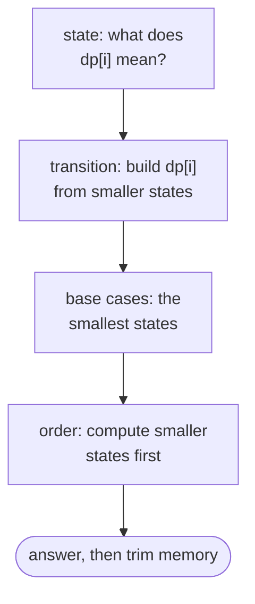
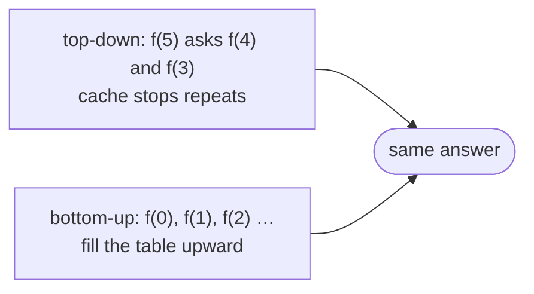

## The idea

Dynamic programming (DP) solves a problem by breaking it into smaller versions of itself, solving each smaller version **once**, and reusing the answers. It applies when two things are true:

- **Optimal substructure.** The answer to the big problem can be built from answers to smaller ones.
- **Overlapping subproblems.** A plain recursive solution would solve the same smaller problem many times.

The classic example is Fibonacci. `fib(n) = fib(n-1) + fib(n-2)` written as plain recursion recomputes `fib(n-2)` twice, `fib(n-3)` three times, and so on, which is exponential. Storing each result the first time cuts it to O(n).

There are two ways to do the storing:

| | Top-down (memoization) | Bottom-up (tabulation) |
|---|---|---|
| How | Write the recursion, cache each result | Fill a table from the smallest cases upward |
| Order of work | Decided by the recursion | You choose it |
| Strength | Closest to how you think about the problem; skips states that are never needed | No recursion depth limit; often lets you keep only the last row or two |
| Watch out for | Recursion depth limits (especially in Python) | Getting the fill order right |

## A recipe

1. **Define the state.** Say in one sentence what `dp[...]` means, for example "`dp[i]` is the number of ways to reach step `i`". Most difficulty in DP is here.
2. **Write the transition.** Express `dp[state]` in terms of smaller states, by asking "what was the last choice made?"
3. **Set the base cases.** The smallest states, whose answers you know directly.
4. **Choose the order.** Every state must be computed after the states it depends on.
5. **Read off the answer**, and then check whether you can drop old rows to save memory.



The same Fibonacci-style problem, solved both ways:



## Common shapes

**1D, linear.** `dp[i]` depends on a few earlier positions. **Climbing Stairs** is the smallest example; **House Robber** adds a choice at each step.

**Unbounded choices (knapsack).** `dp[amount]` is built from `dp[amount − item]` for every item, where each item can be reused. **Coin Change** and **Combination Sum IV** have this shape; read carefully whether the problem counts *combinations* or *ordered sequences*, because the loop order changes the answer.

**2D grid.** `dp[r][c]` depends on its neighbours above and to the left. **Unique Paths** and the worked example below.

**Two sequences.** `dp[i][j]` describes the first `i` items of one sequence and the first `j` of another. **Longest Common Subsequence**.

**Partitioning.** `dp[i]` asks whether (or how many ways) the prefix of length `i` can be split into valid pieces. **Word Break** and **Decode Ways**.

## Built-in functions

| Task | Python | C++ | Java |
|---|---|---|---|
| Memoize a function | `@functools.cache` (3.9+) or `@lru_cache(maxsize=None)` | manual: `vector<long long> memo(n + 1, -1);` | manual: `long[] memo = new long[n + 1]; Arrays.fill(memo, -1);` |
| Memo keyed by a tuple | automatic with `@cache` | `map<pair<int,int>, long long>` | `Map<String, Long>` or a 2D array |
| 1D table | `dp = [0] * (n + 1)` | `vector<long long> dp(n + 1, 0);` | `long[] dp = new long[n + 1];` |
| 2D table | `dp = [[0] * m for _ in range(n)]` | `vector<vector<int>> dp(n, vector<int>(m, 0));` | `int[][] dp = new int[n][m];` |
| "Infinity" for minimums | `float("inf")` | `INT_MAX / 2` or `LLONG_MAX / 2` | `Integer.MAX_VALUE / 2` |
| Raise recursion limit | `sys.setrecursionlimit(10**6)` | not needed (stack size is the limit) | run in a `Thread` with a larger stack |

Use half of the maximum as "infinity" in C++ and Java: `INT_MAX + 1` overflows to a large negative number and silently wins every `min`.

## Pitfalls

**Python recursion depth.** Python stops at about 1,000 nested calls by default. A top-down solution over 10⁵ states needs `sys.setrecursionlimit`, or a bottom-up rewrite.

**Mutable default arguments as a memo.** `def f(n, memo={})` keeps the same dictionary between calls, so answers leak across test cases. Use `@cache`, or pass the memo explicitly.

**Wrong base case for "zero".** "How many ways to make 0?" is usually **1** (choose nothing), not 0. Getting it wrong zeroes out the whole table.

**Counting vs. optimizing.** The same state and transition can answer "how many ways" (add the options) or "the best way" (take the min or max). Make sure the operation matches the question.

```python
from functools import cache


@cache
def ways(n):
    """Ways to write n as an ordered sum of 1s and 2s."""
    if n == 0:
        return 1  # one way to make 0: choose nothing
    return ways(n - 1) + (ways(n - 2) if n >= 2 else 0)


assert [ways(n) for n in range(6)] == [1, 1, 2, 3, 5, 8]
```

## Worked example: cheapest path through a grid

> A grid of non-negative costs is given. Start at the top-left cell, move only **right** or **down**, and stop at the bottom-right cell. Find the smallest possible total cost of the cells you pass through, counting both ends.

**Brute force.** Try every path. A grid with r rows and c columns has C(r + c − 2, r − 1) paths, which is exponential, even though many paths share the same beginning.

**State.** `best(r, c)` is the cheapest cost of reaching cell `(r, c)` from the start.

**Transition.** The last move into `(r, c)` came from above or from the left, so `best(r, c) = grid[r][c] + min(best(r − 1, c), best(r, c − 1))`. A neighbour outside the grid counts as infinity.

**Base case.** `best(0, 0) = grid[0][0]`.

**Trace** for this grid:

```
2  9  1
3  1  7
8  2  4
```

Filling the table row by row, each cell adds its own cost to the cheaper of its top and left neighbours:

| | col 0 | col 1 | col 2 |
|---|---|---|---|
| **row 0** | 2 | 2 + 9 = 11 | 11 + 1 = 12 |
| **row 1** | 2 + 3 = 5 | 1 + min(11, 5) = 6 | 7 + min(12, 6) = 13 |
| **row 2** | 5 + 8 = 13 | 2 + min(6, 13) = 8 | 4 + min(13, 8) = 12 |

The answer is **12**, along the path 2 → 3 → 1 → 2 → 4.

**Top-down**, closest to the definition:

```python
from functools import cache


def min_path_cost_memo(grid):
    @cache
    def best(r, c):
        if r == 0 and c == 0:
            return grid[0][0]
        from_above = best(r - 1, c) if r > 0 else float("inf")
        from_left = best(r, c - 1) if c > 0 else float("inf")
        return grid[r][c] + min(from_above, from_left)

    return best(len(grid) - 1, len(grid[0]) - 1)


GRID = [[2, 9, 1], [3, 1, 7], [8, 2, 4]]
assert min_path_cost_memo(GRID) == 12
```

**Bottom-up with one row.** Each row only needs the row above it, so a single list can be updated in place: before the update `dp[c]` still holds the value from above, and `dp[c - 1]` already holds the new value to the left.

```python
def min_path_cost(grid):
    dp = [float("inf")] * len(grid[0])
    dp[0] = 0
    for row in grid:
        dp[0] += row[0]
        for c in range(1, len(row)):
            dp[c] = row[c] + min(dp[c], dp[c - 1])
    return dp[-1]


assert min_path_cost(GRID) == 12
assert min_path_cost([[5]]) == 5
assert min_path_cost([[1, 2, 3]]) == 6
```

Both versions take **O(r × c)** time. The memoized one uses O(r × c) space for the cache, and the one-row version uses **O(c)**.
