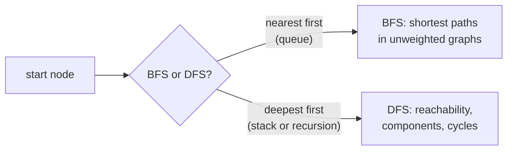

## The idea

A graph is a set of **nodes** (vertices) joined by **edges**. It models anything defined by connections: roads between cities, prerequisites between courses, neighbouring cells in a grid.

Three questions describe any graph:

- **Directed or undirected?** A prerequisite "b before a" is one-way (directed). A road is usually two-way (undirected).
- **Weighted or unweighted?** Do edges have costs, or does every step count the same?
- **Can it have cycles?** A directed graph with no cycles (a DAG) can be put in a valid order, which is a topological sort.

**Storing a graph.** An **adjacency list** keeps, for each node, the list of its neighbours. It uses O(V + E) memory and lists neighbours fast, which is what almost every algorithm needs. An adjacency matrix (a V × V grid of true/false) answers "is there an edge from a to b?" in O(1) but costs O(V²) memory, so it's only worth it for small, dense graphs.

A grid is a graph in disguise: each cell is a node, and its up/down/left/right neighbours are its edges. There's no need to build an adjacency list for it; compute the neighbours on the fly.

```python
from collections import defaultdict

edges = [(0, 1), (0, 2), (1, 3)]
graph = defaultdict(list)
for a, b in edges:  # undirected: add both directions
    graph[a].append(b)
    graph[b].append(a)

assert graph[0] == [1, 2]
assert graph[3] == [1]
```

## Core patterns

**Breadth-first search (BFS).** Explore in rings: all nodes 1 step away, then 2 steps, and so on, using a **queue**. In an unweighted graph, the first time BFS reaches a node is along a shortest path. The worked example below uses this.

**Depth-first search (DFS).** Go as deep as possible before backing up, using recursion or a **stack**. Good for exploring everything reachable, counting connected regions (**Number of Islands**, **Number of Connected Components**), and copying structures (**Clone Graph**).



**Topological sort.** For a DAG, repeatedly take a node with no remaining incoming edges (Kahn's algorithm), or use DFS finish order. If some nodes are never taken, there's a cycle. See **Course Schedule** and **Alien Dictionary**.

**Union-Find (disjoint sets).** Merge nodes into groups as edges arrive and ask "are these two in the same group?" in near-constant time. Useful for **Graph Valid Tree** and counting components.

**Multi-source search.** Start BFS or DFS from several nodes at once, such as every ocean-border cell in **Pacific Atlantic Water Flow**.

Both BFS and DFS visit each node and edge once: **O(V + E)** time.

## Built-in functions

| Task | Python | C++ | Java |
|---|---|---|---|
| Adjacency list | `graph = defaultdict(list)` | `vector<vector<int>> graph(n);` | `List<List<Integer>> graph = new ArrayList<>();` (add n empty lists) |
| Add an edge a → b | `graph[a].append(b)` | `graph[a].push_back(b);` | `graph.get(a).add(b);` |
| Queue for BFS | `q = deque([start])` | `queue<int> q; q.push(start);` | `Deque<Integer> q = new ArrayDeque<>(); q.add(start);` |
| Take from the queue | `q.popleft()` | `q.front(); q.pop();` | `q.poll()` |
| Stack for DFS | `stack = [start]` / `stack.pop()` | `stack<int> st;` | `Deque<Integer> st = new ArrayDeque<>(); st.push(x); st.pop();` |
| Visited marks | `seen = set()` | `vector<bool> seen(n, false);` | `boolean[] seen = new boolean[n];` |
| Four grid directions | `for dr, dc in ((1,0),(-1,0),(0,1),(0,-1)):` | `int dr[] = {1,-1,0,0}, dc[] = {0,0,1,-1};` | `int[][] dirs = {{1,0},{-1,0},{0,1},{0,-1}};` |

In Python, use `collections.deque` for queues: `list.pop(0)` is O(n), which quietly turns a linear BFS quadratic. In Java, prefer `ArrayDeque` over the older `Stack` and `LinkedList` classes for both stacks and queues.

## Pitfalls

**Mark nodes visited when you add them, not when you take them out.** Otherwise the same node can be queued many times before it's processed, which wastes time and, in BFS, can break the shortest-distance guarantee.

**Undirected edges go both ways.** Forgetting the reverse edge makes half the graph unreachable.

**Disconnected graphs.** One search only covers one component. To visit everything, loop over every node and start a new search from each unvisited one.

**Recursion depth.** A recursive DFS on a long path (a 10⁵-node chain, or a snake-shaped grid region) can exceed Python's default limit of about 1,000 calls. Use an explicit stack, or raise the limit with `sys.setrecursionlimit`.

## Worked example: shortest path through a maze

> A grid has open cells `.` and walls `#`. Moving up, down, left or right costs one step. Find the fewest steps from `start` to `goal`, or −1 if the goal can't be reached.

**Brute force.** Try every path with DFS and keep the shortest. The number of paths grows exponentially with the grid size, and you can't stop at the first path found, because it might not be the shortest.

**Using BFS.** Every move costs the same, so BFS explores cells in order of distance: everything 1 step away, then 2, and so on. The first time the goal is reached, that's the shortest distance. Each cell is queued at most once: **O(rows × cols)**.

```
. . # .
. # # .
. . . .
```

From (0, 0) to (0, 3). The wall blocks the top route, so the path goes down and around:

| Distance | Cells reached at that distance |
|---|---|
| 0 | (0,0) |
| 1 | (1,0), (0,1) |
| 2 | (2,0) |
| 3 | (2,1) |
| 4 | (2,2) |
| 5 | (2,3) |
| 6 | (1,3) |
| 7 | **(0,3)**: goal |

```python
from collections import deque


def shortest_path(grid, start, goal):
    rows, cols = len(grid), len(grid[0])
    dist = {start: 0}  # doubles as the visited set
    queue = deque([start])
    while queue:
        r, c = queue.popleft()
        if (r, c) == goal:
            return dist[(r, c)]
        for dr, dc in ((1, 0), (-1, 0), (0, 1), (0, -1)):
            nr, nc = r + dr, c + dc
            if 0 <= nr < rows and 0 <= nc < cols and grid[nr][nc] == "." and (nr, nc) not in dist:
                dist[(nr, nc)] = dist[(r, c)] + 1
                queue.append((nr, nc))
    return -1


MAZE = ["..#.", ".##.", "...."]
assert shortest_path(MAZE, (0, 0), (0, 3)) == 7
assert shortest_path(MAZE, (0, 0), (0, 0)) == 0
assert shortest_path([".#", "#."], (0, 0), (1, 1)) == -1
```

The `dist` map does two jobs: it records each cell's distance, and its keys are the visited set, so a cell gets its distance (and its place in the queue) exactly once.
