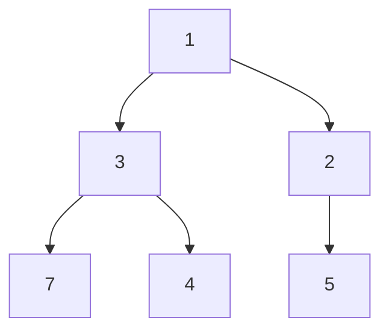
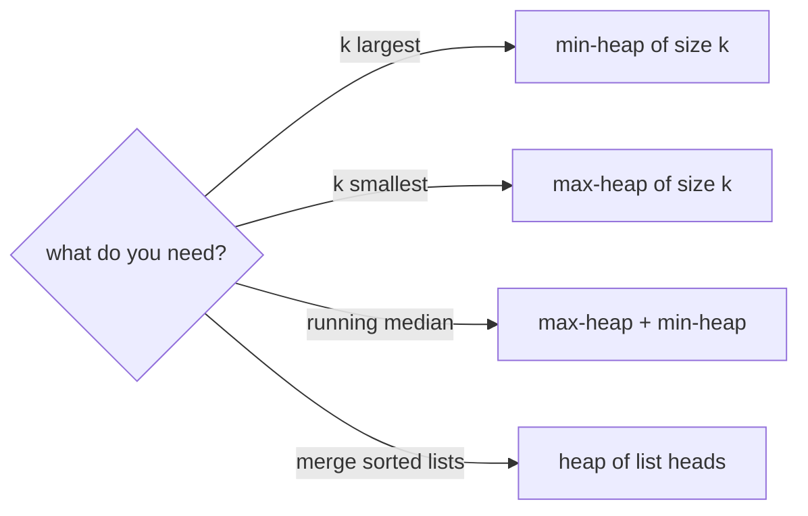

## The idea

A heap is a structure that always knows its **smallest** element (a min-heap) or its **largest** (a max-heap), and stays that way as elements are added and removed. It's the standard way to implement a **priority queue**: "give me the most urgent item next."

It's a complete binary tree stored in an array: the children of index i are at 2i + 1 and 2i + 2. The only rule is that every parent is ≤ its children (in a min-heap). Nothing more is sorted, which is why a heap is cheaper than keeping everything in order.



That's the min-heap stored as `[1, 3, 2, 7, 4, 5]`. The root is always the minimum, while 3 and 2 aren't in sorted order relative to each other.

| Operation | Cost |
|---|---|
| Look at the min (or max) | O(1) |
| Push | O(log n) |
| Pop the min (or max) | O(log n) |
| Build a heap from n items (heapify) | O(n) |
| Find or remove an arbitrary item | O(n) |

## Core patterns

**Top k with a size-k heap.** To keep the k *largest* items from a stream, keep a **min-heap** of size k: whenever it grows past k, pop the smallest. What's left is the top k. That's O(n log k) instead of O(n log n) for a full sort, and it works on streams too long to store. **Top K Frequent Elements** can be solved this way; the worked example uses the mirror image.

**Merge k sorted sequences.** Put the first element of each sequence in a heap, then repeatedly pop the smallest and push its successor from the same sequence. That's O(N log k) for N total elements: **Merge k Sorted Lists**.

**Two heaps around a middle.** A max-heap for the smaller half and a min-heap for the larger half keep the median available in O(1): **Find Median from Data Stream**.

**Scheduling.** Process tasks in order of start time, and use a heap of end times to know when the next resource frees up. This is how **Meeting Rooms II** counts rooms.



## Built-in functions

| Task | Python | C++ | Java |
|---|---|---|---|
| Default heap type | **min**-heap (`heapq` works on a list) | **max**-heap (`priority_queue<int>`) | **min**-heap (`PriorityQueue<Integer>`) |
| Min-heap | `heap = []` | `priority_queue<int, vector<int>, greater<int>> pq;` | `new PriorityQueue<>()` |
| Max-heap | push negated values: `heappush(h, -x)` | `priority_queue<int> pq;` | `new PriorityQueue<>(Collections.reverseOrder())` |
| Push | `heapq.heappush(h, x)` | `pq.push(x);` | `pq.offer(x);` |
| Pop the top | `heapq.heappop(h)` | `pq.top(); pq.pop();` (`pop` returns nothing) | `pq.poll()` |
| Peek | `h[0]` | `pq.top()` | `pq.peek()` |
| Build from a list in O(n) | `heapq.heapify(h)` | `priority_queue<int> pq(v.begin(), v.end());` | `new PriorityQueue<>(list)` |
| Push then pop, in one step | `heapq.heappushpop(h, x)` | push then pop | offer then poll |
| k largest / k smallest | `heapq.nlargest(k, a)`, `heapq.nsmallest(k, a)` | `partial_sort` or `nth_element` | none built in |

```python
import heapq

nums = [5, 1, 8, 3]
heapq.heapify(nums)  # O(n), rearranges the list in place
assert nums[0] == 1  # the minimum is always at index 0

heapq.heappush(nums, 0)
assert heapq.heappop(nums) == 0

max_heap = []
for value in [5, 1, 8]:
    heapq.heappush(max_heap, -value)  # negate to get max-heap behaviour
assert -max_heap[0] == 8

assert heapq.nlargest(2, [5, 1, 8, 3]) == [8, 5]
```

## Pitfalls

**The defaults differ between languages.** Python and Java give you a min-heap; C++ gives you a max-heap. Mixing them up flips your answer.

**A heap is not sorted.** Only `h[0]` is guaranteed to be the minimum; `h[1]` is not necessarily the second smallest. Iterating over the heap's list doesn't give sorted order. Pop repeatedly, or sort, if you need order.

**Ties when pushing tuples.** Python compares tuples element by element. If two entries tie on the priority, it compares the next element, and crashes if that's something incomparable, such as a `ListNode`. Add a unique counter as a tie-breaker: `(priority, counter, item)`.

**Remember to un-negate.** With the negation trick, read values back as `-h[0]`, and push `-x`, not `x`.

## Worked example: the k points closest to the origin

> Given points `[x, y]` and a number `k`, return the `k` points closest to `(0, 0)`, sorted, for a deterministic answer.

**Brute force.** Sort all points by distance and take the first k: **O(n log n)**.

**Keep a max-heap of the k best so far.** Push each point; if the heap now holds more than k, pop the *farthest*, which is the max. The heap never grows beyond k, so each step is O(log k), for **O(n log k)** overall. Use squared distance `x² + y²`: it orders points the same way as the real distance, without a square root. Python only has a min-heap, so store the negated distance.

**Trace** for points `[3,3], [5,−1], [−2,4], [1,1]` and `k = 2` (squared distances 18, 26, 20, 2):

| Point | Distance² | Heap after push (as distances) | Too big, so pop the farthest | Heap kept |
|---|---|---|---|---|
| [3, 3] | 18 | {18} | | {18} |
| [5, −1] | 26 | {18, 26} | | {18, 26} |
| [−2, 4] | 20 | {18, 26, 20} | 26 | {18, 20} |
| [1, 1] | 2 | {18, 20, 2} | 20 | **{18, 2}** |

```python
import heapq


def k_closest(points, k):
    heap = []  # max-heap by distance (negated); holds the k closest seen so far
    for x, y in points:
        heapq.heappush(heap, (-(x * x + y * y), x, y))
        if len(heap) > k:
            heapq.heappop(heap)  # remove the farthest
    return sorted([x, y] for _, x, y in heap)


assert k_closest([[3, 3], [5, -1], [-2, 4], [1, 1]], 2) == [[1, 1], [3, 3]]
assert k_closest([[0, 1]], 1) == [[0, 1]]
```

The counter-intuitive part: to keep the k *smallest* distances, you use a heap that pops the *largest*. The heap holds the current best k, and its top is the worst of them, the first candidate to be replaced.
