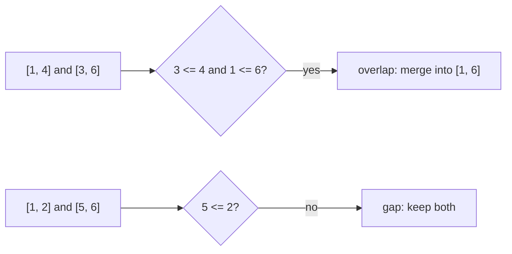

## The idea

An interval is a range `[start, end]`: a meeting from 9 to 11, a booking, a span of numbers. Interval problems ask how ranges relate to each other: do they overlap, how many overlap at once, what's left uncovered?

Two intervals `[a, b]` and `[c, d]` **overlap** when each one starts before the other ends:

```
a <= d  and  c <= b
```

Whether touching endpoints count (is `[1, 2]` overlapping `[2, 3]`?) depends on the problem, so read the statement carefully: it decides between `<=` and `<`.



**Almost every interval problem starts by sorting.** In an unsorted list, any interval could relate to any other, so you'd compare all pairs: O(n²). Sorted by start time, each interval only needs comparing with the most recent ones, and a single sweep is enough: O(n log n) overall, dominated by the sort.

## Core patterns

**Sort by start, then sweep and merge.** Keep the last merged block; extend it when the next interval overlaps, otherwise start a new block. This is **Merge Intervals**. When the input is already sorted, as in **Insert Interval**, you can skip the sort and do one linear pass.

**Sort by end, then choose greedily.** To keep as many non-overlapping intervals as possible, always keep the one that **finishes earliest**: it leaves the most room for the rest. This is the classic activity-selection idea behind **Non-overlapping Intervals**.

**Sweep line with events.** Turn each interval into a +1 event at its start and a −1 event at its end, sort the events, and keep a running total. The maximum total is the most intervals overlapping at any moment, which is the key to **Meeting Rooms II**. A min-heap of end times is an equivalent approach.

**Check neighbours after sorting.** "Can one person attend all meetings?" (**Meeting Rooms**) reduces to: after sorting by start, does any meeting start before the previous one ends?

## Built-in functions

| Task | Python | C++ | Java |
|---|---|---|---|
| Sort by start | `iv.sort(key=lambda x: x[0])` | `sort(iv.begin(), iv.end());` (vectors compare element by element) | `Arrays.sort(iv, (a, b) -> Integer.compare(a[0], b[0]));` |
| Sort by end | `iv.sort(key=lambda x: x[1])` | `sort(iv.begin(), iv.end(), [](auto& a, auto& b) { return a[1] < b[1]; });` | `Arrays.sort(iv, (a, b) -> Integer.compare(a[1], b[1]));` |
| Sort by start, then end descending | `iv.sort(key=lambda x: (x[0], -x[1]))` | comparator returning `a[0] != b[0] ? a[0] < b[0] : a[1] > b[1]` | `(a, b) -> a[0] != b[0] ? Integer.compare(a[0], b[0]) : Integer.compare(b[1], a[1])` |
| Min-heap of end times | `heapq.heappush(ends, e)` | `priority_queue<int, vector<int>, greater<int>> ends;` | `PriorityQueue<Integer> ends = new PriorityQueue<>();` |
| Find insert position by start | `bisect.bisect_left(starts, x)` | `lower_bound(starts.begin(), starts.end(), x)` | `Collections.binarySearch(starts, x)` |

In Java, use `Integer.compare(a, b)` rather than `a - b` in comparators: the subtraction can overflow when values are near the integer limits and produce the wrong order.

## Pitfalls

**Use `max` when extending a block.** After sorting by start, the next interval can sit entirely inside the current one: `[1, 10]` followed by `[2, 3]`. Setting the end to `3` instead of `max(10, 3)` silently shrinks the block.

**Touching endpoints.** Decide once whether `[1, 2]` and `[2, 3]` overlap in your problem, and use `<=` or `<` consistently everywhere.

**Sorting mutates the input.** `list.sort()` and `Arrays.sort` reorder the caller's list. Sort a copy (`sorted(intervals)`) if the original order still matters.

**Which end to sort by.** Merging wants start order; maximizing kept intervals wants end order. Sorting by the wrong one gives plausible but wrong answers.

## Worked example: count the intervals not covered by another

> An interval `[a, b]` is **covered** by `[c, d]` when `c <= a` and `b <= d`. Given a list of distinct intervals, count how many are *not* covered by any other interval.

**Brute force.** For every interval, check every other interval to see whether it covers it: **O(n²)**.

**Sort cleverly, then sweep once.** Sort by start ascending. Then an interval can only be covered by one that came *before* it (an earlier or equal start), and it's covered exactly when its end is no greater than the **largest end seen so far**.

One subtlety: when two intervals share a start, the longer one must come first, or the shorter one would be counted before the interval covering it is seen. So sort by start ascending, and by **end descending** on ties.

**Trace** for `[[1, 4], [3, 6], [2, 8]]`, sorted to `[1, 4], [2, 8], [3, 6]`:

| Interval | Largest end so far | Covered? | Count |
|---|---|---|---|
| [1, 4] | −∞ | no | 1 |
| [2, 8] | 4 | no (8 > 4) | 2 |
| [3, 6] | 8 | **yes** (6 ≤ 8) | 2 |

```python
def count_uncovered(intervals):
    ordered = sorted(intervals, key=lambda iv: (iv[0], -iv[1]))
    count = 0
    max_end = float("-inf")
    for start, end in ordered:
        if end > max_end:  # nothing seen so far reaches this far
            count += 1
            max_end = end
    return count


assert count_uncovered([[1, 4], [3, 6], [2, 8]]) == 2
assert count_uncovered([[1, 4], [1, 2]]) == 1  # needs the end-descending tie-break
assert count_uncovered([[1, 2], [3, 4]]) == 2
```

**O(n log n)** for the sort, then O(n) for the sweep, with O(n) extra space for the sorted copy.
