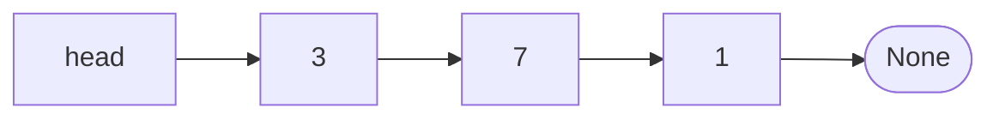

## The idea

A linked list is a chain of **nodes**. Each node holds a value and a pointer to the next node; the last node points to nothing (`None` / `nullptr` / `null`). You hold on to the list by its first node, the **head**.



Compared with an array:

| Operation | Array | Singly linked list |
|---|---|---|
| Read the i-th element | O(1) | O(i): walk from the head |
| Insert or delete at the front | O(n): shift everything | **O(1)** |
| Insert or delete after a node you already have | O(n) | **O(1)**: rewire two pointers |
| Find a value | O(n) | O(n) |
| Extra memory per element | none | one pointer |

Linked-list problems are rarely about speed. They test whether you can **rewire pointers without losing part of the list**. Draw boxes and arrows, and update them one at a time on paper before writing code.

## Core patterns

**Dummy (sentinel) node.** Put a fake node in front of the head. Then the "first node" is never a special case when inserting or deleting, and the real head at the end is `dummy.next`. See **Merge Two Sorted Lists** and **Remove Nth Node From End of List**.

**Fast and slow pointers.** Move one pointer two steps at a time and another one step. When the fast one reaches the end, the slow one is in the middle (the worked example below). If there's a cycle, the fast pointer eventually laps the slow one and they meet: **Linked List Cycle**.

**Gap pointers.** Start one pointer n nodes ahead of another and move them together. When the leader hits the end, the follower is n from the end: **Remove Nth Node From End of List**.

**In-place reversal.** Walk with `prev` and `curr`, flipping one `next` pointer per step: **Reverse a Linked List**, and as a building block in **Reorder List**.

**Merging.** Repeatedly attach the smaller head of two sorted lists. With a heap, the same idea merges k lists: **Merge k Sorted Lists**.

## Built-in functions

Interview problems almost always give you their own `ListNode` class. The built-in list types are useful elsewhere, but they hide the pointers these problems are about.

| Task | Python | C++ | Java |
|---|---|---|---|
| Node definition | `class ListNode:` with `val`, `next` | `struct ListNode { int val; ListNode* next; };` | `class ListNode { int val; ListNode next; }` |
| Create a node | `ListNode(5)` | `new ListNode(5)` | `new ListNode(5)` |
| "No node" | `None` | `nullptr` | `null` |
| Dummy node | `dummy = ListNode(0)` | `ListNode dummy(0);` then `&dummy` | `ListNode dummy = new ListNode(0);` |
| Built-in doubly linked list | none (`collections.deque` is a block-linked deque) | `std::list<int>` | `LinkedList<Integer>` |
| Fast queue / deque | `collections.deque` | `std::deque<int>` | `ArrayDeque<Integer>` |

## Pitfalls

**Losing the rest of the list.** Once you overwrite `node.next`, the old next node is unreachable unless you saved it. Save first, then rewire.

**Checking for null before following a pointer.** `fast.next.next` crashes when `fast` or `fast.next` is null. Fast-pointer loops usually test `while fast and fast.next`.

**Forgetting to return the new head.** After reversing or deleting the first node, the head has changed. Return the new head (or `dummy.next`), not the old variable.

**Accidental cycles.** Rewiring that leaves a node pointing back into the list makes any later traversal loop forever. Make sure the new tail's `next` is set to null.

## Worked example: find the middle node

> Given the head of a singly linked list, return its middle node. With an even number of nodes, return the second of the two middle nodes.

**Brute force.** Walk the list once to count the nodes, then walk again `count // 2` steps. That's O(n) time and O(1) space, but **two passes**.

**Fast and slow pointers.** Move `fast` two nodes per step and `slow` one node per step. When `fast` can't move any further, `slow` has covered half the distance: it's at the middle. **One pass**, O(1) space.

**Trace** for `1 → 2 → 3 → 4 → 5`:

| Step | slow | fast |
|---|---|---|
| start | 1 | 1 |
| 1 | 2 | 3 |
| 2 | 3 | 5 |
| stop (fast.next is None) | **3** | 5 |

With six nodes, `fast` runs off the end (becomes None) after three steps, leaving `slow` at node 4, the second middle.

```python
class ListNode:
    def __init__(self, val=0, next=None):
        self.val = val
        self.next = next


def build(values):
    head = None
    for value in reversed(values):
        head = ListNode(value, head)
    return head


def middle(head):
    slow = fast = head
    while fast and fast.next:
        slow = slow.next
        fast = fast.next.next
    return slow


assert middle(build([1, 2, 3, 4, 5])).val == 3
assert middle(build([1, 2, 3, 4, 5, 6])).val == 4  # second middle
assert middle(build([7])).val == 7
```

To return the *first* middle on even lengths instead, start `fast` one node ahead (`fast = head.next`). Small changes to where the pointers start decide which middle you get, so trace both an odd and an even list before trusting a version.
