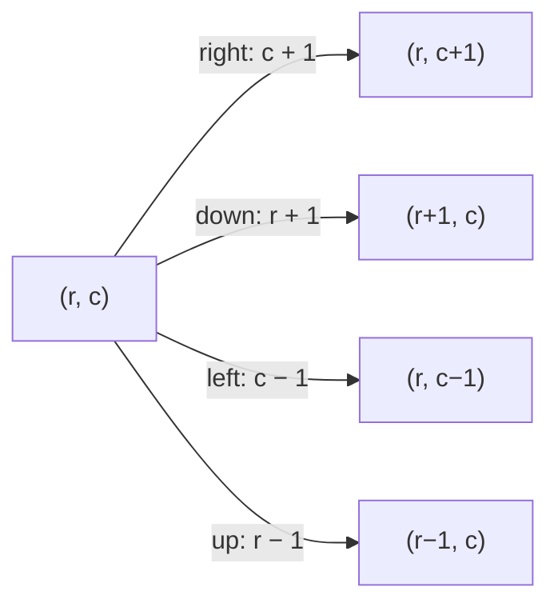

## The idea

A matrix is a 2D grid: a list of rows, each a list of values. Cell `(r, c)` is row `r`, column `c`, and `matrix[r][c]` reads it in O(1). An `m × n` matrix has m rows and n columns, so visiting every cell costs **O(m × n)**, which is usually the best possible because every cell has to be looked at.

Matrix problems mostly come down to **moving around the grid in a controlled order**:



Before reading a neighbour, check it's inside the grid: `0 <= r < rows` and `0 <= c < cols`.

Useful facts about square `n × n` matrices:

- The **main diagonal** has `r == c`; the anti-diagonal has `r + c == n − 1`.
- **Transposing** swaps `(r, c)` with `(c, r)`, reflecting across the main diagonal.
- Rotating 90° clockwise sends `(r, c)` to `(c, n − 1 − r)`.

## Core patterns

**Direction arrays.** Keep the four (or eight) moves in a list and loop over them, instead of writing four near-identical blocks of code. This works for flood fills and for grid BFS/DFS (**Word Search**, **Number of Islands**).

**Layer by layer.** Process the outer ring, then shrink the boundaries (`top`, `bottom`, `left`, `right`) inward. This is the pattern for **Spiral Matrix**.

**Compose simple transformations.** A rotation is a transpose followed by reversing each row (**Rotate Image**). Reflections and transposes are easy to do in place.

**Decide first, then change.** When changes depend on the original contents, record what to do before modifying anything, or new values will trigger more changes. **Set Matrix Zeroes** stores its marks in the first row and column.

**Use the sorted structure.** When rows and columns are both sorted, start from a corner where one move always increases values and the other decreases them. The worked example below does this.

## Built-in functions

| Task | Python | C++ | Java |
|---|---|---|---|
| Create rows × cols of zeros | `[[0] * cols for _ in range(rows)]` | `vector<vector<int>> m(rows, vector<int>(cols, 0));` | `int[][] m = new int[rows][cols];` |
| Dimensions | `len(m)`, `len(m[0])` | `m.size()`, `m[0].size()` | `m.length`, `m[0].length` |
| Deep copy | `[row[:] for row in m]` | `auto copy = m;` (copies every row) | `Arrays.stream(m).map(int[]::clone).toArray(int[][]::new)` |
| Transpose (new matrix) | `[list(col) for col in zip(*m)]` | loop and build `t[c][r] = m[r][c]` | loop and build `t[c][r] = m[r][c]` |
| Reverse a row in place | `row.reverse()` | `reverse(row.begin(), row.end());` | loop swapping from both ends |
| Fill every cell | `for row in m: row[:] = [v] * len(row)` | `for (auto& row : m) fill(row.begin(), row.end(), v);` | `for (int[] row : m) Arrays.fill(row, v);` |
| Four directions | `((1,0), (-1,0), (0,1), (0,-1))` | `int dr[] = {1,-1,0,0}, dc[] = {0,0,1,-1};` | `int[][] dirs = {{1,0},{-1,0},{0,1},{0,-1}};` |

## Pitfalls

**Python's `[[0] * n] * m` shares one row m times.** Changing one cell changes the same column in every row. Build each row separately with a comprehension.

```python
grid = [[0] * 3 for _ in range(2)]
grid[0][1] = 5
assert grid == [[0, 5, 0], [0, 0, 0]]
```

**Rows versus columns.** `matrix[r][c]` is row first. Mixing them up works by accident on square matrices and fails on rectangular ones, so always test a non-square case.

**Shallow copies.** In Python, `m[:]` and `list(m)` copy only the outer list; the rows are still shared. In Java, `m.clone()` on an `int[][]` has the same problem.

**Empty input.** `matrix[0]` crashes when the matrix has no rows. Check `if not matrix or not matrix[0]` when the problem allows empty input.

## Worked example: search a matrix sorted by rows and columns

> Every row is sorted left to right, and every column is sorted top to bottom. Decide whether `target` appears in the matrix.

**Brute force.** Check every cell: **O(m × n)**. Running a binary search on each row is better, O(m log n), but still ignores the column order.

**Start from the top-right corner.** From there, moving **left** always gives smaller values and moving **down** always gives larger ones. So every comparison discards a whole row or a whole column:

- value > target → everything below in this column is even larger, so move left.
- value < target → everything to the left in this row is even smaller, so move down.

That's at most m + n steps: **O(m + n)**, with O(1) extra space.

```
 1   4   7  11
 2   5   8  12
 3   6   9  16
10  13  14  17
```

**Trace** for `target = 5`:

| Position | Value | Compare with 5 | Move |
|---|---|---|---|
| (0, 3) | 11 | larger | left |
| (0, 2) | 7 | larger | left |
| (0, 1) | 4 | smaller | down |
| (1, 1) | 5 | **equal** | found |

```python
def search_sorted_matrix(matrix, target):
    if not matrix or not matrix[0]:
        return False
    r, c = 0, len(matrix[0]) - 1  # top-right corner
    while r < len(matrix) and c >= 0:
        value = matrix[r][c]
        if value == target:
            return True
        if value > target:
            c -= 1  # this column only gets larger going down
        else:
            r += 1  # this row only gets smaller going left
    return False


M = [[1, 4, 7, 11], [2, 5, 8, 12], [3, 6, 9, 16], [10, 13, 14, 17]]
assert search_sorted_matrix(M, 5) is True
assert search_sorted_matrix(M, 15) is False
assert search_sorted_matrix([], 1) is False
```

The bottom-left corner works too, with the moves mirrored. The top-left and bottom-right corners don't: from there, both moves go the same direction, so one comparison can't rule anything out.
