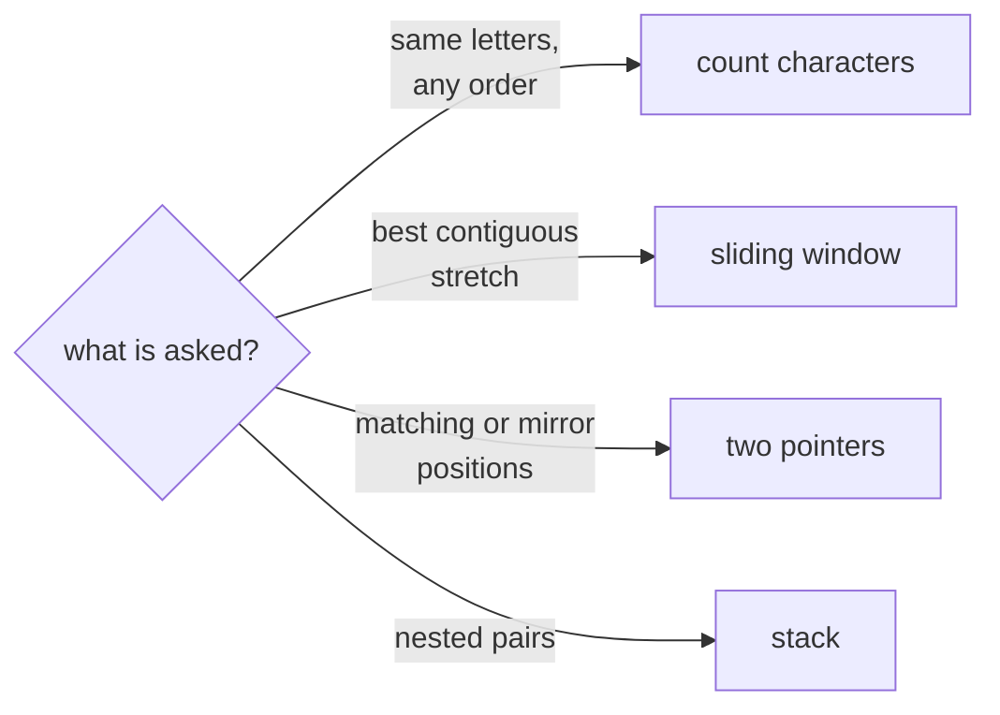

## The idea

A string is a sequence of characters, so most array techniques carry over directly. Two differences matter:

- **Strings are immutable** in Python and Java (and C++ string literals are constant). "Changing" one builds a new string, which costs O(length). Building a long string one piece at a time with `+=` can quietly become O(n²).
- **The alphabet is often small.** With only lowercase letters, a fixed array of 26 counters replaces a hash map and makes "same letters" checks O(1) to compare.

Most string problems ask about **substrings** (contiguous) or **subsequences** (in order, but gaps allowed). A string of length n has about n²/2 substrings, so the brute force usually checks them all, and the faster solutions avoid looking at each substring separately.



## Core patterns

**Character counting.** Anagram-style questions ("same letters, any order") compare counts: **Valid Anagram**. Grouping words by a canonical form, such as their sorted letters or their count tuple, groups anagrams together: **Group Anagrams**.

**Sliding window.** For "longest or shortest substring with some property", grow the window on the right and shrink it from the left only when the property breaks. Each character enters and leaves once: O(n). See **Longest Substring Without Repeating Characters**, **Longest Repeating Character Replacement** and **Minimum Window Substring**.

**Two pointers from both ends.** Palindromes read the same forwards and backwards, so compare `s[i]` and `s[j]` while moving inward: **Valid Palindrome**.

**Expand around the centre.** Every palindrome has a centre, either one character or the gap between two. Expanding outward from each of the 2n − 1 centres finds them all in O(n²) without extra memory: **Longest Palindromic Substring**, **Palindromic Substrings**.

**Stack for nesting.** Brackets, tags and undo operations close in last-opened-first-closed order: **Valid Parentheses**.

**Serialization.** To pack a list of arbitrary strings into one string and recover it exactly, prefix each piece with its length: **Encode and Decode Strings**.

## Built-in functions

| Task | Python | C++ | Java |
|---|---|---|---|
| Length | `len(s)` | `s.size()` | `s.length()` |
| Character at i | `s[i]` | `s[i]` | `s.charAt(i)` |
| Substring | `s[i:j]` (end exclusive) | `s.substr(i, len)` (a **length**, not an end) | `s.substring(i, j)` (end exclusive) |
| Build from pieces | `"".join(parts)` | `s += piece;` (amortized O(1) per append) | `StringBuilder sb; sb.append(x); sb.toString()` |
| Reverse | `s[::-1]` | `reverse(s.begin(), s.end());` | `new StringBuilder(s).reverse().toString()` |
| Character code | `ord(c)`, `chr(n)` | `(int)c`, `(char)n` | `(int)c`, `(char)n` |
| Letter index 0–25 | `ord(c) - ord("a")` | `c - 'a'` | `c - 'a'` |
| Count characters | `Counter(s)` | `int freq[26] = {};` | `int[] freq = new int[26];` |
| Letter or digit? | `c.isalnum()` | `isalnum(c)` | `Character.isLetterOrDigit(c)` |
| Lowercase | `c.lower()` | `tolower(c)` | `Character.toLowerCase(c)` |
| Split on spaces | `s.split()` | `istringstream` + `>>` | `s.trim().split("\\s+")` |
| Find a substring | `s.find(t)` (−1 if missing) | `s.find(t)` (`string::npos` if missing) | `s.indexOf(t)` (−1 if missing) |

## Pitfalls

**Strings are immutable in Python and Java.** You can't assign to `s[i]`. Convert to a list (Python) or a `char[]` / `StringBuilder` (Java), change that, then join it back.

```python
s = "abc"
try:
    s[0] = "z"
    raise AssertionError("strings should be immutable")
except TypeError:
    pass

chars = list(s)
chars[0] = "z"
assert "".join(chars) == "zbc"
```

**Quadratic string building.** `result += piece` in a loop copies the whole result each time in Java and can in Python. Collect pieces in a list and `"".join` them once (Python), or use `StringBuilder` (Java).

**Java compares strings with `.equals`, not `==`.** `==` checks whether two references are the same object, which can happen to work in tests and fail later.

**C++ `substr` takes a length.** `s.substr(2, 3)` is three characters starting at index 2, not the range 2 to 3.

**Unicode.** Fixed arrays of 26 counters only work for lowercase English letters. If the input can contain any character, use a hash map.

## Worked example: the first character that doesn't repeat

> Return the index of the first character in `s` that appears exactly once, or −1 if every character repeats.

**Brute force.** For each position, count how often its character appears in the whole string (`s.count(c)` in Python): **O(n²)**.

**Count once, then scan.** One pass counts every character. A second pass returns the first position whose character has a count of 1. **O(n)** time, and O(k) space for k distinct characters, which is at most 26 for lowercase letters.

**Trace** for `"swiss"`:

| Pass | Result |
|---|---|
| count | s: 3, w: 1, i: 1 |
| scan index 0 | `s` has count 3, skip |
| scan index 1 | `w` has count 1, **return 1** |

```python
from collections import Counter


def first_unique(s):
    counts = Counter(s)
    for i, char in enumerate(s):
        if counts[char] == 1:
            return i
    return -1


assert first_unique("swiss") == 1
assert first_unique("aabb") == -1
assert first_unique("") == -1
assert first_unique("z") == 0
```

The two passes are the key idea: the first pass gathers information about the **whole** string, so the second can make each decision in O(1). Trying to decide during a single pass fails, because a character that looks unique may repeat later.
