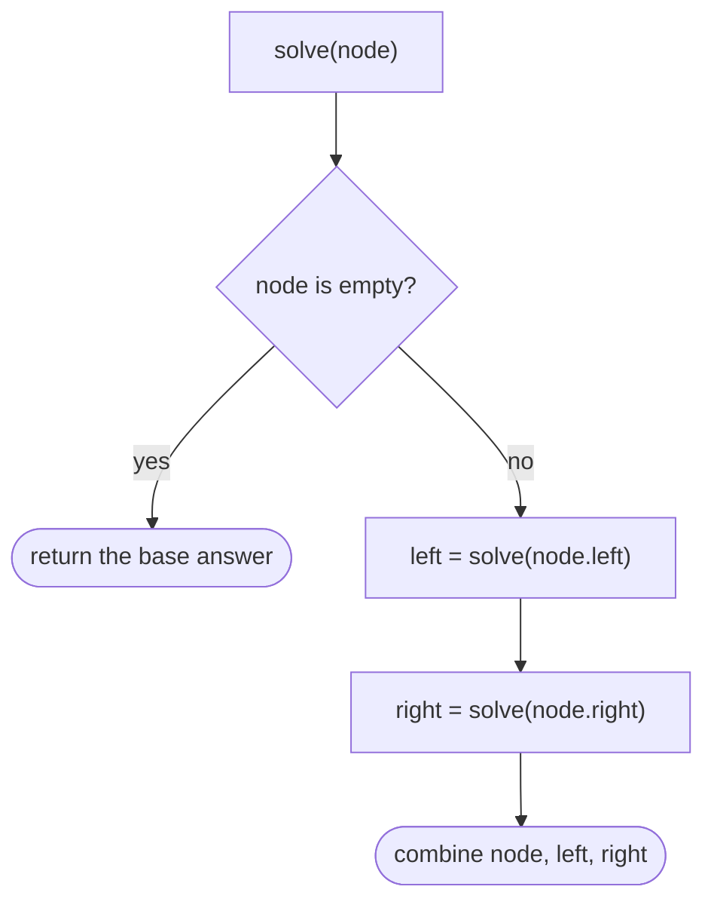

## The idea

A tree is a hierarchy: one **root** at the top, and every other node has exactly one parent. In a **binary tree**, each node has at most two children, `left` and `right`. A node with no children is a **leaf**. The **depth** of a tree is the number of nodes on its longest root-to-leaf path.

The key to almost every tree problem is that **each child is the root of a smaller tree**. So a recursive function that handles one node, and trusts recursive calls to handle the two subtrees, solves the whole thing:



Each node is visited once, so this is usually **O(n)** time. The recursion uses **O(h)** stack space, where h is the height: about log n for a balanced tree, but up to n for a tree shaped like a chain.

A **binary search tree (BST)** adds an ordering rule: everything in a node's left subtree is smaller than it, and everything in the right subtree is larger. That makes search, insert and delete O(h), and an in-order traversal visits the values in sorted order.

## Core patterns

**The four traversals.** Pre-order (node, left, right) is natural for copying or serializing a tree. In-order (left, node, right) gives sorted order in a BST. Post-order (left, right, node) is for answers that need both subtrees first, such as depth or height. Level-order (BFS with a queue) goes row by row.

**Return values up the tree.** Compute an answer from the children's answers: **Maximum Depth of Binary Tree**, **Same Tree**, **Invert Binary Tree**. Sometimes you return one value but track a different global answer, as in **Binary Tree Maximum Path Sum**.

**Pass constraints down the tree.** Hand each child a range or running total it must respect: **Validate Binary Search Tree** passes allowed bounds down. The worked example passes a remaining sum.

**Use the BST ordering.** Go left or right instead of searching both sides: **Lowest Common Ancestor of a BST**, **Kth Smallest Element in a BST** (an in-order walk that stops early).

**Rebuilding and encoding.** Pre-order plus in-order identify a tree uniquely (**Construct Binary Tree from Preorder and Inorder Traversal**). A traversal with explicit null markers can be turned back into the tree (**Serialize and Deserialize Binary Tree**).

**Tries.** A tree keyed by characters, where each path from the root spells a prefix: **Implement Trie**, **Design Add and Search Words**, **Word Search II**.

## Built-in functions

Like linked lists, tree problems provide their own `TreeNode` class.

| Task | Python | C++ | Java |
|---|---|---|---|
| Node definition | `class TreeNode:` with `val`, `left`, `right` | `struct TreeNode { int val; TreeNode *left, *right; };` | `class TreeNode { int val; TreeNode left, right; }` |
| Queue for level order | `deque([root])` | `queue<TreeNode*> q;` | `Deque<TreeNode> q = new ArrayDeque<>();` |
| Level size, for row-by-row | `for _ in range(len(q)):` | `for (int i = q.size(); i > 0; --i)` | `for (int i = q.size(); i > 0; i--)` |
| Ordered set (balanced BST) | none built in; keep a sorted list with `bisect` | `std::set<int>` | `TreeSet<Integer>` |
| Ordered map | none built in | `std::map<int, int>` | `TreeMap<Integer, Integer>` |
| Smallest key ≥ x | `bisect.bisect_left(keys, x)` on a sorted list | `s.lower_bound(x)` | `set.ceiling(x)` |
| Raise recursion limit | `sys.setrecursionlimit(10**5)` | not needed | not needed (or run in a thread with a bigger stack) |

## Pitfalls

**Forgetting the empty tree.** Almost every recursive function needs `if node is None` first. It's the base case that stops the recursion.

**Checking children instead of whole subtrees.** For BST validity, `left.val < node.val` isn't enough: every value in the left subtree must be smaller. Pass bounds down instead.

**Deep, chain-shaped trees.** A tree with 10⁴ nodes in a line makes recursion 10⁴ calls deep, past Python's default limit of about 1,000. Raise the limit or use an explicit stack.

**Recomputing subtrees.** Calling `height(node)` inside a recursion that already visits every node can turn O(n) into O(n²). Return several values at once (say, a pair) instead of making separate calls.

## Worked example: does a root-to-leaf path add up to a target?

> Given a binary tree and a number `target`, decide whether some path from the root down to a **leaf** has values adding up exactly to `target`.

```
        6
       / \
      3   9
     / \   \
    1   4   7
```

The root-to-leaf sums are 6+3+1 = 10, 6+3+4 = 13 and 6+9+7 = 22.

**Brute force.** List every root-to-leaf path, add each one up, and compare. Copying paths costs O(n × h).

**Pass the remaining amount down.** At each node, subtract its value from the target and hand the rest to its children. At a leaf, the path works exactly when nothing remains. Each node is visited once: **O(n)** time and **O(h)** stack space.

**Trace** for `target = 13`:

| Node | Remaining after subtracting | Leaf? | Result |
|---|---|---|---|
| 6 | 7 | no | try children |
| 3 | 4 | no | try children |
| 1 | 3 | yes | 3 ≠ 0, false |
| 4 | 0 | yes | **0 = 0, true** |

```python
class TreeNode:
    def __init__(self, val, left=None, right=None):
        self.val = val
        self.left = left
        self.right = right


tree = TreeNode(6, TreeNode(3, TreeNode(1), TreeNode(4)), TreeNode(9, None, TreeNode(7)))


def has_path_sum(node, target):
    if node is None:
        return False
    remaining = target - node.val
    if node.left is None and node.right is None:
        return remaining == 0
    return has_path_sum(node.left, remaining) or has_path_sum(node.right, remaining)


assert has_path_sum(tree, 13) is True
assert has_path_sum(tree, 22) is True
assert has_path_sum(tree, 9) is False  # 6 + 3 stops at a node that isn't a leaf
assert has_path_sum(None, 0) is False
```

The traversals of the same tree, written as small recursive functions:

```python
def preorder(node):
    return [] if node is None else [node.val] + preorder(node.left) + preorder(node.right)


def inorder(node):
    return [] if node is None else inorder(node.left) + [node.val] + inorder(node.right)


def postorder(node):
    return [] if node is None else postorder(node.left) + postorder(node.right) + [node.val]


assert preorder(tree) == [6, 3, 1, 4, 9, 7]
assert inorder(tree) == [1, 3, 4, 6, 9, 7]
assert postorder(tree) == [1, 4, 3, 7, 9, 6]
```

This tree isn't a BST (7 sits to the right of 9 but is smaller), which is why its in-order traversal isn't sorted.
