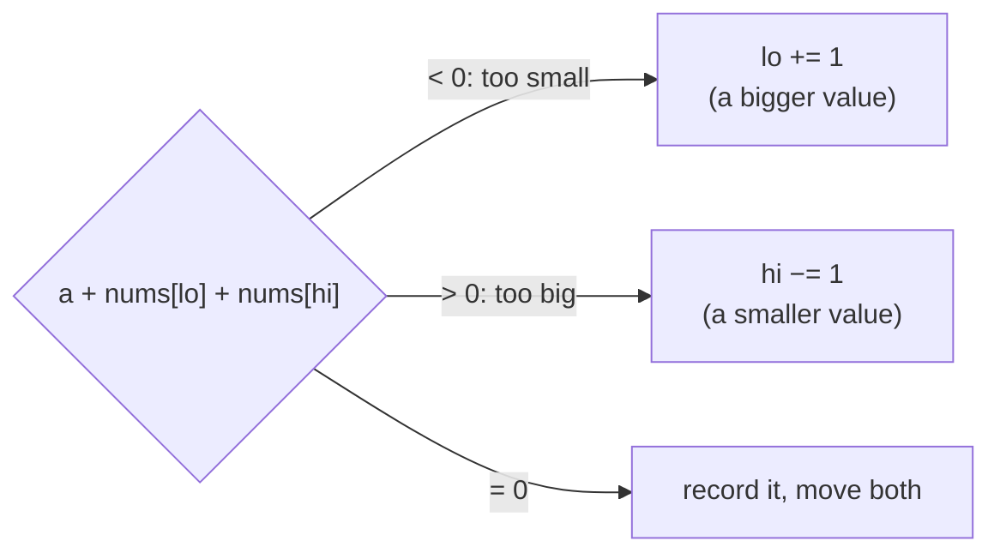
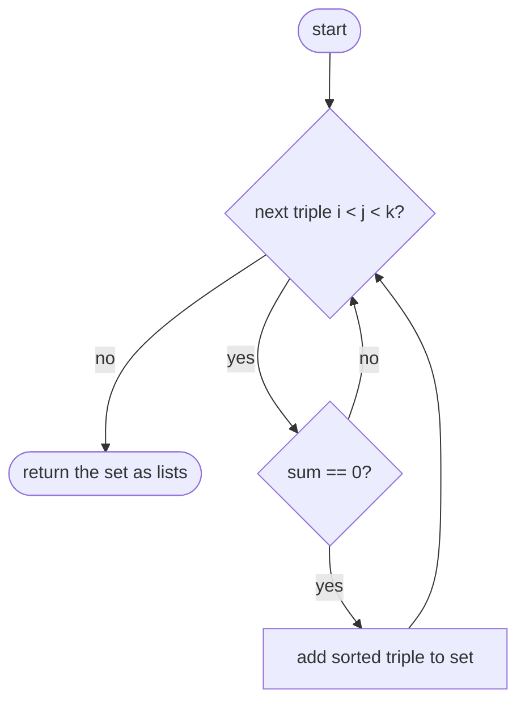
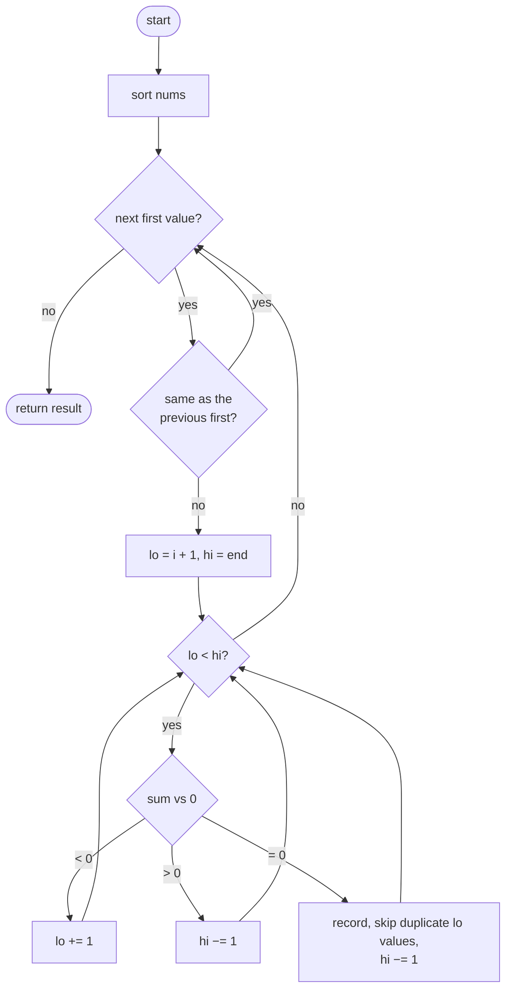

## How to think

**1. Restate the problem.** Find every distinct set of three values, taken from three different positions, that adds up to 0. Each set counts once, however many ways it can be formed.

**2. Let the constraints guide you.** With 3,000 numbers, checking all triples is about 4.5 × 10⁹ combinations: too slow. O(n²) is about 9 × 10⁶, which is fine.

**3. Reduce to a problem you know.** Fix the first value `a`. Now you need two more values that add up to `−a`: that's **Two Sum**. On a **sorted** array, Two Sum takes one pass with two pointers moving inward:



So: sort once, then for each first value run the two-pointer scan. That's n scans of O(n): **O(n²)**.

**4. Distinct triplets for free.** Sorting puts equal values next to each other, so duplicates are easy to skip: skip a first value equal to the previous first value, and after recording a triplet, move `lo` past copies of the value just used.

**5. Watch the edge cases.** All zeros gives exactly one triplet `[0, 0, 0]`. With fewer than three useful values, the answer is empty.

## Approach 1: Brute force — every triple, deduplicated with a set
<!-- approach: brute_force | time: O(n³) | space: O(number of triplets) -->

Try every combination of three positions. When the values sum to zero, sort them and add the tuple to a set, so the same values found in different orders count once.

**Dry run** on `[-2, 0, 1, 1, 2, -1]` (zero-sum triples found):

| Positions | Values | Sorted key | New? |
|---|---|---|---|
| 0, 1, 4 | −2, 0, 2 | (−2, 0, 2) | yes |
| 0, 2, 3 | −2, 1, 1 | (−2, 1, 1) | yes |
| 1, 2, 5 | 0, 1, −1 | (−1, 0, 1) | yes |
| 1, 3, 5 | 0, 1, −1 | (−1, 0, 1) | no: already found |

### Code
```python
class Solution:
    def threeSum(self, nums: List[int]) -> List[List[int]]:
        n = len(nums)
        found = set()
        for i in range(n):
            for j in range(i + 1, n):
                for k in range(j + 1, n):
                    if nums[i] + nums[j] + nums[k] == 0:
                        found.add(tuple(sorted((nums[i], nums[j], nums[k]))))
        return [list(triplet) for triplet in found]
```

### Line by line
- `3` Number of values.
- `4` Distinct triplets, stored as sorted tuples so the same values in a different order look identical.
- `5-7` Every combination of three different positions, each considered once.
- `8-9` A zero-sum triple: add its sorted form to the set, which ignores repeats.
- `10` Convert the tuples back to lists.

### Flowchart


## Approach 2: Optimized — sort, then two pointers for each first value
<!-- approach: optimized | time: O(n²) | space: O(1) besides sorting and the output -->

Sort the numbers. For each first value (skipping repeats), squeeze two pointers from both ends of the rest, moving whichever pointer brings the sum closer to zero.

**Dry run** on `[-2, 0, 1, 1, 2, -1]`, sorted to `[-2, -1, 0, 1, 1, 2]`:

| First (i) | lo, hi values | Sum | Action |
|---|---|---|---|
| −2 | −1, 2 | −1 | lo up |
| −2 | 0, 2 | 0 | **record [−2, 0, 2]**, move both |
| −2 | 1, 1 | 0 | **record [−2, 1, 1]**, move both |
| −1 | 0, 2 | 1 | hi down |
| −1 | 0, 1 | 0 | **record [−1, 0, 1]**, skip the second 1 |
| 0 | 1, 2 | 3 | hi down; then lo meets hi |

### Code
```python
class Solution:
    def threeSum(self, nums: List[int]) -> List[List[int]]:
        nums.sort()
        result = []
        for i in range(len(nums) - 2):
            if i > 0 and nums[i] == nums[i - 1]:
                continue
            lo, hi = i + 1, len(nums) - 1
            while lo < hi:
                total = nums[i] + nums[lo] + nums[hi]
                if total < 0:
                    lo += 1
                elif total > 0:
                    hi -= 1
                else:
                    result.append([nums[i], nums[lo], nums[hi]])
                    lo += 1
                    while lo < hi and nums[lo] == nums[lo - 1]:
                        lo += 1
                    hi -= 1
        return result
```

### Line by line
- `3` Sorting makes the two-pointer scan possible and groups equal values together.
- `4` The triplets found.
- `5` Each position can be the smallest value of a triplet, leaving at least two positions after it.
- `6-7` A first value equal to the previous one would find exactly the same triplets again, so skip it.
- `8` The other two values come from the rest of the array: one pointer at each end.
- `9-10` Squeeze the pointers together, checking the current sum.
- `11-12` Too small: only moving `lo` right makes it bigger.
- `13-14` Too big: only moving `hi` left makes it smaller.
- `15-16` Exactly zero: record the triplet.
- `17-19` Move `lo` past every copy of the value just used, so the same triplet isn't recorded twice.
- `20` Move `hi` too; with `lo`'s value changed, the old `hi` value can't complete another new triplet.
- `21` Every distinct zero-sum triplet.

### Flowchart

