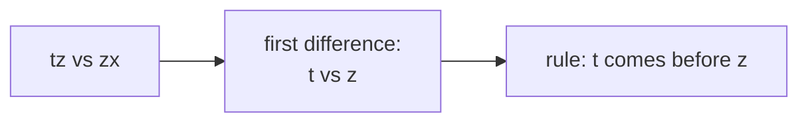
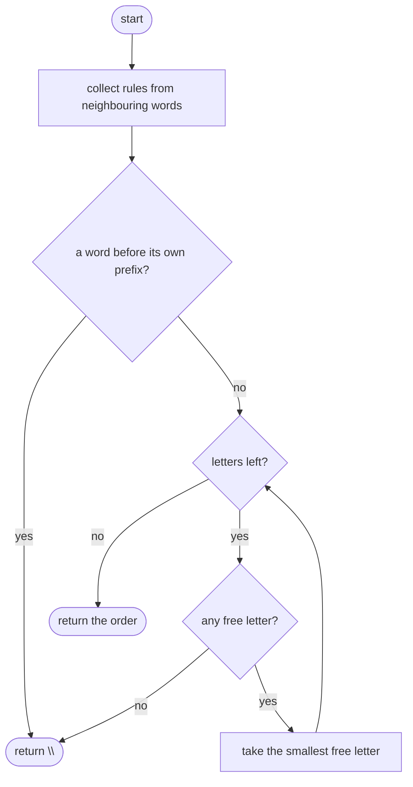
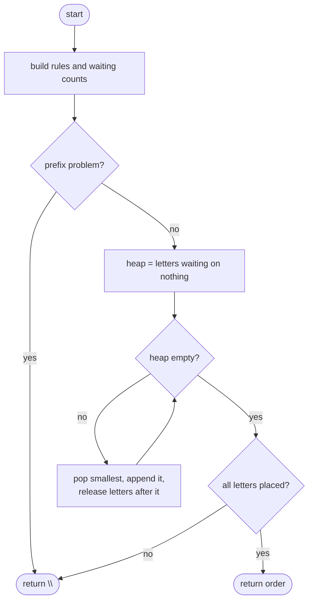

## How to think

**1. Restate the problem.** The words are sorted by an unknown alphabet. Recover an order of the letters that explains the sorting, picking the alphabetically smallest one when several work, or return `""` if none does.

**2. Where the information is.** Compare **neighbouring** words. Find the first position where they differ: the earlier word's letter comes before the later word's letter. That one pair is the only rule this word pair gives; the letters after it say nothing.



**3. Rules form a graph; an alphabet is a topological order.** Each rule `a → b` is an edge. An order that respects every edge exists exactly when there's no cycle. Kahn's algorithm (see **Course Schedule**) builds one: repeatedly take a letter with no remaining "must come after" constraints.

**4. Two ways to get an impossible input.**

- **A cycle** in the rules, such as c before b and b before c.
- **A prefix in the wrong place:** `"ab"` sorted before `"a"`. A word must come after its own prefix, and no alphabet can fix that.

**5. A unique answer.** When several letters are free at once, always take the alphabetically smallest. A min-heap does that efficiently.

## Approach 1: Brute force — repeatedly scan for the smallest free letter
<!-- approach: brute_force | time: O(L² × R) for L letters and R rules | space: O(L + R) -->

Collect the rules. Then, while letters remain, scan every remaining letter for those with no unplaced letter required before them, and take the smallest. With at most 26 letters this is fast, but the rescanning grows quadratically with larger alphabets.

**Dry run** on `["tx", "tz", "zx", "zt"]`:

| Rules found | x < z (tx, tz), t < z (tz, zx), x < t (zx, zt) |
|---|---|

| Remaining | Free letters | Take |
|---|---|---|
| t, x, z | x | x |
| t, z | t | t |
| z | z | z |

Answer: **"xtz"**.

### Code
```python
class Solution:
    def alienOrder(self, words: List[str]) -> str:
        letters = {char for word in words for char in word}
        rules = set()
        for first, second in zip(words, words[1:]):
            for a, b in zip(first, second):
                if a != b:
                    rules.add((a, b))
                    break
            else:
                if len(first) > len(second):
                    return ""
        order = []
        while letters:
            free = [c for c in letters if not any(b == c and a in letters for a, b in rules)]
            if not free:
                return ""
            chosen = min(free)
            order.append(chosen)
            letters.remove(chosen)
        return "".join(order)
```

### Line by line
- `3` Every letter that appears must be placed.
- `4-8` For each neighbouring pair of words, the first differing letters give one rule: `a` comes before `b`.
- `9-11` No difference found (`for … else` runs when the loop didn't `break`): if the first word is longer, a word came before its own prefix, which is impossible.
- `13` Place letters one at a time.
- `14` A letter is free when no still-unplaced letter must come before it.
- `15-16` Nothing is free: the remaining rules form a cycle.
- `17-19` Take the alphabetically smallest free letter, for the unique answer.
- `20` Every letter placed.

### Flowchart


## Approach 2: Optimized — Kahn's algorithm with a min-heap
<!-- approach: optimized | time: O(C + L log L) for C total characters | space: O(L + R) -->

Build the graph once with a count of incoming rules per letter. Keep the free letters in a min-heap; taking one releases the letters that were waiting on it.

**Dry run** on `["abc", "abd", "b"]`:

| Step | Detail |
|---|---|
| rules | c < d (abc, abd), a < b (abd, b) |
| free at start | a, c (heap) |
| take a | releases b → heap: b, c |
| take b | heap: c |
| take c | releases d → heap: d |
| take d | answer **"abcd"** |

### Code
```python
class Solution:
    def alienOrder(self, words: List[str]) -> str:
        letters = {char for word in words for char in word}
        after = {char: set() for char in letters}
        waiting = {char: 0 for char in letters}
        for first, second in zip(words, words[1:]):
            for a, b in zip(first, second):
                if a != b:
                    if b not in after[a]:
                        after[a].add(b)
                        waiting[b] += 1
                    break
            else:
                if len(first) > len(second):
                    return ""
        ready = [char for char in letters if waiting[char] == 0]
        heapq.heapify(ready)
        order = []
        while ready:
            char = heapq.heappop(ready)
            order.append(char)
            for nxt in after[char]:
                waiting[nxt] -= 1
                if waiting[nxt] == 0:
                    heapq.heappush(ready, nxt)
        return "".join(order) if len(order) == len(letters) else ""
```

### Line by line
- `3` Every letter to place.
- `4-5` `after[a]` lists letters that must come after `a`; `waiting[b]` counts rules still holding `b` back.
- `6-12` Each neighbouring word pair gives at most one rule. A repeated rule is counted once.
- `13-15` A word sorted before its own prefix: impossible.
- `16-17` Letters with nothing before them, in a min-heap so the smallest comes out first.
- `19-21` Place the smallest free letter.
- `22-25` It's placed, so the letters waiting on it have one fewer constraint; any that reach zero become free.
- `26` If some letters were never freed, they're in a cycle.

### Flowchart

