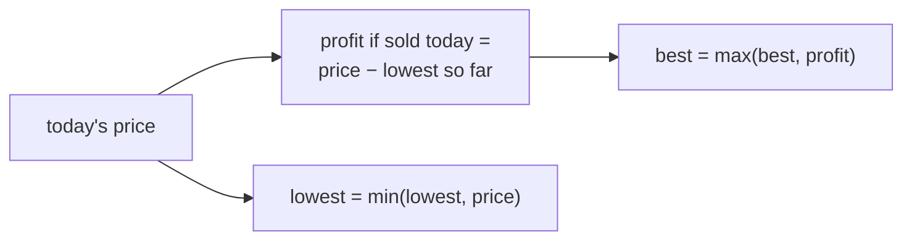
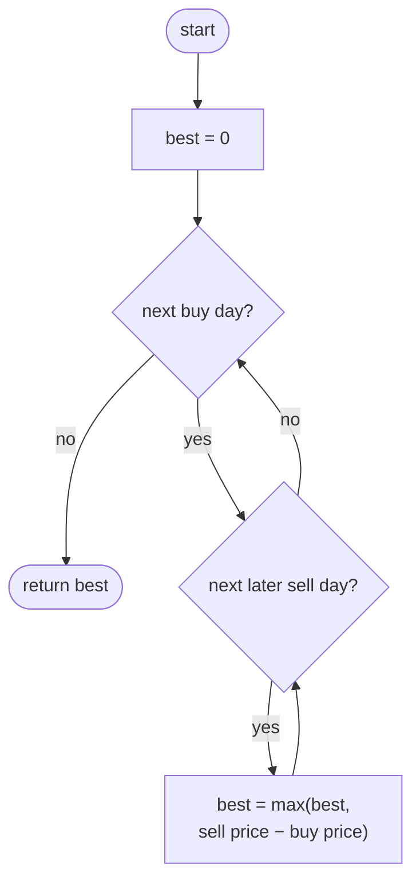
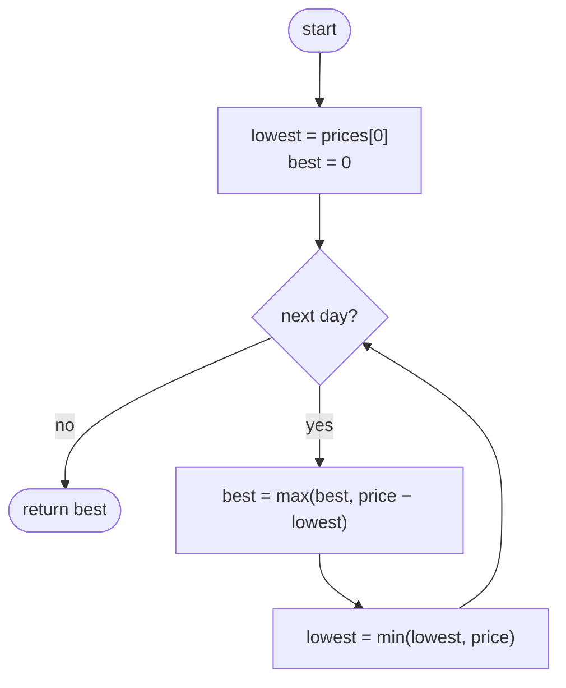

## How to think

**1. Restate the problem.** Pick a buy day and a later sell day to maximize `sell price − buy price`. If every trade loses money, the answer is 0 (don't trade).

**2. Let the constraints guide you.** Up to 10⁵ days means about 5 × 10⁹ buy/sell pairs, which is too many. We need one pass.

**3. Fix the sell day and ask one question.** If you sell on day `i`, the best buy day is simply the **cheapest day before it**. So while walking left to right, remember the lowest price seen so far. Each day's best profit is then `price − lowest so far`.



**4. Order matters.** Compute today's profit *before* updating the lowest price with today, so you never buy and sell on the same day. It gives 0 either way, but the habit avoids bugs in harder variants.

**5. Watch the edge cases.** Falling prices give 0, not a negative number. A single day gives 0.

## Approach 1: Brute force — try every buy and sell day
<!-- approach: brute_force | time: O(n²) | space: O(1) -->

For each buy day, try every later sell day and keep the largest difference.

**Dry run** on `[8, 3, 6, 1, 7, 5]`, showing the best sell for each buy day:

| Buy day | Buy price | Best later price | Profit |
|---|---|---|---|
| 0 | 8 | 7 | −1 |
| 1 | 3 | 7 | 4 |
| 2 | 6 | 7 | 1 |
| 3 | 1 | 7 | **6** |
| 4 | 7 | 5 | −2 |

Best: **6**, and `best` starting at 0 handles the all-losses case.

### Code
```python
class Solution:
    def maxProfit(self, prices: List[int]) -> int:
        best = 0
        for buy in range(len(prices)):
            for sell in range(buy + 1, len(prices)):
                best = max(best, prices[sell] - prices[buy])
        return best
```

### Line by line
- `3` Not trading earns 0, so the answer can never go below 0.
- `4` Try each day as the buy day.
- `5` The sell day must come strictly later.
- `6` Keep the largest profit seen.
- `7` The best profit over all pairs.

### Flowchart


## Approach 2: Optimized — track the cheapest price so far
<!-- approach: optimized | time: O(n) | space: O(1) -->

Walk once. For each day, the best trade ending today buys at the lowest price seen before it.

**Dry run** on `[8, 3, 6, 1, 7, 5]`:

| Day | Price | Profit if sold today | best | lowest after today |
|---|---|---|---|---|
| 0 | 8 | | 0 | 8 |
| 1 | 3 | 3 − 8 = −5 | 0 | 3 |
| 2 | 6 | 6 − 3 = 3 | 3 | 3 |
| 3 | 1 | 1 − 3 = −2 | 3 | 1 |
| 4 | 7 | 7 − 1 = 6 | **6** | 1 |
| 5 | 5 | 5 − 1 = 4 | 6 | 1 |

### Code
```python
class Solution:
    def maxProfit(self, prices: List[int]) -> int:
        lowest = prices[0]
        best = 0
        for i in range(1, len(prices)):
            price = prices[i]
            best = max(best, price - lowest)
            lowest = min(lowest, price)
        return best
```

### Line by line
- `3` The cheapest buy price available so far: day 0's price.
- `4` No trade yet, so profit 0.
- `5-6` Consider each later day as a sell day.
- `7` Selling today after buying at the cheapest earlier price is the best trade that ends today.
- `8` Update the cheapest price *after* using it, so a day is never both buy and sell.
- `9` The best trade over all sell days.

### Flowchart

