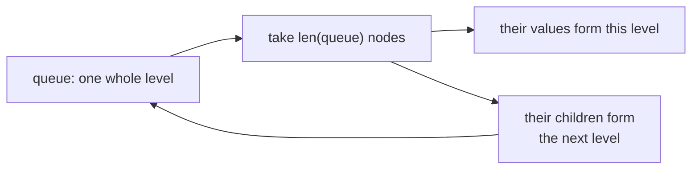
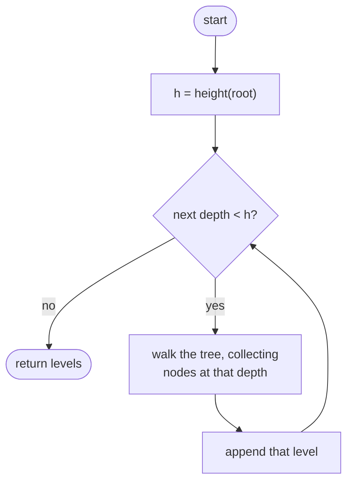
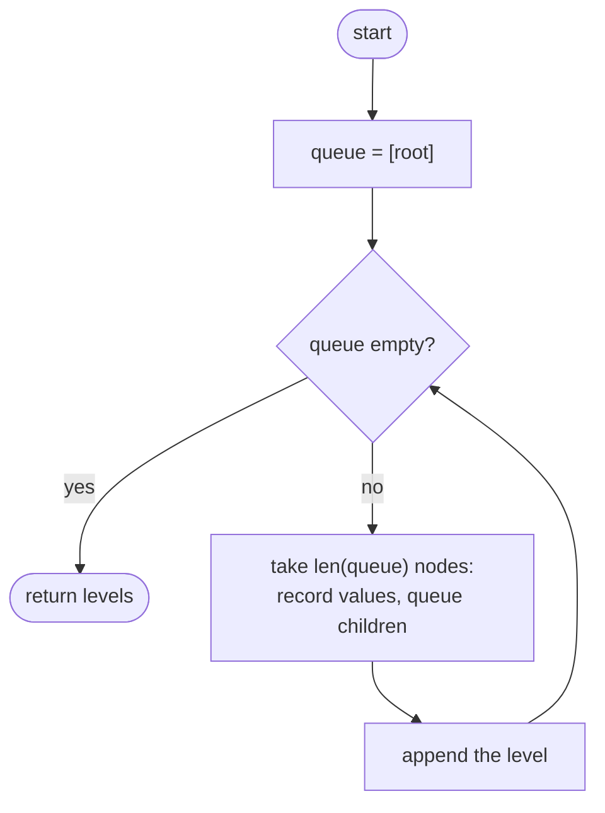

## How to think

**1. Restate the problem.** List the values row by row, top to bottom, left to right within each row.

**2. Level by level means breadth-first.** A **queue** naturally processes nodes in order of depth: the root, then all depth-1 nodes, then depth 2. The question is how to know where one level ends and the next begins.

**3. Freeze the level size.** At the start of each round, the queue holds **exactly one full level**. Record its length, take that many nodes out (adding their children to the back), and you've processed exactly one level.



**4. A depth-first alternative.** You can also walk the tree once with a depth counter and append each value to `levels[depth]`. Re-walking the tree once per level, as in the brute force, is what to avoid.

**5. Watch the edge cases.** An empty tree gives `[]`, not `[[]]`. Skip empty children instead of queuing them.

## Approach 1: Brute force — collect each depth with a separate walk
<!-- approach: brute_force | time: O(n × h) | space: O(h) -->

Find the tree's height, then for each depth walk the whole tree again, collecting the nodes at exactly that depth (left before right keeps the order correct).

**Dry run** on `[3, 9, 20, null, null, 15, 7]` (height 3):

| Depth | Walk collects |
|---|---|
| 0 | 3 |
| 1 | 9, 20 |
| 2 | 15, 7 |

### Code
```python
class Solution:
    def levelOrder(self, root: Optional[TreeNode]) -> List[List[int]]:
        def height(node):
            return 0 if node is None else 1 + max(height(node.left), height(node.right))

        def collect(node, depth, out):
            if node is None:
                return
            if depth == 0:
                out.append(node.val)
                return
            collect(node.left, depth - 1, out)
            collect(node.right, depth - 1, out)

        levels = []
        for depth in range(height(root)):
            level = []
            collect(root, depth, level)
            levels.append(level)
        return levels
```

### Line by line
- `3-4` The number of levels.
- `6-12` `collect` walks down `depth` levels and records the nodes it reaches there, left before right.
- `14-18` One full walk per level, which repeats work near the top of the tree.
- `19` All levels, top to bottom.

### Flowchart


## Approach 2: Optimized — BFS, one level per round
<!-- approach: optimized | time: O(n) | space: O(w) for the widest level -->

Keep a queue starting with the root. Each round, take exactly as many nodes as the queue holds: their values form one level, and their children are queued for the next.

**Dry run** on `[3, 9, 20, null, null, 15, 7]`:

| Round | Queue at start | Level recorded | Queue afterwards |
|---|---|---|---|
| 1 | 3 | [3] | 9, 20 |
| 2 | 9, 20 | [9, 20] | 15, 7 |
| 3 | 15, 7 | [15, 7] | empty |

### Code
```python
class Solution:
    def levelOrder(self, root: Optional[TreeNode]) -> List[List[int]]:
        levels = []
        queue = deque([root] if root else [])
        while queue:
            level = []
            for _ in range(len(queue)):
                node = queue.popleft()
                level.append(node.val)
                queue.extend(child for child in (node.left, node.right) if child)
            levels.append(level)
        return levels
```

### Line by line
- `3-4` The levels found, and a queue holding the first level (or nothing for an empty tree).
- `5` One iteration per level.
- `6-7` `len(queue)` is evaluated once, so only this level's nodes are taken, even as children are added behind them.
- `8-9` Record the value and queue the children for the next level.
- `10` This level is complete.
- `11` All levels.

### Flowchart

