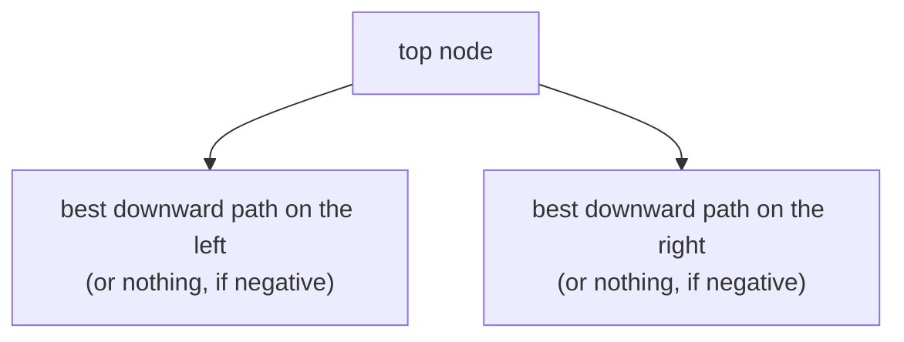
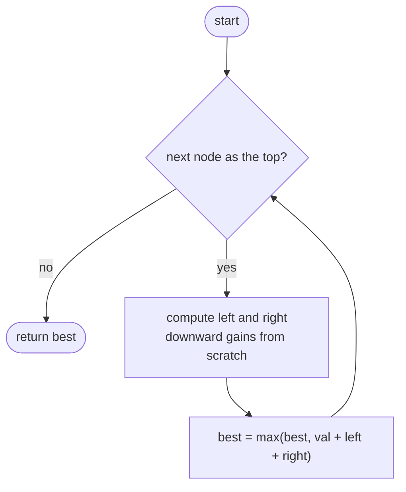
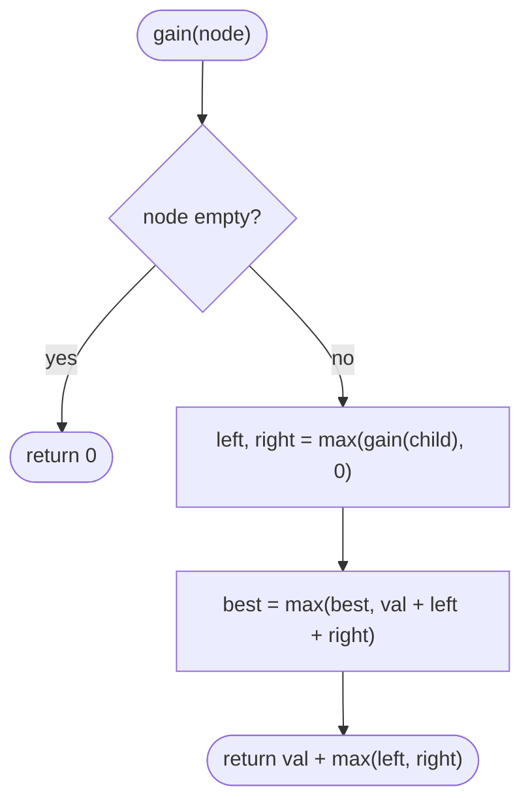

## How to think

**1. Restate the problem.** A path can start and end anywhere, but it can't fork. Find the path with the largest sum.

**2. Every path has a highest node.** Call it the path's **top**. From the top, the path goes down into the left subtree (or not) and down into the right subtree (or not). So:

```
best path with this top = node.val + best downward gain on the left + best downward gain on the right
```

where a downward gain is a path that starts at a child and only goes down, and is never worth taking if it's negative (use 0 instead).



**3. Two different numbers per node.** Each node contributes a **candidate answer** (as a top: it may use both sides) and reports a **downward gain** to its parent (only one side, because the parent's path can't fork here). Mixing them up is the classic bug.

**4. One post-order pass.** Compute both children's gains first, then the node's candidate and its own gain. Each node is visited once: O(n).

**5. Watch the edge cases.** All negative values: the answer is the single largest value, since a path must contain at least one node. Never start `best` at 0.

## Approach 1: Brute force — recompute downward gains for every top
<!-- approach: brute_force | time: O(n²) worst case | space: O(h) -->

For every node as the top, compute the best downward gain into each subtree from scratch. Each gain computation walks the whole subtree, so nodes near the bottom are re-walked once per ancestor.

**Dry run** on `[-10, 9, 20, null, null, 15, 7]`:

| Top | Left gain | Right gain | Candidate |
|---|---|---|---|
| −10 | 9 | 20 + 15 = 35 | 34 |
| 9 | 0 | 0 | 9 |
| 20 | 15 | 7 | **42** |
| 15 | 0 | 0 | 15 |
| 7 | 0 | 0 | 7 |

Answer: **42**.

### Code
```python
class Solution:
    def maxPathSum(self, root: Optional[TreeNode]) -> int:
        def down(node):
            if node is None:
                return 0
            return max(0, node.val + max(down(node.left), down(node.right)))

        best = float("-inf")
        stack = [root]
        while stack:
            node = stack.pop()
            best = max(best, node.val + down(node.left) + down(node.right))
            stack.extend(child for child in (node.left, node.right) if child)
        return best
```

### Line by line
- `3` `down(node)` is the best sum of a path starting at `node` and going only downward, or 0 if every such path is negative.
- `4-5` Nothing below: gain 0.
- `6` Take this node plus the better side, but never go below 0 (take nothing instead).
- `8` A path has at least one node, so start below any real sum.
- `9-11` Visit every node as a possible top.
- `12` This node plus the best downward gains on both sides, recomputed from scratch each time.
- `13` Continue with the children.
- `14` The best path overall.

### Flowchart


## Approach 2: Optimized — one post-order pass
<!-- approach: optimized | time: O(n) | space: O(h) -->

A single recursive `gain(node)` returns the node's best downward gain to its parent, and along the way updates the global best with the node as a top.

**Dry run** on `[-10, 9, 20, null, null, 15, 7]`, in the order the calls finish:

| Node | Left, right gains | Candidate (val + both) | Returns (val + better side) | best |
|---|---|---|---|---|
| 9 | 0, 0 | 9 | 9 | 9 |
| 15 | 0, 0 | 15 | 15 | 15 |
| 7 | 0, 0 | 7 | 7 | 15 |
| 20 | 15, 7 | 42 | 35 | **42** |
| −10 | 9, 35 | 34 | 25 | 42 |

### Code
```python
class Solution:
    def maxPathSum(self, root: Optional[TreeNode]) -> int:
        best = float("-inf")

        def gain(node):
            nonlocal best
            if node is None:
                return 0
            left = max(gain(node.left), 0)
            right = max(gain(node.right), 0)
            best = max(best, node.val + left + right)
            return node.val + max(left, right)

        gain(root)
        return best
```

### Line by line
- `3` The best path seen anywhere; it must contain at least one node.
- `5-6` `gain` returns the best downward path starting here; `nonlocal` lets it update `best`.
- `7-8` Empty subtree: contributes nothing.
- `9-10` The children's gains, dropping any negative side.
- `11` This node as the top, using **both** sides.
- `12` What the parent can use: this node plus **one** side, because a path can't fork.
- `14-15` One pass over the tree, then the answer.

### Flowchart

