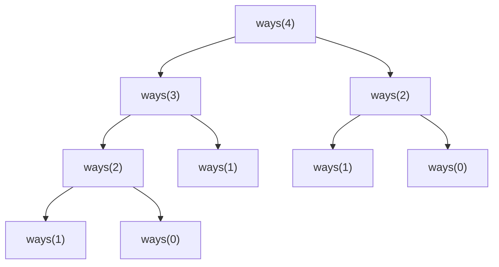
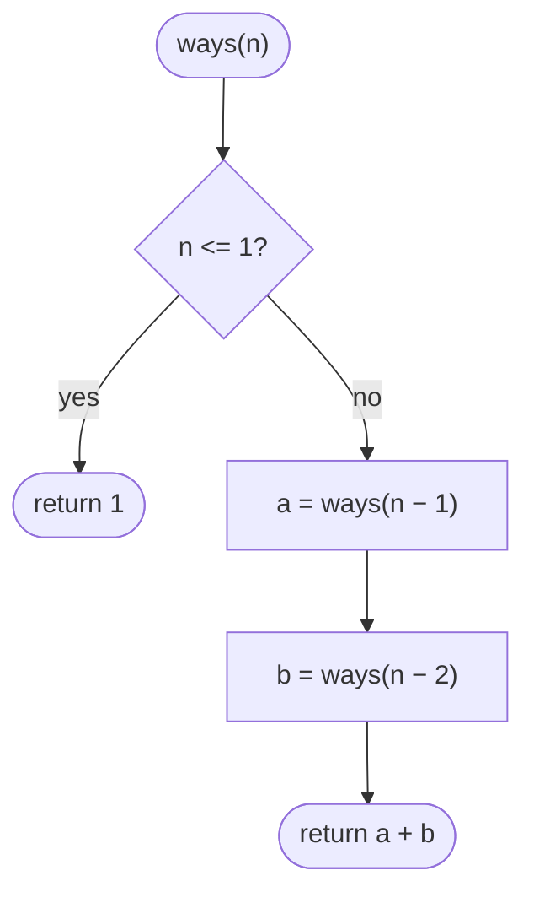
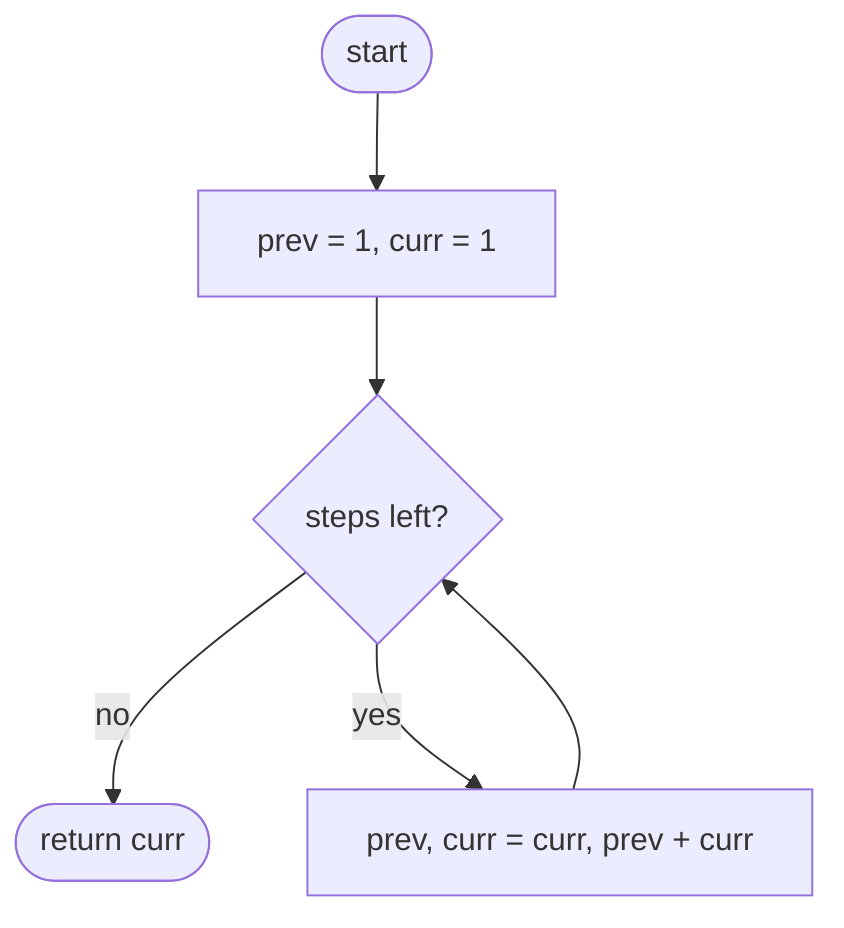

## How to think

**1. Restate the problem.** Count the different sequences of 1-step and 2-step moves that land exactly on step `n`. Order matters: `1+2` and `2+1` are different.

**2. Think about the last move.** Every way of reaching step `n` ends with either a 1-step move (from step `n − 1`) or a 2-step move (from step `n − 2`). These two groups never overlap, so:

```
ways(n) = ways(n − 1) + ways(n − 2)
```

with `ways(0) = 1` (standing at the bottom is one way: do nothing) and `ways(1) = 1`. That's the Fibonacci sequence.

**3. Notice the repeated work.** Written as plain recursion, the same values get recomputed again and again. Here is the call tree for `ways(4)`: `ways(2)` is solved twice, `ways(1)` three times.



The tree roughly doubles with every extra step, so `n = 45` means billions of calls. **Overlapping subproblems** like this are the signal for dynamic programming: compute each `ways(i)` once, from the bottom up.

**4. Only the last two values matter.** `ways(i)` uses just `ways(i − 1)` and `ways(i − 2)`, so instead of a whole table we can keep two variables and slide them forward.

**5. Watch the edge cases.** `n = 1` has exactly one way. The answer for `n = 45` is 1,836,311,903, which still fits in a 32-bit signed integer in C++ and Java.

## Approach 1: Brute force — plain recursion
<!-- approach: brute_force | time: O(2ⁿ) | space: O(n) -->

Translate the recurrence directly into code. Each call splits into two more calls, so the work grows exponentially. Every call is still correct, so this is a fine way to check your understanding, but it is far too slow beyond about `n = 30`.

**Dry run** for `n = 4`, reading the call tree above from the leaves up:

| Call | Result |
|---|---|
| ways(0), ways(1) | 1, 1 (base cases) |
| ways(2) = ways(1) + ways(0) | 2 |
| ways(3) = ways(2) + ways(1) | 3 |
| ways(4) = ways(3) + ways(2) | **5** |

### Code
```python
class Solution:
    def climbStairs(self, n: int) -> int:
        if n <= 1:
            return 1
        return self.climbStairs(n - 1) + self.climbStairs(n - 2)
```

### Line by line
- `3-4` Base cases: step 0 and step 1 can each be reached in exactly one way.
- `5` The last move was either 1 step or 2 steps, so add the ways to reach the two steps below. Both calls recompute shared work, which is what makes this exponential.

### Flowchart


## Approach 2: Optimized — bottom-up with two variables
<!-- approach: optimized | time: O(n) | space: O(1) -->

Start from the base cases and walk upward, keeping only the last two answers. Each step computes the next value as the sum of the two before it, exactly once.

**Dry run** for `n = 5`. `prev` and `curr` hold the ways to reach the step below and the current step:

| After step | prev | curr |
|---|---|---|
| start (steps 0 and 1) | 1 | 1 |
| step 2 | 1 | 2 |
| step 3 | 2 | 3 |
| step 4 | 3 | 5 |
| step 5 | 5 | **8** |

### Code
```python
class Solution:
    def climbStairs(self, n: int) -> int:
        prev, curr = 1, 1  # ways to reach step 0 and step 1
        for _ in range(n - 1):
            prev, curr = curr, prev + curr
        return curr
```

### Line by line
- `3` The two base cases. `curr` always holds the answer for the step we're on, starting at step 1.
- `4` Moving from step 1 up to step `n` takes `n − 1` steps. For `n = 1` the loop doesn't run and the answer is 1.
- `5` Slide the window up one step: the new `curr` is the sum of the two previous answers, and the old `curr` becomes `prev`. The simultaneous assignment uses the old values on the right-hand side.
- `6` After the loop, `curr` is the number of ways to reach step `n`.

### Flowchart

