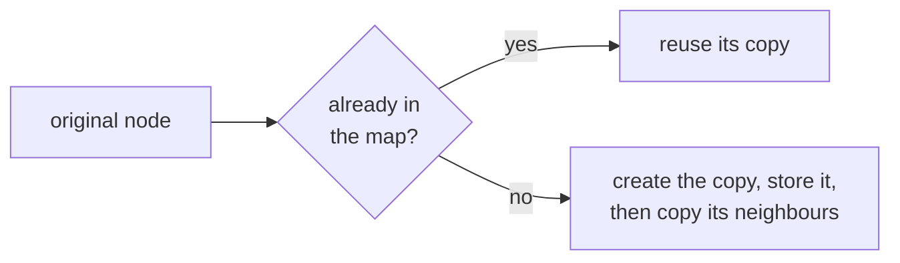
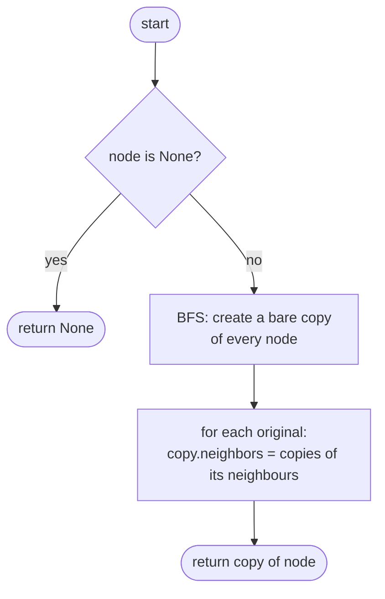
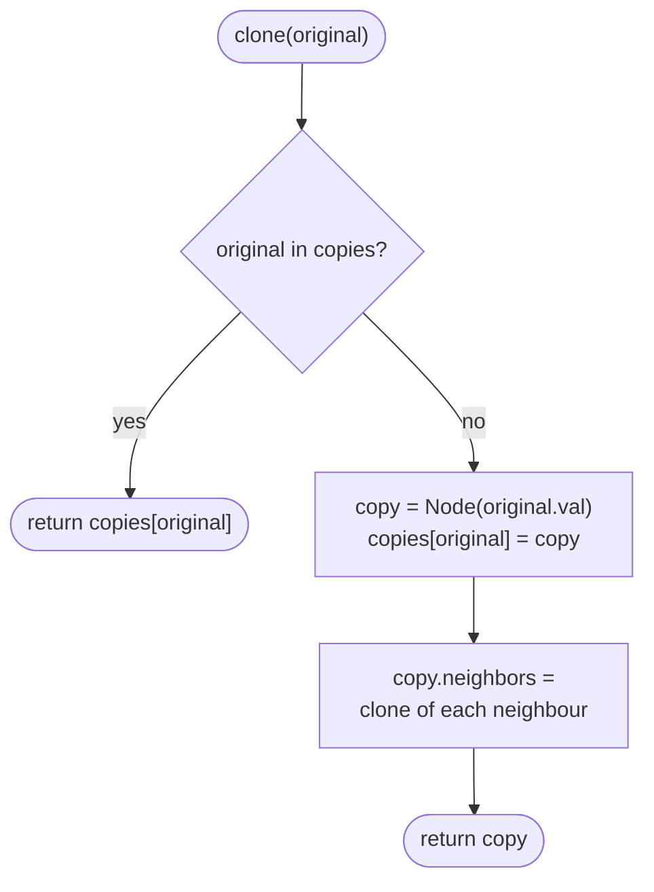

## How to think

**1. Restate the problem.** Build a brand-new graph with the same shape: one new `Node` for every original node, wired with the same connections. No new node may point to an old one.

**2. The trap: cycles and shared neighbours.** Node 1 links to node 2, and node 2 links back to node 1. Copying "a node and then its neighbours" blindly would copy node 1 again, and again, forever, or create two different copies of the same node.

**3. Keep a map from original to copy.** Before creating a copy, check the map: if this original was already copied, reuse that copy. Each original gets exactly one copy, and cycles stop naturally.



**4. Store the copy before copying the neighbours.** In a cycle, a neighbour will point back to the node being copied, and the map must already contain it at that moment.

**5. Watch the edge cases.** An empty graph returns `None`. A single node has no neighbours.

## Approach 1: Brute force — two passes: create every copy, then wire the edges
<!-- approach: brute_force | time: O(V + E) | space: O(V) -->

This isn't slow, just more roundabout. First, breadth-first search to create a copy of every node (without neighbours). Second, for each original, fill in its copy's neighbour list using the map. Separating "create" from "wire" makes it easy to see that nothing is copied twice.

**Dry run** on the square `1-2-3-4-1`:

| Pass | Work |
|---|---|
| 1 (BFS) | copies of 1, 2, 4, 3 created, with no links yet |
| 2 | copy 1 → [copy 2, copy 4], copy 2 → [copy 1, copy 3], and so on |

### Code
```python
class Solution:
    def cloneGraph(self, node: Optional[Node]) -> Optional[Node]:
        if node is None:
            return None
        copies = {node: Node(node.val)}
        queue = deque([node])
        while queue:
            current = queue.popleft()
            for neighbour in current.neighbors:
                if neighbour not in copies:
                    copies[neighbour] = Node(neighbour.val)
                    queue.append(neighbour)
        for original, copy in copies.items():
            copy.neighbors = [copies[n] for n in original.neighbors]
        return copies[node]
```

### Line by line
- `3-4` An empty graph has nothing to copy.
- `5` The map from each original node to its copy, starting with the given node.
- `6-11` Pass 1: breadth-first search, creating a bare copy the first time each node is seen.
- `12-13` Pass 2: every copy now exists, so each copy's neighbour list can point to copies only.
- `14` The copy of the node we were given.

### Flowchart


## Approach 2: Optimized — one-pass DFS with a map
<!-- approach: optimized | time: O(V + E) | space: O(V) -->

A recursive `clone(original)`: return the existing copy if there is one; otherwise create it, record it, then clone its neighbours. One pass does both creating and wiring.

**Dry run** on the triangle `1-2-3`:

| Call | Action |
|---|---|
| clone(1) | create copy 1, then clone neighbours 2 and 3 |
| clone(2) | create copy 2; its neighbour 1 is already in the map → reuse |
| clone(3) | create copy 3; neighbours 1 and 2 → reuse both |

### Code
```python
class Solution:
    def cloneGraph(self, node: Optional[Node]) -> Optional[Node]:
        copies = {}

        def clone(original):
            if original in copies:
                return copies[original]
            copy = Node(original.val)
            copies[original] = copy
            copy.neighbors = [clone(n) for n in original.neighbors]
            return copy

        return clone(node) if node else None
```

### Line by line
- `3` Original node → its copy.
- `5` `clone` returns the copy of `original`, creating it if needed.
- `6-7` Already copied (for example, we came back around a cycle): reuse it.
- `8-9` Create the copy and record it **before** visiting the neighbours, so any cycle back to this node finds it.
- `10` Each neighbour's copy, created or reused.
- `11` The finished copy.
- `13` Handle the empty graph, otherwise copy from the given node.

### Flowchart

