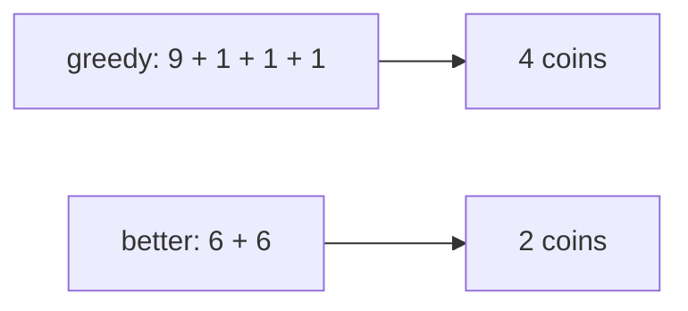
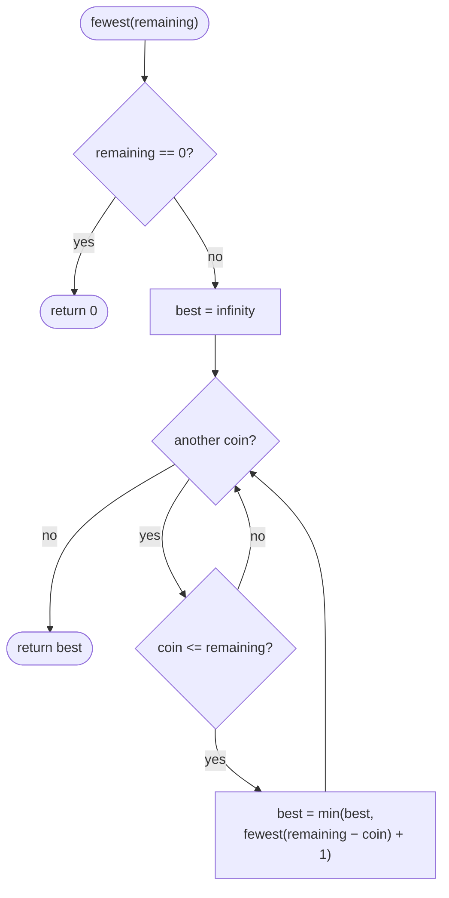
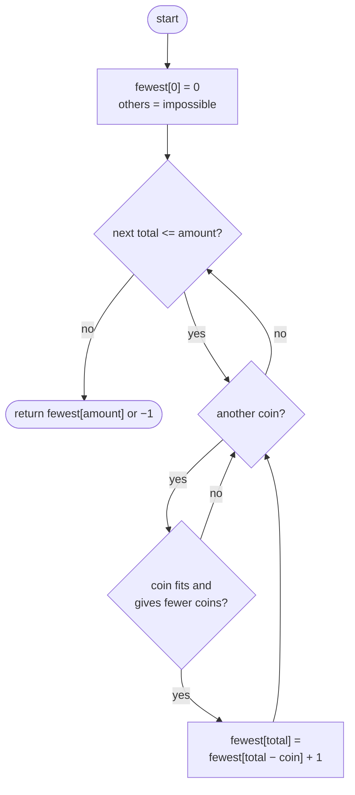

## How to think

**1. Restate the problem.** Using any coin as many times as you like, make exactly `amount` with as few coins as possible, or return −1 if it can't be done.

**2. Why the obvious idea fails.** It's tempting to always take the biggest coin that fits (greedy). That works for everyday currency but not in general. With coins `[9, 6, 1]` and amount 12:



Taking the 9 first looked good but forced three 1s afterwards. We need to consider every choice, which points to **dynamic programming**.

**3. Think about the last coin.** If the best way to make `amount` ends with coin `c`, then the rest is the best way to make `amount − c`. So:

```
fewest(a) = 1 + min( fewest(a − c) for every coin c ≤ a )
fewest(0) = 0
```

**4. Find the overlap.** Different coin orders reach the same remaining amount over and over (paying 2 then 5 leaves the same remainder as 5 then 2). With `amount` up to 10⁴, there are only 10⁴ + 1 different remainders, so computing each one once is cheap: amount × number of coins steps.

**5. Watch the edge cases.**

- `amount = 0` needs 0 coins, not −1.
- Some amounts can't be made at all, such as 3 from `[2]`. Track those as "infinity" and return −1 at the end.
- A coin can be larger than every amount (up to 2³¹ − 1), so check `coin <= a` before subtracting.

## Approach 1: Brute force — try every coin, recursively
<!-- approach: brute_force | time: O(kᵃ) for k coins | space: O(a) -->

Write the recurrence as a recursive function with no memory. It tries every coin at every level, so the same remainders are solved again and again, and the running time grows exponentially with the amount.

**Dry run** with `coins = [2, 5]`, `amount = 11` (a few branches):

| Path of coins taken | Remaining | Coins used |
|---|---|---|
| 5, 2, 2, 2 | 0 | **4** |
| 2, 2, 2, 5 | 0 | 4 (same coins, different order, solved again) |
| 5, 5 | 1 | dead end: no coin fits |
| 2, 2, 2, 2, 2 | 1 | dead end |

### Code
```python
class Solution:
    def coinChange(self, coins: List[int], amount: int) -> int:
        def fewest(remaining):
            if remaining == 0:
                return 0
            best = float("inf")
            for coin in coins:
                if coin <= remaining:
                    best = min(best, fewest(remaining - coin) + 1)
            return best

        answer = fewest(amount)
        return -1 if answer == float("inf") else answer
```

### Line by line
- `3` `fewest(remaining)` is the smallest number of coins that make exactly `remaining`.
- `4-5` Base case: nothing left to pay needs no coins.
- `6` Infinity means "can't be made" until some coin proves otherwise.
- `7-9` Try each coin that fits as the last coin: one coin plus the best way to pay the rest. Nothing is remembered, so identical remainders are recomputed.
- `10` The best over all coins, or infinity if none worked.
- `12-13` Translate "impossible" (infinity) into the required −1.

### Flowchart


## Approach 2: Optimized — bottom-up table
<!-- approach: optimized | time: O(amount × k) | space: O(amount) -->

Fill a table `fewest[0..amount]` from small totals to large. By the time we reach total `t`, every smaller total is final, so each entry is the best of "one coin plus an already-solved smaller total".

**Dry run** with `coins = [2, 5]`, `amount = 11` (∞ = impossible):

| total | 0 | 1 | 2 | 3 | 4 | 5 | 6 | 7 | 8 | 9 | 10 | 11 |
|---|---|---|---|---|---|---|---|---|---|---|---|---|
| fewest | 0 | ∞ | 1 | ∞ | 2 | 1 | 3 | 2 | 4 | 3 | 2 | **4** |

For example, `fewest[11] = 1 + min(fewest[9], fewest[6]) = 1 + min(3, 3) = 4`.

### Code
```python
class Solution:
    def coinChange(self, coins: List[int], amount: int) -> int:
        INF = amount + 1  # more coins than could ever be needed
        fewest = [0] + [INF] * amount
        for total in range(1, amount + 1):
            for coin in coins:
                if coin <= total and fewest[total - coin] + 1 < fewest[total]:
                    fewest[total] = fewest[total - coin] + 1
        return -1 if fewest[amount] == INF else fewest[amount]
```

### Line by line
- `3` A stand-in for infinity. No answer can use more than `amount` coins (the smallest coin is at least 1), so `amount + 1` is safely "impossible", and unlike `float("inf")` it stays an integer.
- `4` `fewest[0] = 0` is the base case; every other total starts as impossible.
- `5` Solve totals in increasing order, so smaller totals are already final.
- `6-8` Try each coin as the last one. If it fits and gives fewer coins than the best so far, keep it.
- `9` If the target total was never reached, report −1.

### Flowchart

