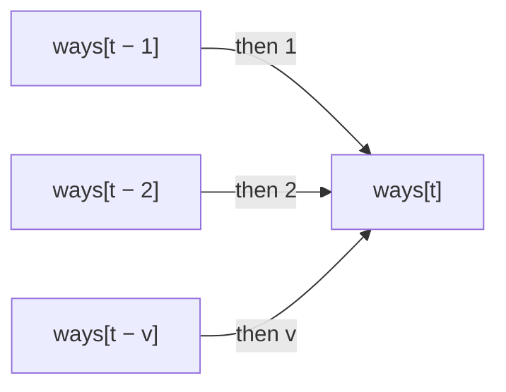
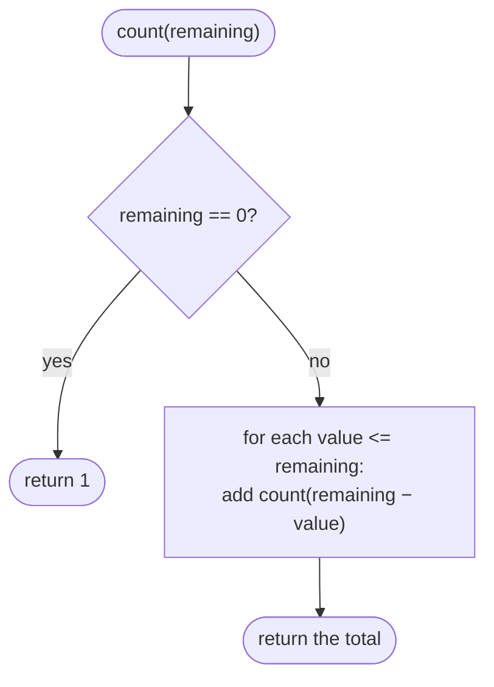
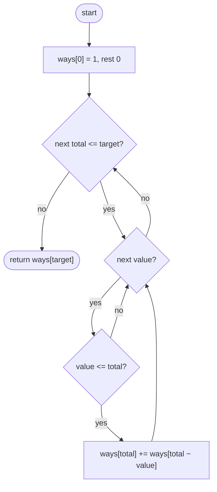

## How to think

**1. Restate the problem.** Count the ordered sequences of numbers from `nums` (with repeats allowed) that add up to `target`. `1 + 2` and `2 + 1` are different sequences.

**2. Think about the last number.** Any sequence reaching `t` ends with some value `v` from `nums`. Before it is a sequence reaching `t − v`. So the number of ways to reach `t` is the sum, over every usable value, of the ways to reach `t − v`:

```
ways[t] = sum of ways[t − v] for each v in nums with v <= t
ways[0] = 1   (the empty sequence)
```



**3. Order matters, so loop over totals on the outside.** With the total outermost, every value can be the last one at every step, so different orders are counted separately. (Putting the values on the outside instead counts combinations, where order doesn't matter, as in Coin Change II. Same code with the loops swapped, and a different answer.)

**4. Overlapping subproblems.** There are only `target + 1` different totals, so the table solves each once: O(target × n).

**5. Watch the edge cases.** `ways[0] = 1`. Values bigger than the target never help. A target that can't be reached gives 0.

## Approach 1: Brute force — recursion over the last number
<!-- approach: brute_force | time: exponential | space: O(target) -->

Count the sequences for `remaining` by trying every value as the next one and adding up the counts. The same remainders are counted again and again.

**Dry run** with `nums = [1, 2]`, `target = 3`:

| Call | Breakdown | Result |
|---|---|---|
| count(1) | count(0) | 1 |
| count(2) | count(1) + count(0) | 2 |
| count(3) | count(2) + count(1) | **3** |

The sequences are 1+1+1, 1+2 and 2+1.

### Code
```python
class Solution:
    def combinationSum4(self, nums: List[int], target: int) -> int:
        def count(remaining):
            if remaining == 0:
                return 1
            return sum(count(remaining - value) for value in nums if value <= remaining)

        return count(target)
```

### Line by line
- `3` `count(remaining)` is the number of ordered sequences adding up to `remaining`.
- `4-5` Exactly one way to make 0: stop, with the sequence complete.
- `6` Try each value that fits as the next number and add up the possibilities. No caching, so this repeats work.
- `8` Count for the full target.

### Flowchart


## Approach 2: Optimized — bottom-up table over totals
<!-- approach: optimized | time: O(target × n) | space: O(target) -->

Fill `ways[0..target]` in increasing order. Each entry adds up the entries one step back for every value.

**Dry run** with `nums = [2, 3]`, `target = 7`:

| t | 0 | 1 | 2 | 3 | 4 | 5 | 6 | 7 |
|---|---|---|---|---|---|---|---|---|
| ways[t] | 1 | 0 | 1 | 1 | 1 | 2 | 2 | **3** |

For example, `ways[7] = ways[5] + ways[4] = 2 + 1 = 3`: 2+2+3, 2+3+2 and 3+2+2.

### Code
```python
class Solution:
    def combinationSum4(self, nums: List[int], target: int) -> int:
        ways = [1] + [0] * target
        for total in range(1, target + 1):
            for value in nums:
                if value <= total:
                    ways[total] += ways[total - value]
        return ways[target]
```

### Line by line
- `3` One way to make 0 (the empty sequence); every other total starts at 0.
- `4` Totals on the outside, so every value can come last at every step: that's what makes different orders count separately.
- `5-7` Each value that fits can be the last number, after any sequence reaching `total − value`.
- `8` The count for the target.

### Flowchart

