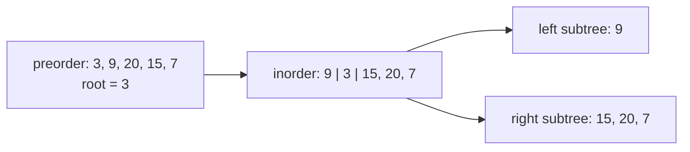
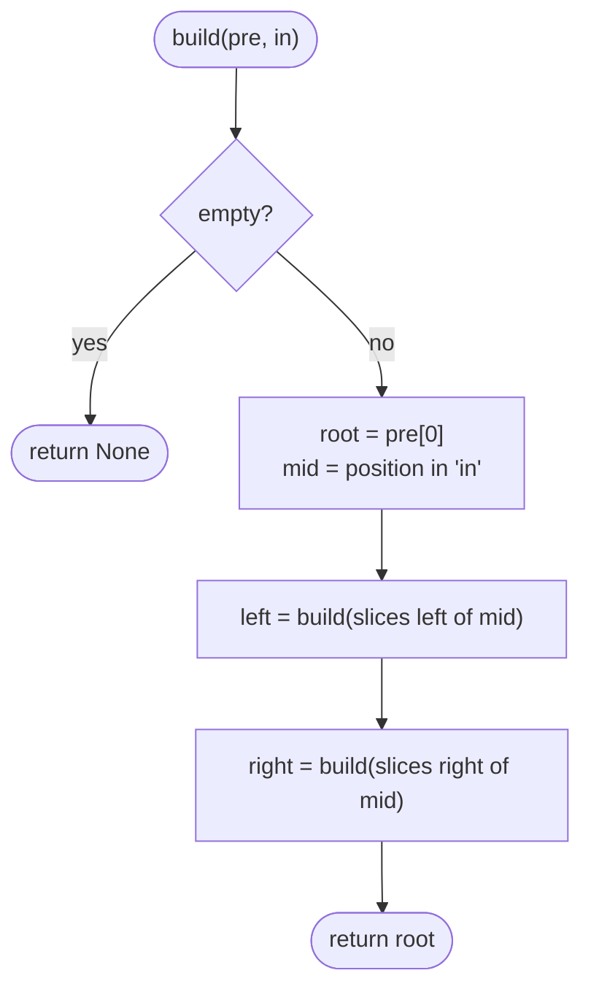
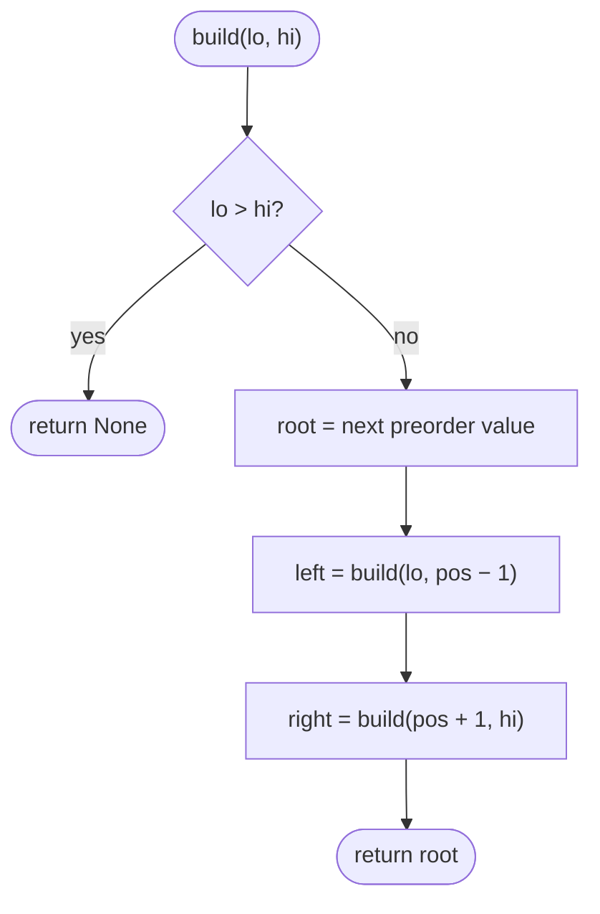

## How to think

**1. Restate the problem.** Rebuild a tree from two traversals: preorder (node, left, right) and inorder (left, node, right). Values are distinct.

**2. What each traversal tells you.**

- **Preorder's first value is the root.**
- **In the inorder list, everything left of the root is the left subtree, and everything right of it is the right subtree.**



**3. Recurse.** The left subtree has as many nodes as there are values left of the root in the inorder list, and its preorder comes right after the root in the preorder list. Build the left subtree from those, then the right subtree from the rest.

**4. Make each step O(1).** Searching the inorder list for the root costs O(n) per node, and slicing lists copies them. Instead, keep a **map from value to inorder position**, work with index ranges, and take preorder values from a single shared iterator, in order. Every node is then created in O(1): O(n) total.

**5. Watch the edge cases.** A single node, and trees shaped like a chain (every node has one child), where the recursion is as deep as the tree.

## Approach 1: Brute force — search and slice at every node
<!-- approach: brute_force | time: O(n²) | space: O(n²) for the slices -->

Take the root from preorder, find it in inorder with a linear search, slice both lists into left and right parts, and recurse.

**Dry run** on preorder `[3, 9, 20, 15, 7]`, inorder `[9, 3, 15, 20, 7]`:

| Call | Root | Left lists | Right lists |
|---|---|---|---|
| top | 3 | pre [9], in [9] | pre [20, 15, 7], in [15, 20, 7] |
| right | 20 | pre [15], in [15] | pre [7], in [7] |

Result: **[3, 9, 20, null, null, 15, 7]**.

### Code
```python
class Solution:
    def buildTree(self, preorder: List[int], inorder: List[int]) -> Optional[TreeNode]:
        if not preorder:
            return None
        root = TreeNode(preorder[0])
        mid = inorder.index(preorder[0])
        root.left = self.buildTree(preorder[1:mid + 1], inorder[:mid])
        root.right = self.buildTree(preorder[mid + 1:], inorder[mid + 1:])
        return root
```

### Line by line
- `3-4` No values: an empty subtree.
- `5` Preorder starts with the root.
- `6` Linear search for the root in inorder: O(n) per node.
- `7` The `mid` values left of the root form the left subtree; in preorder they come right after the root.
- `8` Everything after them forms the right subtree.
- `9` The rebuilt subtree.

### Flowchart


## Approach 2: Optimized — index map and a shared preorder iterator
<!-- approach: optimized | time: O(n) | space: O(n) -->

Map each value to its inorder index once. Build recursively over an inorder **range**, taking the next root from a single preorder iterator. Preorder visits roots exactly in the order this recursion creates them.

**Dry run** on the same input (positions: 9→0, 3→1, 15→2, 20→3, 7→4):

| Call range | Next preorder value | Split at | Left range | Right range |
|---|---|---|---|---|
| 0..4 | 3 | 1 | 0..0 | 2..4 |
| 0..0 | 9 | 0 | empty | empty |
| 2..4 | 20 | 3 | 2..2 | 4..4 |
| 2..2 | 15 | 2 | empty | empty |
| 4..4 | 7 | 4 | empty | empty |

### Code
```python
class Solution:
    def buildTree(self, preorder: List[int], inorder: List[int]) -> Optional[TreeNode]:
        position = {value: i for i, value in enumerate(inorder)}
        next_root = iter(preorder)

        def build(lo, hi):
            if lo > hi:
                return None
            value = next(next_root)
            node = TreeNode(value)
            node.left = build(lo, position[value] - 1)
            node.right = build(position[value] + 1, hi)
            return node

        return build(0, len(inorder) - 1)
```

### Line by line
- `3` O(1) lookup of any value's inorder position.
- `4` Preorder roots, consumed one at a time.
- `6` `build(lo, hi)` builds the subtree whose inorder values are `inorder[lo..hi]`.
- `7-8` An empty range is an empty subtree.
- `9-10` The next preorder value is this subtree's root.
- `11-12` Build the left part first, because preorder lists the whole left subtree before the right.
- `13` The finished subtree.
- `15` The whole inorder range is the whole tree.

### Flowchart

