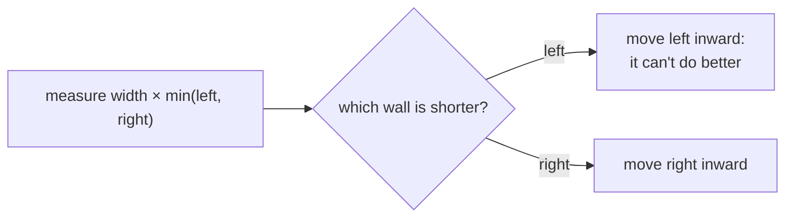
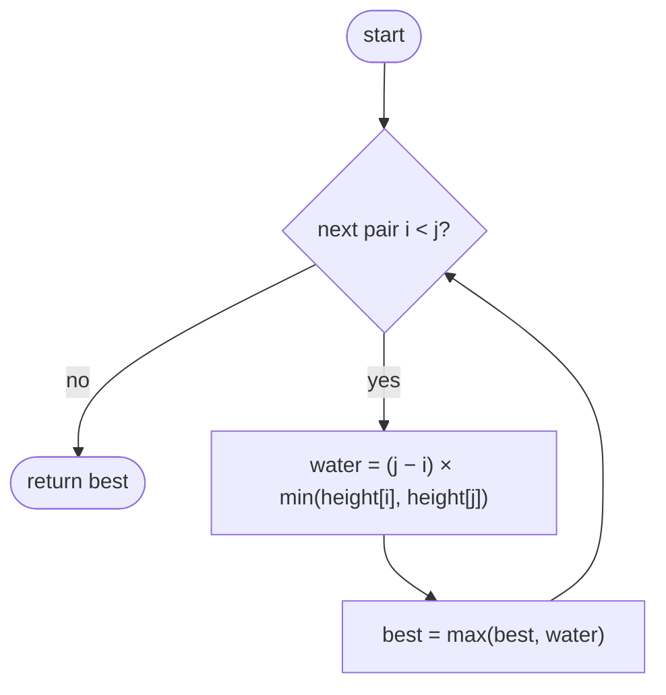
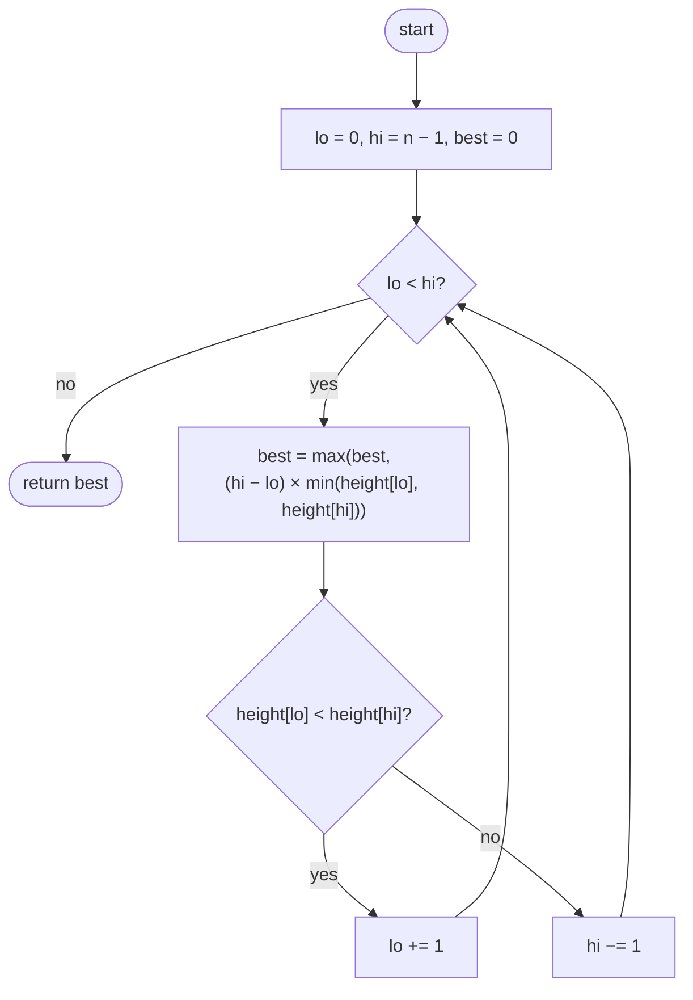

## How to think

**1. Restate the problem.** Pick two walls. The water between them is `width × shorter wall`. Maximize it.

**2. Let the constraints guide you.** 10⁵ walls means about 5 × 10⁹ pairs: too slow. We need O(n).

**3. Start as wide as possible.** Begin with the two outermost walls: the widest container. Any other container is narrower, so it can only win by being **taller**.

**4. Which wall can be discarded?** Say the left wall is the shorter one. Every container that uses this left wall with any wall further in is narrower, and its height is still capped by this same short wall. So none of them can beat what we just measured, and the left wall can be thrown away safely. **Always move the shorter wall inward.**



**5. Watch the edge cases.** Walls of height 0 hold nothing. When the two walls are equal, moving either one is safe.

## Approach 1: Brute force — every pair of walls
<!-- approach: brute_force | time: O(n²) | space: O(1) -->

Measure every pair of walls and keep the best.

**Dry run** on `[2, 7, 3, 6, 4, 8]` (the best few pairs):

| Walls (i, j) | Width | Shorter wall | Water |
|---|---|---|---|
| 0, 5 | 5 | 2 | 10 |
| 1, 5 | 4 | 7 | **28** |
| 1, 3 | 2 | 6 | 12 |
| 3, 5 | 2 | 6 | 12 |

### Code
```python
class Solution:
    def maxArea(self, height: List[int]) -> int:
        best = 0
        for i in range(len(height)):
            for j in range(i + 1, len(height)):
                water = (j - i) * min(height[i], height[j])
                best = max(best, water)
        return best
```

### Line by line
- `3` The best amount found so far.
- `4-5` Every pair of walls `i < j`, each once.
- `6` Distance between them times the shorter wall.
- `7` Keep the largest.
- `8` The best container overall.

### Flowchart


## Approach 2: Optimized — two pointers, move the shorter wall
<!-- approach: optimized | time: O(n) | space: O(1) -->

Start with the outermost walls. Measure, then move the shorter wall one step inward. Each step discards a wall that can't be part of a better container, so after n − 1 steps every useful pair has been covered.

**Dry run** on `[2, 7, 3, 6, 4, 8]`:

| lo (height) | hi (height) | Width | Water | best | Move |
|---|---|---|---|---|---|
| 0 (2) | 5 (8) | 5 | 10 | 10 | lo: 2 is shorter |
| 1 (7) | 5 (8) | 4 | **28** | 28 | lo: 7 is shorter |
| 2 (3) | 5 (8) | 3 | 9 | 28 | lo |
| 3 (6) | 5 (8) | 2 | 12 | 28 | lo |
| 4 (4) | 5 (8) | 1 | 4 | 28 | lo; pointers meet |

### Code
```python
class Solution:
    def maxArea(self, height: List[int]) -> int:
        lo, hi = 0, len(height) - 1
        best = 0
        while lo < hi:
            water = (hi - lo) * min(height[lo], height[hi])
            best = max(best, water)
            if height[lo] < height[hi]:
                lo += 1
            else:
                hi -= 1
        return best
```

### Line by line
- `3` Start with the widest container: the first and last walls.
- `4` The best amount found so far.
- `5` Keep going until the pointers meet.
- `6-7` Measure the current container and keep the best.
- `8-9` The left wall is shorter, so no container using it with a closer right wall can be better: discard it.
- `10-11` Otherwise discard the right wall (on a tie, either is safe).
- `12` The best container found.

### Flowchart

