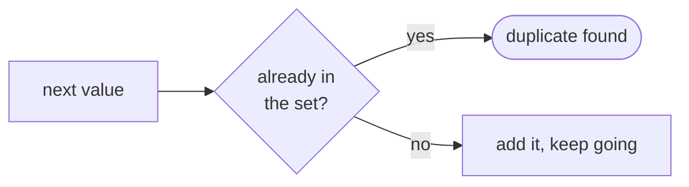
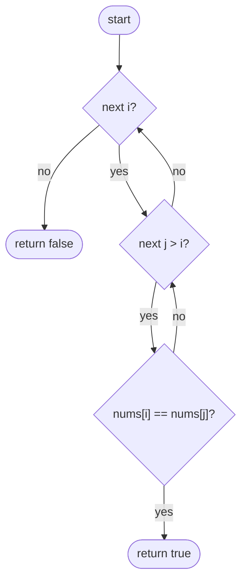
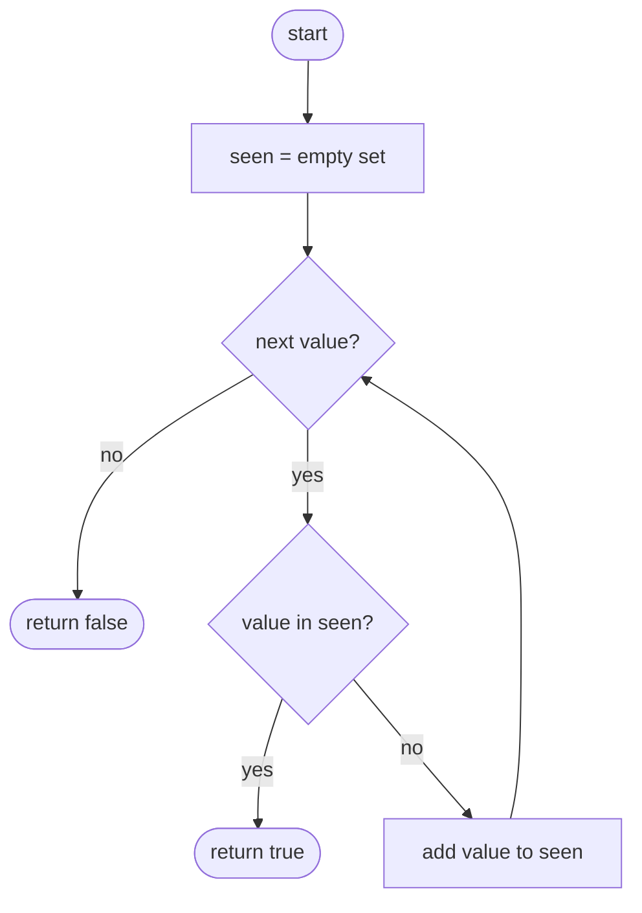

## How to think

**1. Restate the problem.** Does any value appear at least twice?

**2. Let the constraints guide you.** 10⁵ values means about 5 × 10⁹ pairs if you compare every pair, which is too slow.

**3. Remember what you've seen.** Walking left to right, a value is a duplicate exactly when it's already been seen. "Have I seen this value?" is a membership question, which a **hash set** answers in O(1) on average.



**4. Another valid idea: sort.** After sorting, equal values sit next to each other, so one scan of neighbours finds a duplicate. That's O(n log n) time but only O(1) extra space if you're allowed to reorder the input: a classic time-versus-memory trade-off.

**5. Watch the edge cases.** A single element can't have a duplicate. The values go down to −10⁹, which hash sets handle like any other number.

## Approach 1: Brute force — compare every pair
<!-- approach: brute_force | time: O(n²) | space: O(1) -->

Compare each element with every element after it.

**Dry run** on `[4, 1, 7, 1]`:

| i | j | nums[i] vs nums[j] | Equal? |
|---|---|---|---|
| 0 | 1, 2, 3 | 4 vs 1, 7, 1 | no |
| 1 | 2 | 1 vs 7 | no |
| 1 | 3 | 1 vs 1 | **yes → true** |

### Code
```python
class Solution:
    def containsDuplicate(self, nums: List[int]) -> bool:
        for i in range(len(nums)):
            for j in range(i + 1, len(nums)):
                if nums[i] == nums[j]:
                    return True
        return False
```

### Line by line
- `3` Fix the first element of a pair.
- `4` Compare it with every later element, so each pair is checked once.
- `5-6` Two equal values at different positions: a duplicate.
- `7` Every pair was different.

### Flowchart


## Approach 2: Optimized — a hash set of seen values
<!-- approach: optimized | time: O(n) | space: O(n) -->

Walk once, checking each value against the set of values seen so far before adding it.

**Dry run** on `[4, 1, 7, 1]`:

| Value | In the set? | Set afterwards |
|---|---|---|
| 4 | no | {4} |
| 1 | no | {4, 1} |
| 7 | no | {4, 1, 7} |
| 1 | **yes → true** | |

### Code
```python
class Solution:
    def containsDuplicate(self, nums: List[int]) -> bool:
        seen = set()
        for value in nums:
            if value in seen:
                return True
            seen.add(value)
        return False
```

### Line by line
- `3` Every value met so far.
- `4` One pass over the list.
- `5-6` Seen before means it appears at least twice; stop immediately.
- `7` Remember this value for the rest of the scan.
- `8` The scan finished without a repeat.

### Flowchart

