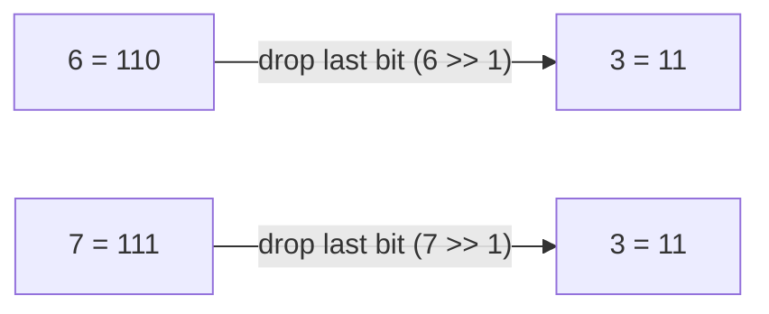
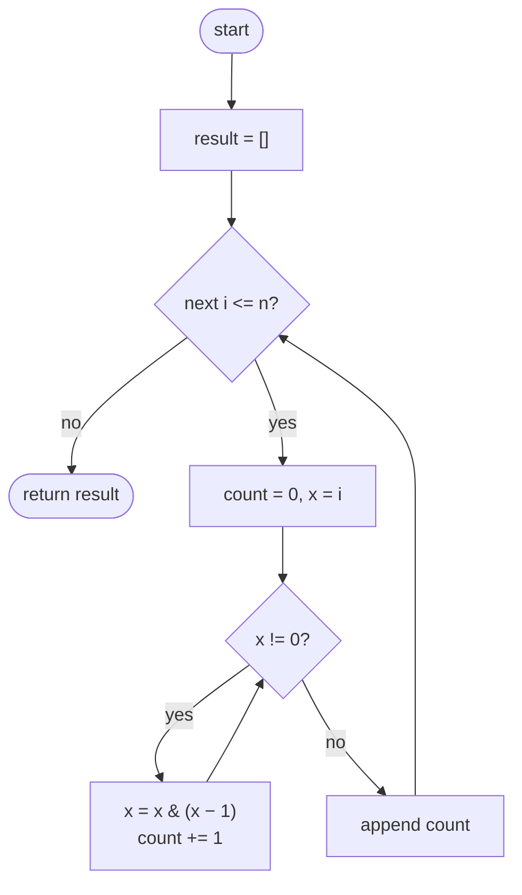
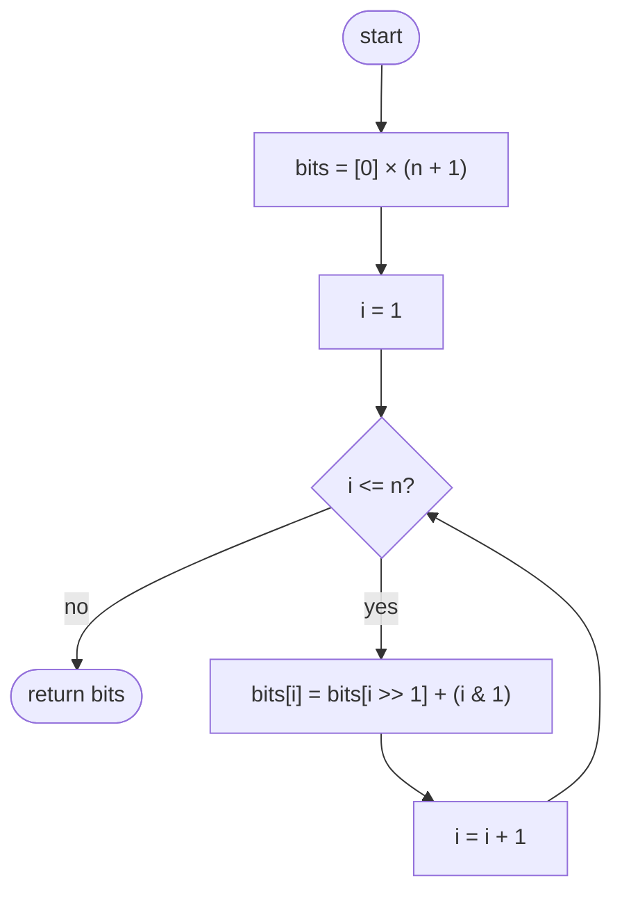

## How to think

**1. Restate the problem.** For every number from 0 to `n`, count its 1 bits, and return all the counts as a list.

**2. Let the constraints guide you.** `n` goes up to 10⁵. Counting each number's bits separately costs up to 17 steps per number, about 1.7 million steps in total, which is actually fast enough. The problem asks for something better, though: **O(n) overall**, so each answer must come from earlier answers in O(1).

**3. Look for a smaller number with almost the same bits.** Write a few numbers in binary and drop the last bit:



`6` and `7` both become `3` once the last bit is dropped. So the 1s in `i` are the 1s in `i >> 1`, plus one more if the dropped bit was 1:

```
bits[i] = bits[i >> 1] + (i & 1)
```

And `i >> 1` is always smaller than `i`, so its answer is already computed if we fill the list from 0 upward. This is dynamic programming on numbers.

**4. Watch the edge cases.**

- `n = 0` returns `[0]`, a list of length 1, not an empty list.
- The list always has `n + 1` entries.

## Approach 1: Brute force — count each number separately
<!-- approach: brute_force | time: O(n log n) | space: O(1) besides the output -->

For each `i` from 0 to `n`, count its bits from scratch with the "clear the lowest 1" trick from **Number of 1 Bits**, and append the count.

**Dry run** for `n = 5`:

| i | binary | steps of `x &= x − 1` | count |
|---|---|---|---|
| 0 | `0` | none | 0 |
| 1 | `1` | 1 → 0 | 1 |
| 2 | `10` | 10 → 0 | 1 |
| 3 | `11` | 11 → 10 → 0 | 2 |
| 4 | `100` | 100 → 0 | 1 |
| 5 | `101` | 101 → 100 → 0 | 2 |

Each number is handled independently, so nothing is reused: up to log n steps per number.

### Code
```python
class Solution:
    def countBits(self, n: int) -> List[int]:
        result = []
        for i in range(n + 1):
            count, x = 0, i
            while x:
                x &= x - 1
                count += 1
            result.append(count)
        return result
```

### Line by line
- `3` The answers, filled in order from 0 to `n`.
- `4` `n + 1` numbers in total, including both 0 and `n`.
- `5` Work on a copy `x`, so `i` stays intact as the loop variable.
- `6-8` Remove one 1 bit per step and count the steps; the loop ends when no 1s remain.
- `9` Record this number's count.
- `10` The list now has an entry for every number from 0 to `n`.

### Flowchart


## Approach 2: Optimized — reuse the answer for i >> 1
<!-- approach: optimized | time: O(n) | space: O(1) besides the output -->

Fill `bits` from 0 upward. Each entry takes one lookup of a smaller number's answer plus one bit check, as derived in *How to think*.

**Dry run** for `n = 7`:

| i | binary | i >> 1 | bits[i >> 1] | i & 1 | bits[i] |
|---|---|---|---|---|---|
| 0 | `0` | | | | 0 |
| 1 | `1` | 0 | 0 | 1 | 1 |
| 2 | `10` | 1 | 1 | 0 | 1 |
| 3 | `11` | 1 | 1 | 1 | 2 |
| 4 | `100` | 2 | 1 | 0 | 1 |
| 5 | `101` | 2 | 1 | 1 | 2 |
| 6 | `110` | 3 | 2 | 0 | 2 |
| 7 | `111` | 3 | 2 | 1 | 3 |

Every row only reads a row above it, so filling top to bottom always works.

### Code
```python
class Solution:
    def countBits(self, n: int) -> List[int]:
        bits = [0] * (n + 1)
        for i in range(1, n + 1):
            bits[i] = bits[i >> 1] + (i & 1)
        return bits
```

### Line by line
- `3` One slot per number from 0 to `n`. `bits[0] = 0` is the base case and is already set.
- `4` Fill from 1 upward, so every smaller answer is ready when it's needed.
- `5` Dropping the last bit gives `i >> 1`, whose count is known. Add 1 back if the dropped bit, `i & 1`, was a 1.
- `6` Each entry took O(1) work, so the whole list took O(n).

### Flowchart

