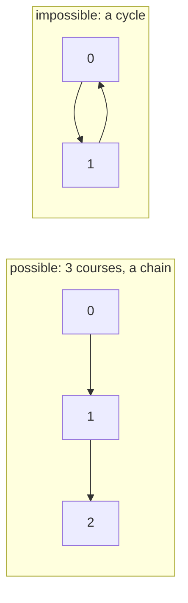
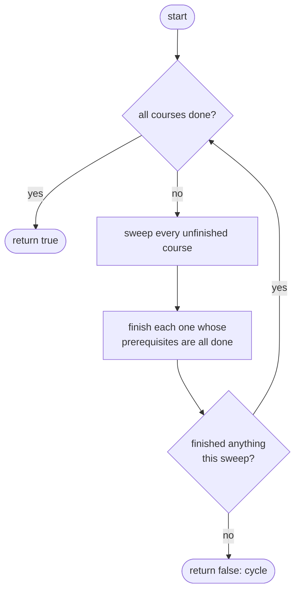
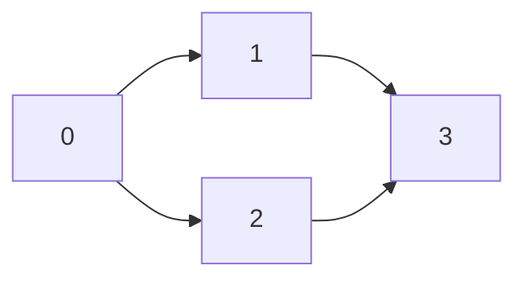
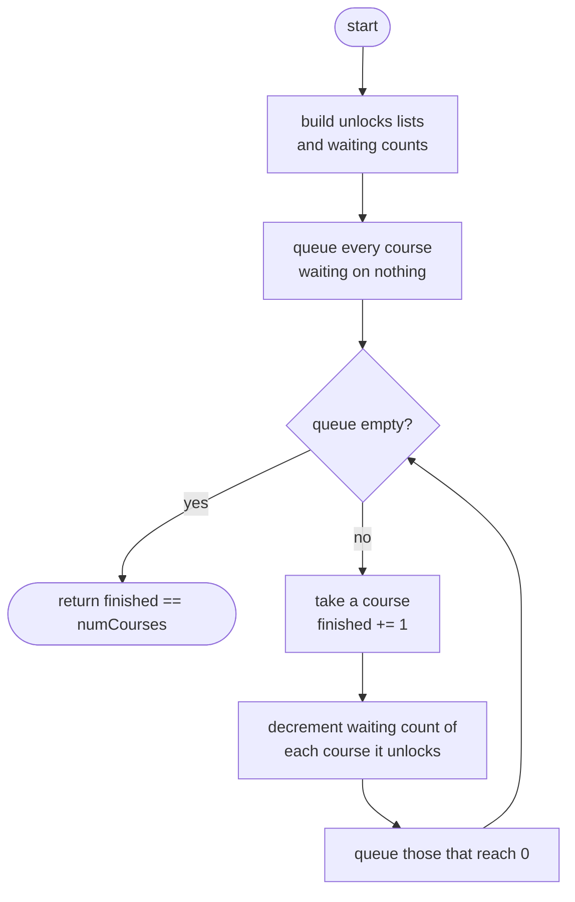

## How to think

**1. Restate the problem.** Courses have prerequisites: `[a, b]` means take `b` before `a`. Decide whether every course can be completed.

**2. Draw it as a graph.** Each course is a node, and each prerequisite is an arrow from `b` to `a` ("b unlocks a"). Courses can be finished in some order exactly when the graph has **no cycle**. A cycle means a group of courses that all wait on each other, so none of them can ever start.



**3. Simulate a student.** A course with no unfinished prerequisites can be taken right now. Take it, which may free up the courses it unlocks. Keep going. If you run out of available courses while some remain, those remaining courses are stuck in (or behind) a cycle.

**4. Make each step cheap.** Instead of rescanning every prerequisite to find available courses, keep a count of unfinished prerequisites per course. Finishing a course just decrements the counts of the courses it unlocks; a count reaching zero means "available now". This is **Kahn's algorithm** for topological sorting.

**5. Watch the edge cases.**

- No prerequisites: every course is available immediately.
- A course that requires itself (`[1, 1]`) is a one-node cycle: impossible.
- A cycle in one part of the graph makes the whole answer `false`, even if other courses are fine.

## Approach 1: Brute force — repeatedly scan for an available course
<!-- approach: brute_force | time: O(V² × E) | space: O(V) -->

Keep a set of finished courses. Sweep through all courses, finishing any whose prerequisites are all finished, by checking the whole prerequisite list each time. Repeat sweeps until everything is finished, or a full sweep makes no progress.

**Dry run** with `numCourses = 3`, prerequisites `[[1,0],[2,1]]`:

| Sweep | Course | Unfinished prerequisites? | Finished set afterwards |
|---|---|---|---|
| 1 | 0 | none | {0} |
| 1 | 1 | needs 0: done | {0, 1} |
| 1 | 2 | needs 1: done | {0, 1, 2} |

All 3 finished: `true`. With `[[0,1],[1,0]]`, the first sweep finds nothing to take, so the answer is `false`.

### Code
```python
class Solution:
    def canFinish(self, numCourses: int, prerequisites: List[List[int]]) -> bool:
        done = set()
        while len(done) < numCourses:
            progress = False
            for course in range(numCourses):
                if course in done:
                    continue
                if all(before in done for after, before in prerequisites if after == course):
                    done.add(course)
                    progress = True
            if not progress:
                return False
        return True
```

### Line by line
- `3` Courses finished so far.
- `4` Keep sweeping until every course is finished.
- `5` Tracks whether this sweep managed to finish anything.
- `6-8` Look at each unfinished course.
- `9` Scan the *entire* prerequisite list for this course's requirements and check they're all done. Repeating this scan for every course in every sweep is what makes this slow.
- `10-11` Take the course and note that the sweep made progress.
- `12-13` A sweep that finishes nothing means the remaining courses wait on each other forever: there's a cycle.
- `14` Everything was finished.

### Flowchart


## Approach 2: Optimized — Kahn's algorithm (topological sort)
<!-- approach: optimized | time: O(V + E) | space: O(V + E) -->

Build the graph once: for each course, the list of courses it unlocks, and how many prerequisites it is still waiting on. Start a queue with every course waiting on nothing. Repeatedly take a course, count it as finished, and decrement the waiting count of everything it unlocks, queueing any that reach zero. If every course gets finished, there was no cycle.

**Dry run** with `numCourses = 4`, prerequisites `[[1,0],[2,0],[3,1],[3,2]]` (course 3 needs both 1 and 2):

| Take | Waiting counts after (courses 0, 1, 2, 3) | Queue | Finished |
|---|---|---|---|
| start | 0, 1, 1, 2 | [0] | 0 |
| 0 | 0, 0, 0, 2 | [1, 2] | 1 |
| 1 | 0, 0, 0, 1 | [2] | 2 |
| 2 | 0, 0, 0, 0 | [3] | 3 |
| 3 | 0, 0, 0, 0 | [] | **4 = numCourses → true** |



### Code
```python
class Solution:
    def canFinish(self, numCourses: int, prerequisites: List[List[int]]) -> bool:
        unlocks = [[] for _ in range(numCourses)]
        waiting_on = [0] * numCourses
        for course, before in prerequisites:
            unlocks[before].append(course)
            waiting_on[course] += 1
        ready = deque(c for c in range(numCourses) if waiting_on[c] == 0)
        finished = 0
        while ready:
            course = ready.popleft()
            finished += 1
            for nxt in unlocks[course]:
                waiting_on[nxt] -= 1
                if waiting_on[nxt] == 0:
                    ready.append(nxt)
        return finished == numCourses
```

### Line by line
- `3` `unlocks[b]` lists the courses that `b` is a prerequisite for: the arrows leaving `b`.
- `4` `waiting_on[a]` counts `a`'s unfinished prerequisites (its *in-degree*).
- `5-7` Build both from the prerequisite list in one pass.
- `8` Courses with nothing to wait for can be taken immediately.
- `9` How many courses we've managed to finish.
- `10-12` Take any available course and finish it.
- `13-14` Finishing it removes one prerequisite from each course it unlocks.
- `15-16` A course whose last prerequisite was just finished becomes available.
- `17` Courses inside a cycle never reach zero, so they're never finished. Finishing all of them means there's no cycle.

### Flowchart

