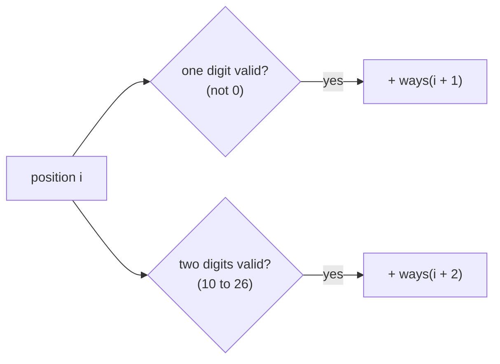
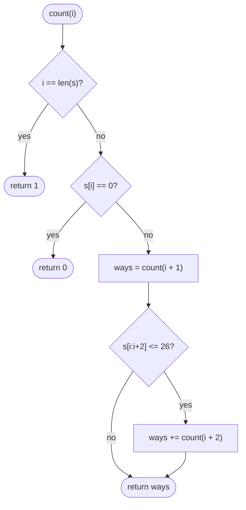
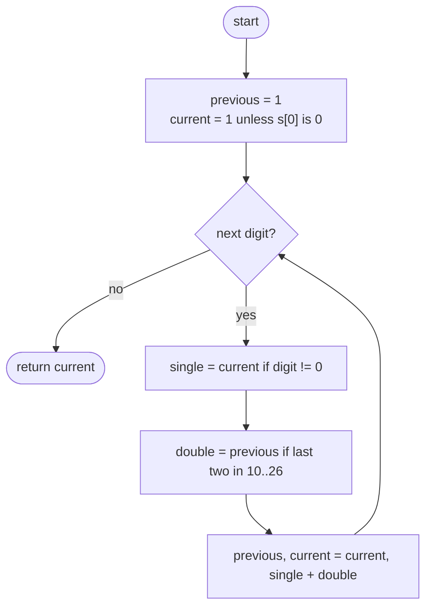

## How to think

**1. Restate the problem.** Split a digit string into pieces from `1` to `26`, with no piece starting with `0`, and count the ways.

**2. Look at the first piece.** It's either one digit (any digit except `0`) or two digits (`10` to `26`). Whatever comes after is the same problem on a shorter string:

```
ways(i) = ways(i + 1)   if s[i] != "0"
        + ways(i + 2)   if s[i:i+2] is between "10" and "26"
ways(end) = 1
```



**3. It's Fibonacci with conditions.** Each position depends on the next two, just like Climbing Stairs, except a step is only allowed when the digits form a valid code. So two running values are enough.

**4. Zeros are the tricky part.** A `0` can't stand alone, so it must be the second digit of `10` or `20`. `"30"`, `"00"` and a leading `0` make the whole count 0.

**5. Watch the edge cases.** `"10"` has exactly one decoding; `"27"` has one (2 7); `"0"` has none.

## Approach 1: Brute force — recursion over the first piece
<!-- approach: brute_force | time: O(2ⁿ) | space: O(n) -->

Count decodings of `s[i:]` by trying a one-digit and a two-digit first piece. Without memory, a string of all 1s makes the calls grow like Fibonacci numbers.

**Dry run** on `"123"`:

| Call | One digit | Two digits | Result |
|---|---|---|---|
| count(3) | end | | 1 |
| count(2) | "3" → count(3) = 1 | none | 1 |
| count(1) | "2" → count(2) = 1 | "23" → count(3) = 1 | 2 |
| count(0) | "1" → count(1) = 2 | "12" → count(2) = 1 | **3** |

### Code
```python
class Solution:
    def numDecodings(self, s: str) -> int:
        def count(i):
            if i == len(s):
                return 1
            if s[i] == "0":
                return 0
            ways = count(i + 1)
            if i + 1 < len(s) and int(s[i:i + 2]) <= 26:
                ways += count(i + 2)
            return ways

        return count(0)
```

### Line by line
- `3` `count(i)` is the number of ways to decode `s[i:]`.
- `4-5` Reaching the end means one complete decoding.
- `6-7` No code starts with 0, so nothing can begin here.
- `8` Use one digit (1 to 9) as the next letter.
- `9-10` Or two digits, if they form 10 to 26 (the first digit is already known not to be 0).
- `11` The total from both choices.
- `13` Decode the whole string.

### Flowchart


## Approach 2: Optimized — two running counts, left to right
<!-- approach: optimized | time: O(n) | space: O(1) -->

Walk left to right. `current` is the number of decodings of the prefix ending here and `previous` of the prefix one shorter. A new digit adds `current` if it's a valid single code, and `previous` if it forms a valid two-digit code with the digit before it.

**Dry run** on `"226"`:

| i | Digit | Single valid? | Pair | Pair valid? | previous, current afterwards |
|---|---|---|---|---|---|
| 0 | 2 | yes | | | 1, 1 |
| 1 | 2 | yes → 1 | "22" | yes → 1 | 1, 2 |
| 2 | 6 | yes → 2 | "26" | yes → 1 | 2, **3** |

The three decodings: 2 2 6, 22 6, 2 26.

### Code
```python
class Solution:
    def numDecodings(self, s: str) -> int:
        previous, current = 1, (0 if s[0] == "0" else 1)
        for i in range(1, len(s)):
            single = current if s[i] != "0" else 0
            double = previous if 10 <= int(s[i - 1:i + 1]) <= 26 else 0
            previous, current = current, single + double
        return current
```

### Line by line
- `3` `previous` is the count for the empty prefix (1); `current` for the first digit: 1 unless it's 0.
- `4` Extend the prefix one digit at a time.
- `5` If this digit is a valid letter alone, every decoding of the prefix before it extends.
- `6` If the last two digits form 10 to 26, every decoding of the prefix two back extends. The `10 <=` check rejects a leading zero like "05".
- `7` Slide the window forward one digit.
- `8` Decodings of the whole string.

### Flowchart

