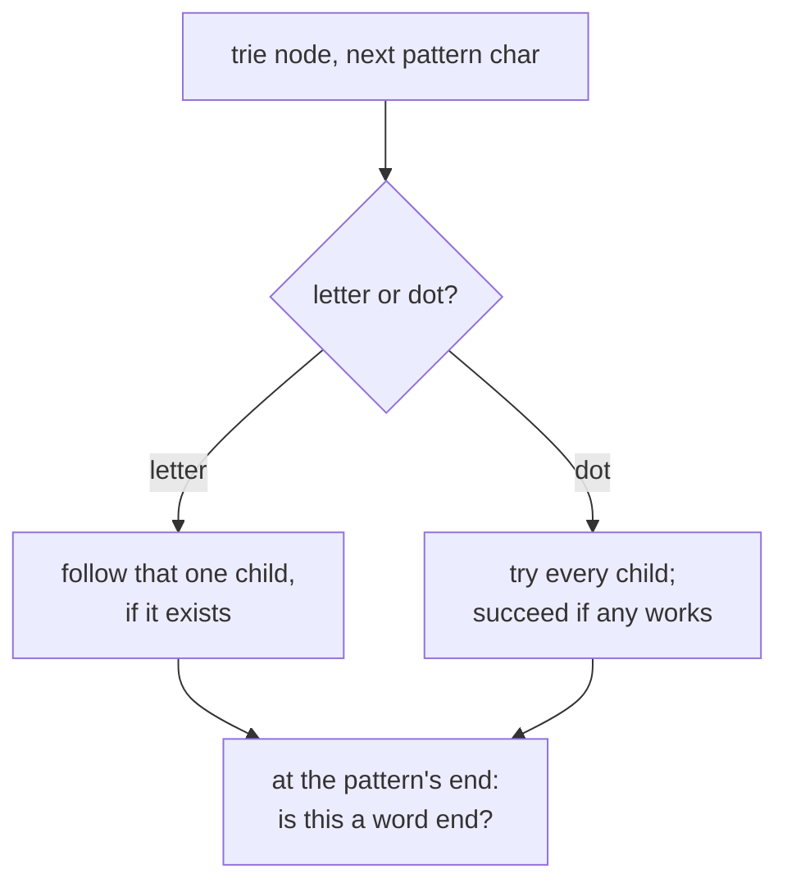
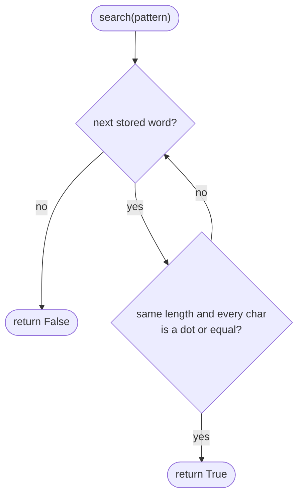
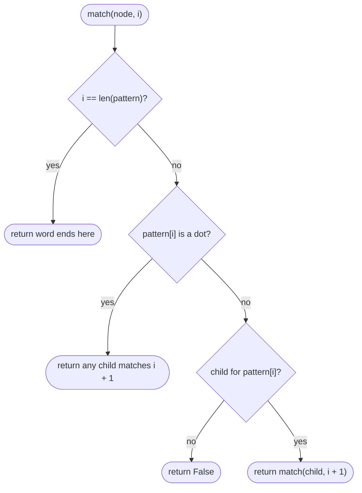

## How to think

**1. Restate the problem.** Store words, and search with patterns where `.` matches any single letter.

**2. Without wildcards, it's a trie.** See **Implement Trie**: walk the pattern's letters down the tree.

**3. A dot means "try every branch".** At a `.`, any child can continue the match, so try each child in turn (depth-first) and succeed if any of them leads to a word end at exactly the right depth.



**4. Why the trie wins.** Comparing the pattern against every stored word costs O(words × length) per search. The trie only explores branches consistent with the pattern so far. With at most two dots per pattern, the branching stays small.

**5. Watch the edge cases.** A dot must match **exactly one** letter: `..` doesn't match `a`. A pattern longer than every word fails.

## Approach 1: Brute force — compare the pattern with every word
<!-- approach: brute_force | time: O(N × L) per search | space: O(total characters) -->

Store words in a set. To search, check every stored word: same length, and every pattern character is either `.` or equal.

**Dry run** with words `bad`, `dad`, search `.ad`:

| Word | Same length? | Characters match? |
|---|---|---|
| bad | yes | . ~ b, a = a, d = d → **match** |

### Code
```python
class WordDictionary:
    def __init__(self):
        self.words = set()

    def addWord(self, word: str) -> None:
        self.words.add(word)

    def search(self, word: str) -> bool:
        return any(
            len(candidate) == len(word) and all(p == "." or p == c for p, c in zip(word, candidate))
            for candidate in self.words
        )
```

### Line by line
- `3` Every added word.
- `5-6` Adding is a set insert.
- `8-12` A stored word matches when it has the same length and every pattern character is a dot or the same letter. Every word is checked.

### Flowchart


## Approach 2: Optimized — trie with depth-first search on dots
<!-- approach: optimized | time: O(L) without dots; more per dot | space: O(total characters) -->

Store words in a trie. Search recursively: a letter follows one child, a dot tries every child, and the end of the pattern must land on a word-end marker.

**Dry run** with words `bad`, `dad`, `mad`, search `b..`:

| Depth | Pattern char | Nodes tried |
|---|---|---|
| 0 | b | follow b |
| 1 | . | child a |
| 2 | . | child d |
| 3 | end | `bad` ends here → **true** |

### Code
```python
class WordDictionary:
    def __init__(self):
        self.root = {}

    def addWord(self, word: str) -> None:
        node = self.root
        for char in word:
            node = node.setdefault(char, {})
        node["$"] = True

    def search(self, word: str) -> bool:
        def match(node, i):
            if i == len(word):
                return "$" in node
            if word[i] == ".":
                return any(match(child, i + 1) for key, child in node.items() if key != "$")
            return word[i] in node and match(node[word[i]], i + 1)

        return match(self.root, 0)
```

### Line by line
- `3` The trie's root.
- `5-9` Insert as in an ordinary trie, marking the word's end with `$`.
- `12` `match(node, i)`: can `word[i:]` be matched starting from this node?
- `13-14` The whole pattern was consumed: success only if a word ends here.
- `15-16` A dot: try every child (skipping the `$` marker), succeeding if any branch matches the rest.
- `17` A letter: that child must exist and match the rest.
- `19` Start at the root with the first character.

### Flowchart

