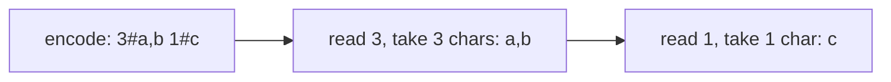
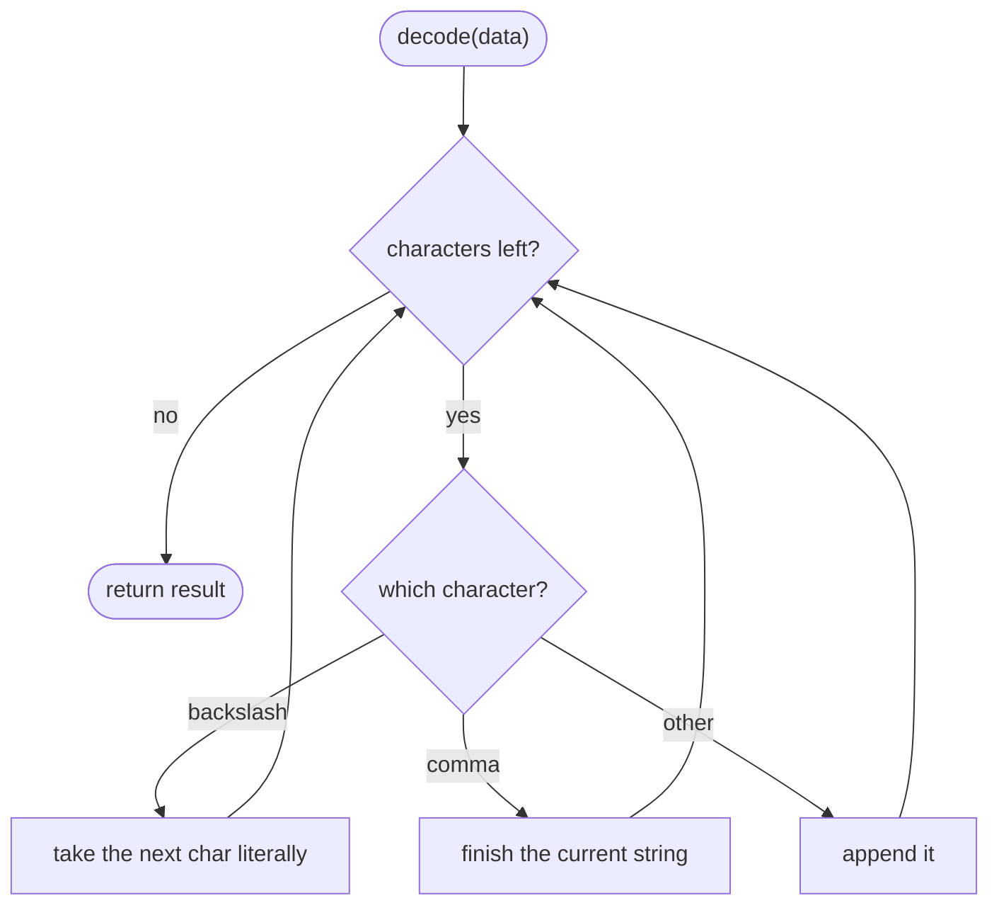
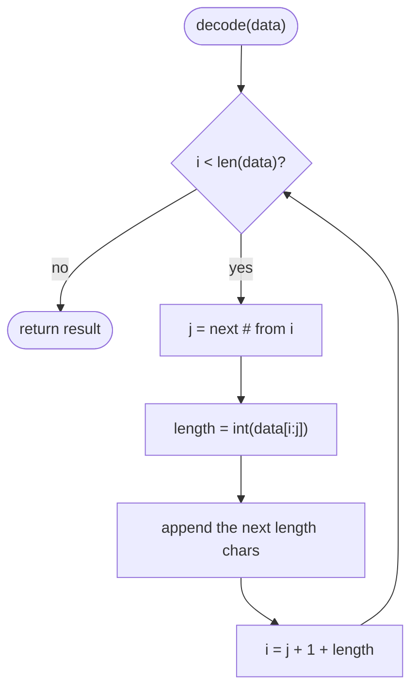

## How to think

**1. Restate the problem.** Pack a list of strings into one string, and unpack it back into the identical list, even when the strings contain any character, including whatever separator you choose.

**2. Why a plain separator fails.** Joining `["a,b", "c"]` with `,` gives `"a,b,c"`, which splits back into three strings. Any character you pick can appear inside the data.

**3. Two fixes.**

- **Escape the separator.** Write `\,` for a comma inside the data and `\\` for a backslash, and end every string with an unescaped `,`. Decoding reads character by character, unescaping as it goes. It works, but it's easy to get subtly wrong.
- **Prefix each string with its length.** Write `len#string` for each one. The decoder reads digits up to `#`, then takes exactly that many characters, **whatever they are**. The content is never inspected, so no character in it can confuse the decoder.



**4. Empty cases must stay distinct.** `[]` and `[""]` are different lists. With length prefixes, `[]` encodes as `""` and `[""]` as `"0#"`. With escaping, terminating every string with `,` gives `""` and `","`.

**5. Watch the edge cases.** Empty strings, strings that look like encoded data (`"4#abc"`), and backslashes.

## Approach 1: Brute force — escape the separator
<!-- approach: brute_force | time: O(N) for N total characters | space: O(N) -->

Escape backslashes and commas inside each string, end each string with an unescaped comma, and decode by scanning character by character. It's linear, but the escaping rules are easy to get subtly wrong, which is why it's the "first idea" rather than the clean one.

**Dry run** on `["", "a,b", "#"]`:

| String | Escaped + terminator |
|---|---|
| "" | `,` |
| "a,b" | `a\,b,` |
| "#" | `#,` |

Encoded: `,a\,b,#,` → decoding finds the three unescaped commas, giving `""`, `"a,b"` and `"#"`.

### Code
```python
class Codec:
    def encode(self, strs: List[str]) -> str:
        return "".join(s.replace("\\", "\\\\").replace(",", "\\,") + "," for s in strs)

    def decode(self, data: str) -> List[str]:
        result, current, i = [], [], 0
        while i < len(data):
            char = data[i]
            if char == "\\":
                current.append(data[i + 1])
                i += 2
            elif char == ",":
                result.append("".join(current))
                current = []
                i += 1
            else:
                current.append(char)
                i += 1
        return result
```

### Line by line
- `3` Escape backslashes first (so the commas' escapes aren't escaped again), then commas, and end each string with an unescaped comma. An empty list encodes as `""`, distinct from `[""]` → `","`.
- `6` The decoded strings, the one being built, and the read position.
- `7-8` Read one character at a time.
- `9-11` A backslash means "the next character is literal": take it, skip both.
- `12-15` An unescaped comma ends the current string.
- `16-18` Any other character is part of the current string.
- `19` Every string, in order.

### Flowchart


## Approach 2: Optimized — length prefixes
<!-- approach: optimized | time: O(N) | space: O(N) -->

Encode each string as its length, a `#`, then the string itself. Decode by reading the number up to `#` and slicing exactly that many characters.

**Dry run** on `["4#abc", "#"]`:

| Step | Encoded / decoded |
|---|---|
| encode | `5#4#abc` + `1##` = `5#4#abc1##` |
| read "5", take 5 chars | `4#abc` |
| read "1", take 1 char | `#` |

The `#` characters inside the data are never mistaken for separators: the decoder never looks inside a string's content.

### Code
```python
class Codec:
    def encode(self, strs: List[str]) -> str:
        return "".join(f"{len(s)}#{s}" for s in strs)

    def decode(self, data: str) -> List[str]:
        result, i = [], 0
        while i < len(data):
            j = data.index("#", i)
            length = int(data[i:j])
            result.append(data[j + 1:j + 1 + length])
            i = j + 1 + length
        return result
```

### Line by line
- `3` Each string becomes `length#content`. An empty list encodes to `""`; `[""]` encodes to `"0#"`.
- `6` Decoded strings and the read position.
- `7` Each loop iteration decodes one string.
- `8-9` The length is the digits up to the next `#`. Searching from `i` only ever sees a length prefix, never content.
- `10` Take exactly `length` characters, whatever they contain.
- `11` Jump past this string to the next length prefix.
- `12` Every string, in order.

### Flowchart

