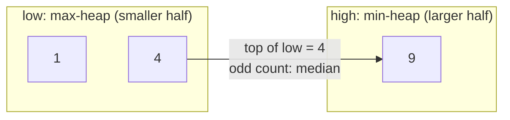
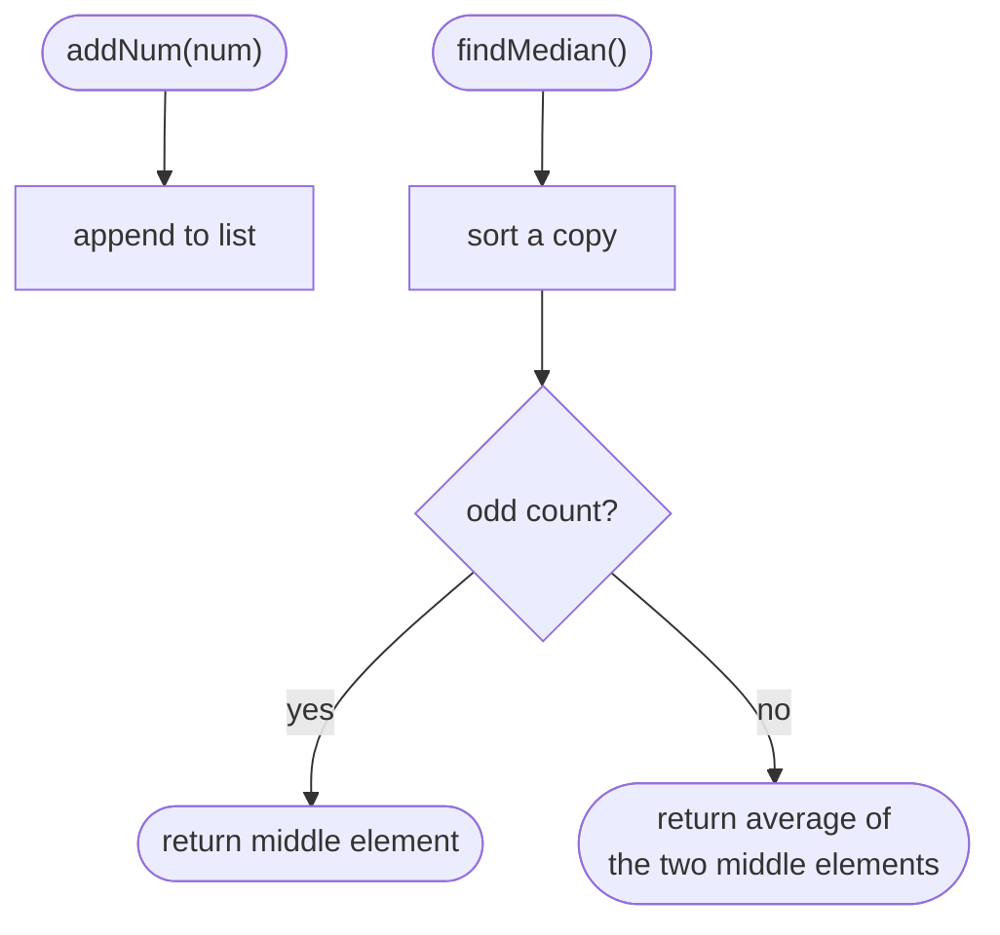
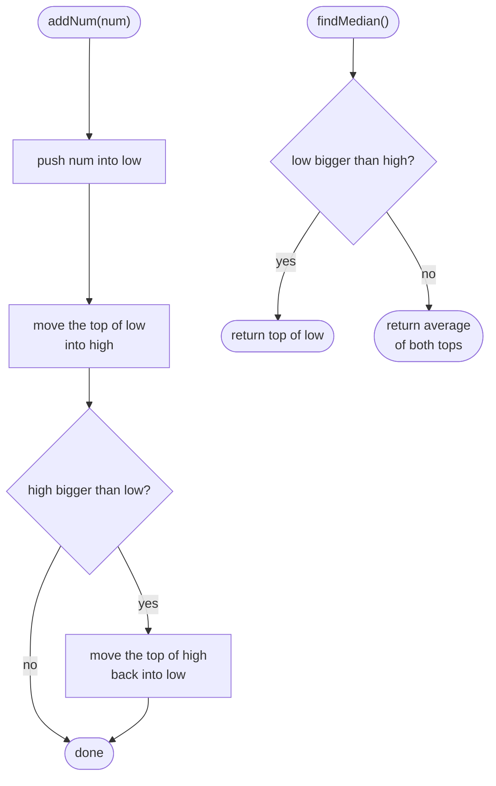

## How to think

**1. Restate the problem.** Numbers arrive one at a time. At any moment you may be asked for the median of everything so far: the middle value, or the average of the two middle values when the count is even.

**2. What does the median actually need?** Not the whole sorted list, just the **boundary between the smaller half and the larger half**. If you knew the largest value of the smaller half and the smallest value of the larger half, the median would come straight from those two numbers.

**3. Two heaps hold exactly that boundary.**

- `low`: a **max-heap** with the smaller half. Its top is the largest of the small values.
- `high`: a **min-heap** with the larger half. Its top is the smallest of the large values.



After adding 4, 9 and 1, `low` holds {1, 4} and `high` holds {9}. The count is odd, so the median is the top of `low`, 4.

**4. Keep two rules after every insert.**

- **Order:** everything in `low` ≤ everything in `high`.
- **Balance:** `low` has the same number of elements as `high`, or exactly one more.

Then the median is `top(low)` for an odd count, or the average of the two tops for an even count. Inserting costs O(log n), and reading the median costs O(1).

**5. Watch the edge cases.**

- Python's `heapq` is a min-heap only. Store **negated** values to get a max-heap.
- Duplicates and negative numbers work without special handling.
- Medians are returned as floats, such as `4.0` and `6.5`.

## Approach 1: Brute force — store everything, sort on every query
<!-- approach: brute_force | time: O(1) per add, O(n log n) per median | space: O(n) -->

Append each number to a list. When asked for the median, sort a copy and read the middle. Adding is instant, but every query re-sorts everything, so a stream with many queries is slow.

**Dry run** for add 4, add 9, median, add 1, median:

| Operation | Stored values | Sorted copy | Result |
|---|---|---|---|
| add 4 | [4] | | |
| add 9 | [4, 9] | | |
| median | | [4, 9] | (4 + 9) / 2 = **6.5** |
| add 1 | [4, 9, 1] | | |
| median | | [1, 4, 9] | **4.0** |

### Code
```python
class MedianFinder:
    def __init__(self):
        self.values = []

    def addNum(self, num: int) -> None:
        self.values.append(num)

    def findMedian(self) -> float:
        ordered = sorted(self.values)
        n = len(ordered)
        if n % 2 == 1:
            return float(ordered[n // 2])
        return (ordered[n // 2 - 1] + ordered[n // 2]) / 2
```

### Line by line
- `3` Every number received, in arrival order.
- `5-6` Adding is just an O(1) append.
- `8-9` Sort a copy of everything: O(n log n) on *every* query.
- `10-12` Odd count: the single middle element.
- `13` Even count: the average of the two middle elements. `/` always gives a float in Python.

### Flowchart


## Approach 2: Optimized — two heaps
<!-- approach: optimized | time: O(log n) per add, O(1) per median | space: O(n) -->

Each new number goes into `low` first. The largest value in `low` is then moved to `high`, which keeps the order rule. If `high` has become bigger than `low`, its smallest value moves back, which keeps the balance rule.

**Dry run** for add 4, add 9, median, add 1, median (`low` shown as real values):

| Operation | low (max-heap) | high (min-heap) | Result |
|---|---|---|---|
| add 4 | push 4, move 4 to high, then move it back → {4} | {} | |
| add 9 | push 9, move 9 to high → {4} | {9} | |
| median | top 4 | top 9 | even count: **6.5** |
| add 1 | push 1, move 4 to high, then move 4 back → {1, 4} | {9} | |
| median | top 4 | | odd count: **4.0** |

### Code
```python
class MedianFinder:
    def __init__(self):
        self.low = []   # max-heap (values negated): the smaller half
        self.high = []  # min-heap: the larger half

    def addNum(self, num: int) -> None:
        heapq.heappush(self.low, -num)
        heapq.heappush(self.high, -heapq.heappop(self.low))
        if len(self.high) > len(self.low):
            heapq.heappush(self.low, -heapq.heappop(self.high))

    def findMedian(self) -> float:
        if len(self.low) > len(self.high):
            return float(-self.low[0])
        return (-self.low[0] + self.high[0]) / 2
```

### Line by line
- `3` The smaller half. `heapq` only builds min-heaps, so values are stored negated: the smallest negated value is the largest real one.
- `4` The larger half, as a normal min-heap.
- `7` Put the new number into the smaller half first.
- `8` Move the largest of the smaller half across. Whatever `num` was, this restores the order rule: everything in `low` ≤ everything in `high`.
- `9-10` If that left `high` bigger than `low`, move its smallest value back. Now `low` has the same size as `high`, or one more.
- `13-14` Odd total count: `low` holds the extra element, and its top is the median.
- `15` Even count: the median is the average of the two tops, the two middle values.

### Flowchart

