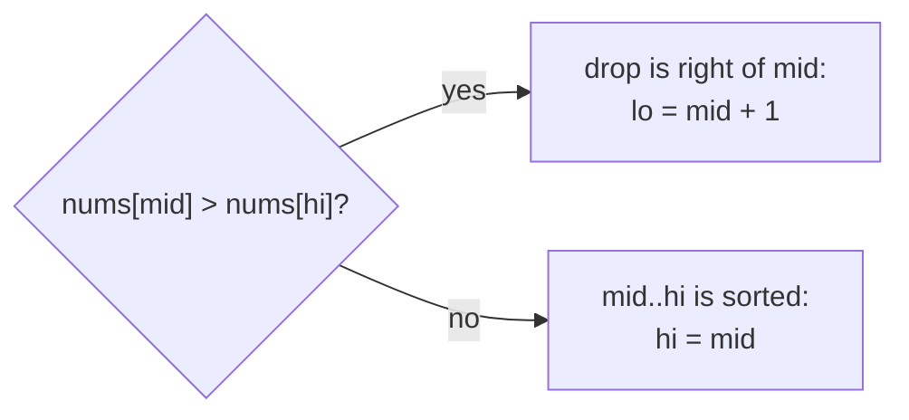
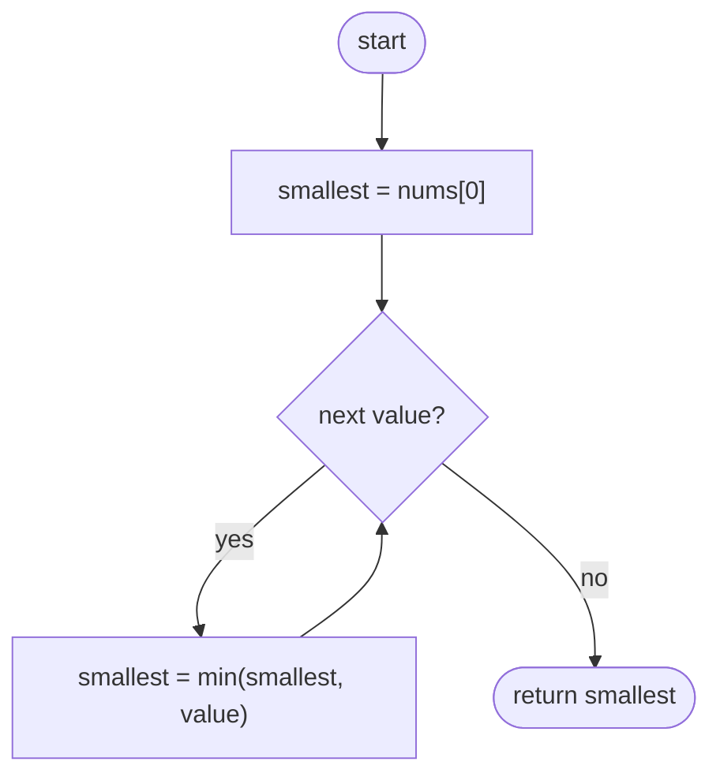
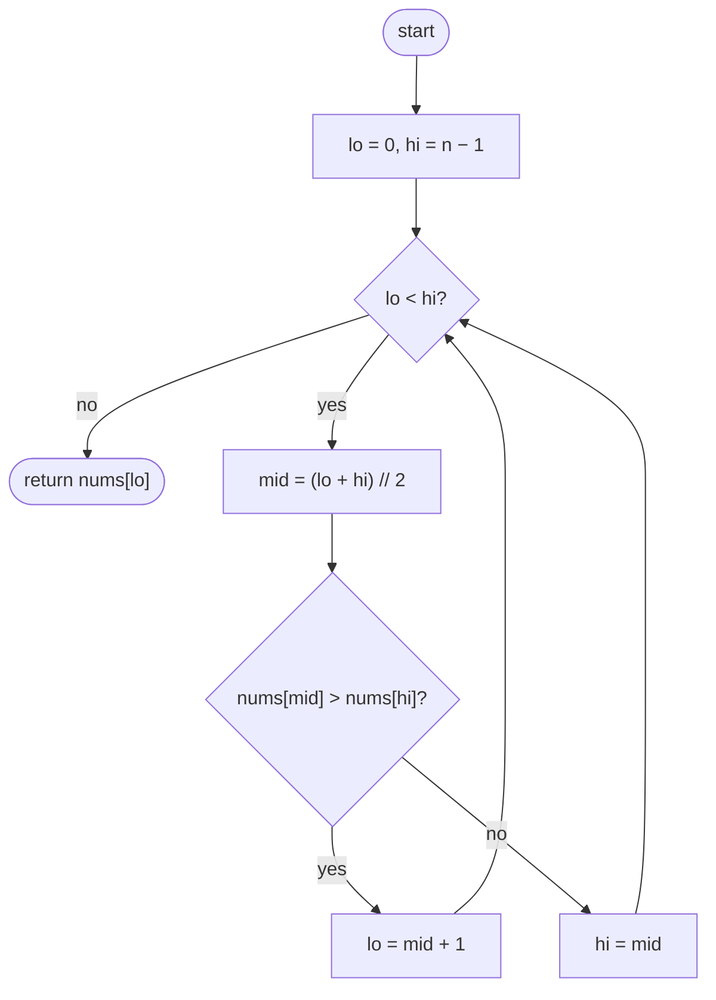

## How to think

**1. Restate the problem.** A sorted list was rotated, so it rises, drops once, then rises again: `[6, 9, 12, 2, 4]`. Find the smallest value, which sits right after the drop, in O(log n).

**2. O(log n) means binary search.** We can't search for a known value, but we can still halve the range each step if we can tell **which half contains the drop**.

**3. Compare the middle with the right end.** In a rotated sorted list:

- If `nums[mid] > nums[hi]`, the drop is to the right of `mid`, so the minimum is in `(mid, hi]`.
- Otherwise `nums[mid] .. nums[hi]` is sorted, so the minimum is at `mid` or to its left: `[lo, mid]`.



**4. Why compare with the right end and not the left?** If the list isn't rotated at all, `nums[lo] < nums[mid]` holds, yet the minimum is on the *left*. Comparing with `nums[hi]` handles the rotated and unrotated cases with the same rule.

**5. Watch the edge cases.** A single element, an unrotated list, and the minimum at the very last position (rotated by one to the left) are all covered by the same loop.

## Approach 1: Brute force — scan everything
<!-- approach: brute_force | time: O(n) | space: O(1) -->

Look at every value and keep the smallest. It's correct, simple, and fast enough for 5,000 elements, but it ignores the sorted structure, and it doesn't meet the O(log n) requirement.

**Dry run** on `[6, 9, 12, 2, 4]`: the running minimum goes 6, 6, 6, **2**, 2.

### Code
```python
class Solution:
    def findMin(self, nums: List[int]) -> int:
        smallest = nums[0]
        for value in nums:
            smallest = min(smallest, value)
        return smallest
```

### Line by line
- `3` Start with any element.
- `4-5` Compare against every element and keep the smaller.
- `6` The overall minimum.

### Flowchart


## Approach 2: Optimized — binary search on the drop
<!-- approach: optimized | time: O(log n) | space: O(1) -->

Keep a range `[lo, hi]` that always contains the minimum. Each step compares the middle with the right end and throws away the half that can't contain it.

**Dry run** on `[6, 9, 12, 2, 4]`:

| lo | hi | mid | nums[mid] vs nums[hi] | Move |
|---|---|---|---|---|
| 0 | 4 | 2 | 12 > 4 | lo = 3 |
| 3 | 4 | 3 | 2 ≤ 4 | hi = 3 |
| 3 | 3 | | lo == hi | return nums[3] = **2** |

### Code
```python
class Solution:
    def findMin(self, nums: List[int]) -> int:
        lo, hi = 0, len(nums) - 1
        while lo < hi:
            mid = (lo + hi) // 2
            if nums[mid] > nums[hi]:
                lo = mid + 1
            else:
                hi = mid
        return nums[lo]
```

### Line by line
- `3` The minimum is somewhere in the whole list.
- `4` Stop when the range is one element: that element is the minimum.
- `5` The middle, rounded down, so `mid < hi` always holds inside the loop.
- `6-7` The middle is bigger than the right end, so the drop, and the minimum, lie strictly right of `mid`.
- `8-9` Otherwise everything from `mid` to `hi` is increasing, so the minimum is `mid` itself or something to its left. Keep `mid`, since it might be the answer.
- `10` The range has shrunk to the minimum.

### Flowchart

