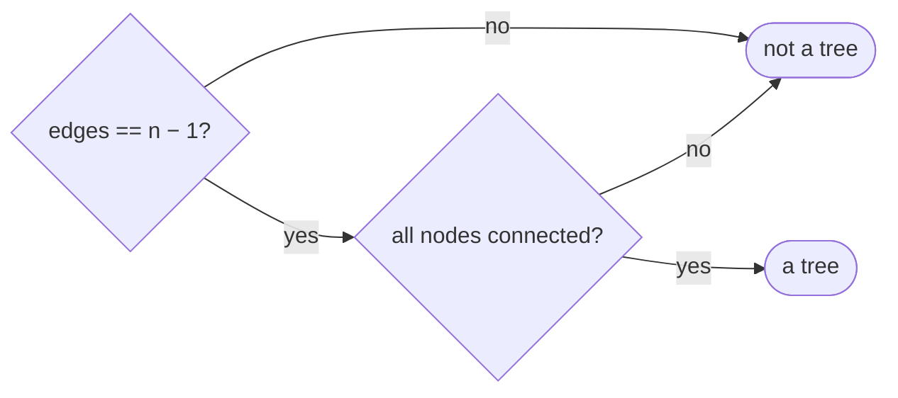
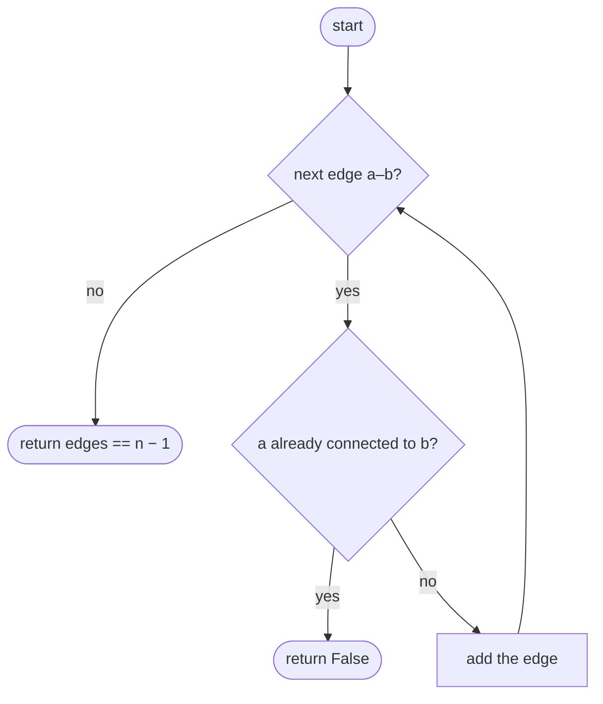
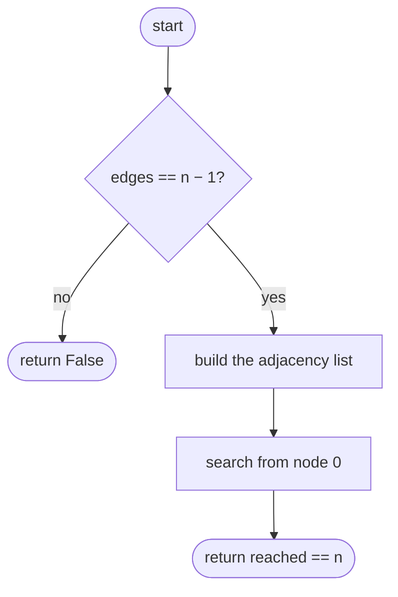

## How to think

**1. Restate the problem.** Do the edges connect all `n` nodes without forming any cycle?

**2. Count the edges first.** A tree on `n` nodes has **exactly `n − 1` edges**. Fewer, and it can't be connected; more, and it must contain a cycle. That one check rules out most inputs immediately.

**3. With exactly `n − 1` edges, one more check is enough.** Connected with `n − 1` edges ⇔ no cycle ⇔ tree. So check *either* "connected" *or* "no cycle", not both.



**4. Detecting a cycle edge by edge.** Adding edge `a–b` creates a cycle exactly when `a` and `b` are **already connected**. Asking that with a fresh search for every edge is slow; union-find answers it in near-constant time. With the edge-count trick, a single connectivity search is simpler still.

**5. Watch the edge cases.** One node with no edges is a tree. Two separate pieces can have the right number of edges only if one piece contains a cycle, and the connectivity check catches that.

## Approach 1: Brute force — check each edge for an existing path
<!-- approach: brute_force | time: O(E × (V + E)) | space: O(V + E) -->

Add edges one at a time. Before adding `a–b`, search the graph built so far: if `b` is already reachable from `a`, this edge would close a cycle. At the end, the edge count confirms connectivity.

**Dry run** on `n = 4`, edges `[[0, 1], [1, 2], [2, 0]]`:

| Edge | Already connected? | Action |
|---|---|---|
| 0–1 | no | add |
| 1–2 | no | add |
| 2–0 | yes (2 → 1 → 0) | **cycle → false** |

### Code
```python
class Solution:
    def validTree(self, n: int, edges: List[List[int]]) -> bool:
        graph = defaultdict(list)

        def connected(a, b):
            seen, stack = {a}, [a]
            while stack:
                node = stack.pop()
                if node == b:
                    return True
                for nxt in graph[node]:
                    if nxt not in seen:
                        seen.add(nxt)
                        stack.append(nxt)
            return False

        for a, b in edges:
            if connected(a, b):
                return False
            graph[a].append(b)
            graph[b].append(a)
        return len(edges) == n - 1
```

### Line by line
- `3` The graph built so far, as an adjacency list.
- `5-14` `connected` searches from `a` and reports whether `b` is reachable.
- `16-17` If the endpoints are already joined, this edge would close a cycle.
- `18-19` Otherwise add the edge in both directions.
- `20` No cycles, so the graph is a forest; with exactly `n − 1` edges a forest is a single tree.

### Flowchart


## Approach 2: Optimized — edge count plus one connectivity search
<!-- approach: optimized | time: O(V + E) | space: O(V + E) -->

If the edge count isn't `n − 1`, answer false. Otherwise search once from node 0 and check that every node was reached.

**Dry run** on `n = 5`, edges `[[0, 1], [0, 2], [0, 3], [1, 4]]`:

| Step | Result |
|---|---|
| edge count | 4 = 5 − 1 ✓ |
| search from 0 | reaches 0, 1, 2, 3, 4 |
| all 5 reached | **true** |

### Code
```python
class Solution:
    def validTree(self, n: int, edges: List[List[int]]) -> bool:
        if len(edges) != n - 1:
            return False
        graph = defaultdict(list)
        for a, b in edges:
            graph[a].append(b)
            graph[b].append(a)
        seen, stack = {0}, [0]
        while stack:
            node = stack.pop()
            for nxt in graph[node]:
                if nxt not in seen:
                    seen.add(nxt)
                    stack.append(nxt)
        return len(seen) == n
```

### Line by line
- `3-4` A tree on `n` nodes always has exactly `n − 1` edges.
- `5-8` Build an undirected adjacency list.
- `9-14` One depth-first search from node 0, marking every reachable node.
- `15` With `n − 1` edges, reaching every node means connected and therefore acyclic: a tree.

### Flowchart

