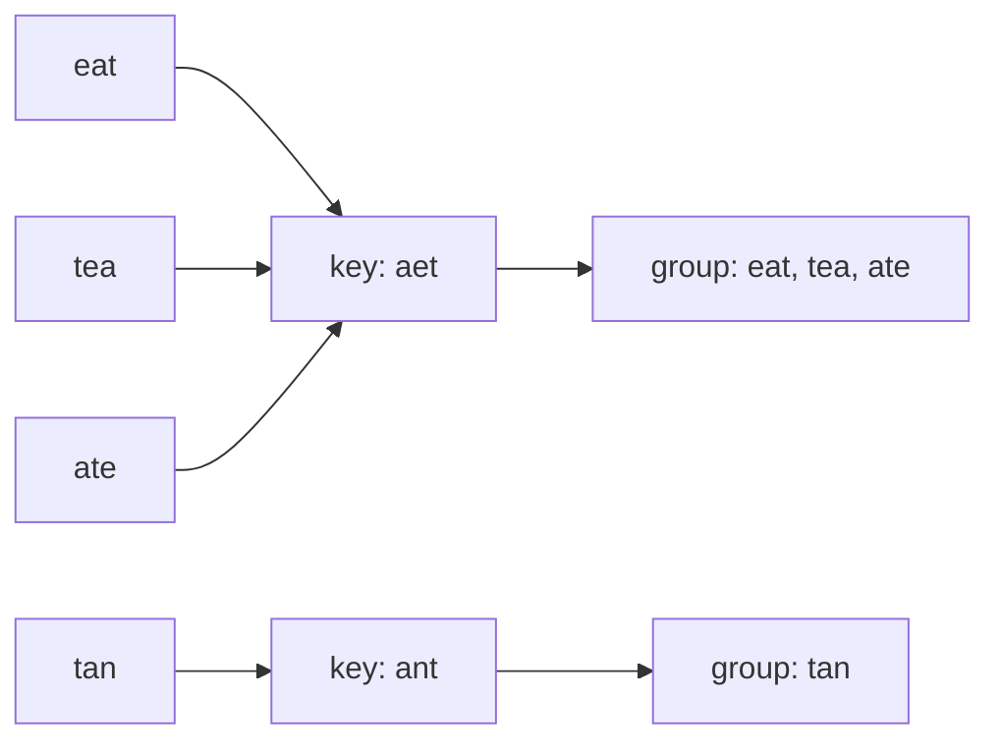
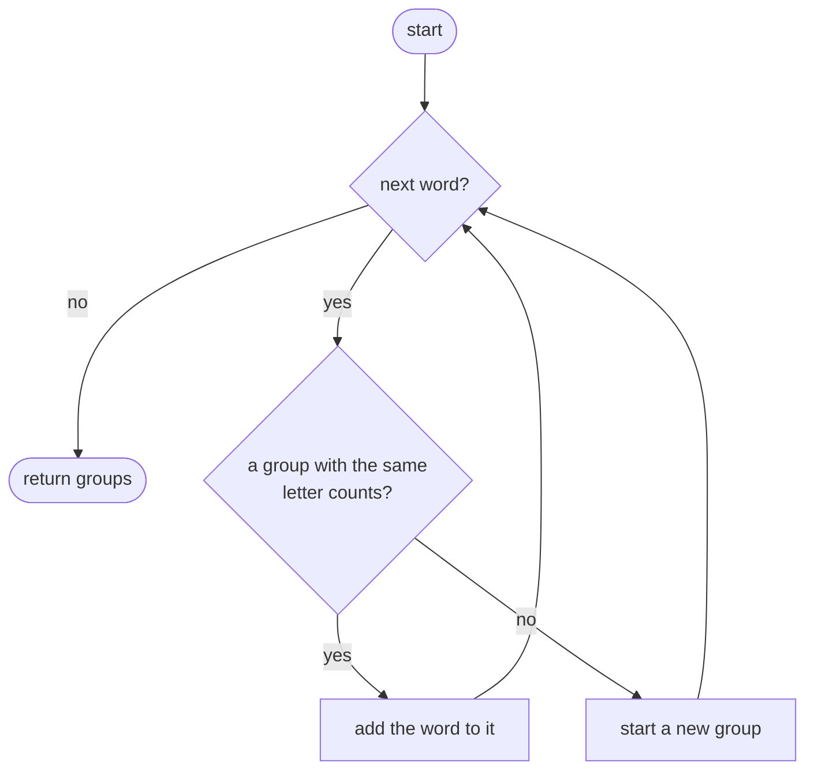
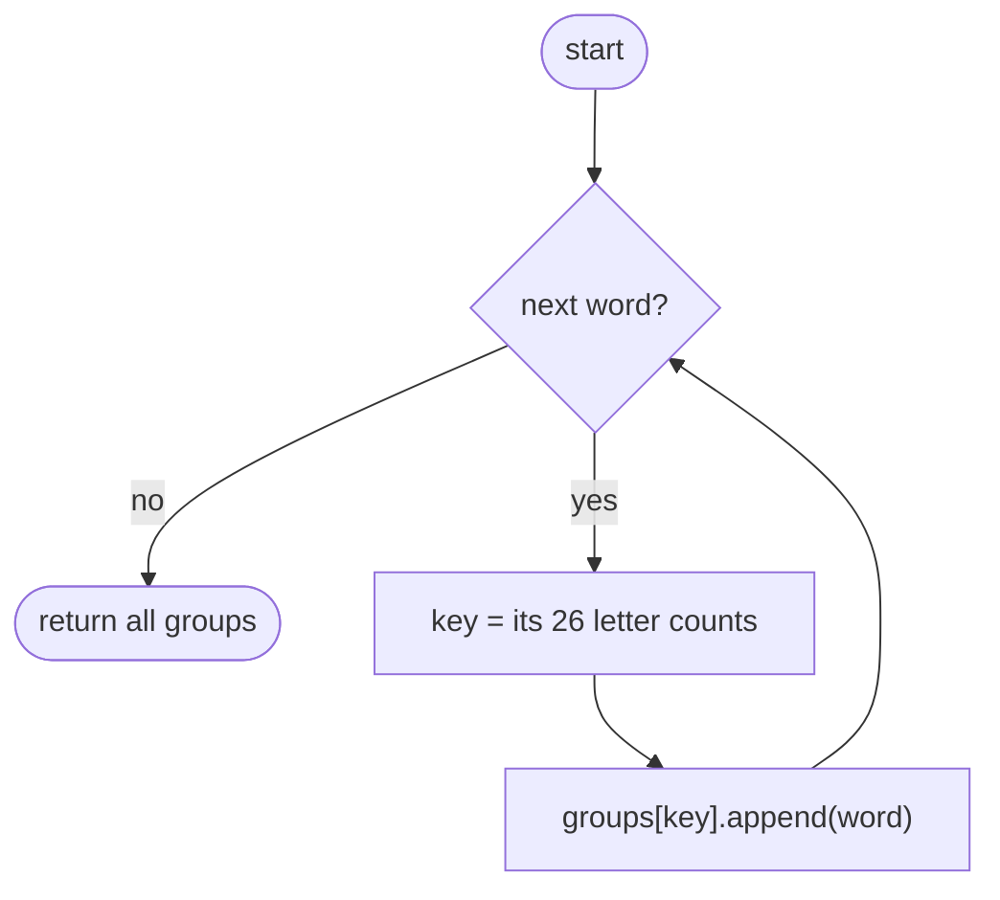

## How to think

**1. Restate the problem.** Put words into groups so that two words share a group exactly when they're anagrams.

**2. Comparing pairs is slow.** Checking each word against every group's representative is O(n × groups × L): fine for a handful of words, too slow for 10⁴.

**3. Give every word a key that all its anagrams share.** If anagrams produce the **same key** and non-anagrams produce different keys, a hash map from key to group does the grouping in one pass. Two good keys:

- the word's letters **sorted**: `"eat"`, `"tea"` and `"ate"` all become `"aet"` (O(L log L) per word);
- the word's **26 letter counts** as a tuple (O(L) per word).



**4. Keys must be hashable.** Python lists can't be dictionary keys, so convert the counts to a tuple.

**5. Watch the edge cases.** The empty string is a valid word, and every empty string groups together. A single word forms a group of one.

## Approach 1: Brute force — compare each word with every group
<!-- approach: brute_force | time: O(n × g × L) | space: O(n × L) -->

For each word, check the existing groups one by one; join the first group whose first word has the same letter counts, or start a new group.

**Dry run** on `["eat", "tea", "tan", "ate"]`:

| Word | Compared with | Result |
|---|---|---|
| eat | (no groups) | new group [eat] |
| tea | eat ✓ | [eat, tea] |
| tan | eat ✗ | new group [tan] |
| ate | eat ✓ | [eat, tea, ate] |

### Code
```python
class Solution:
    def groupAnagrams(self, strs: List[str]) -> List[List[str]]:
        groups = []
        for word in strs:
            for group in groups:
                if len(group[0]) == len(word) and Counter(group[0]) == Counter(word):
                    group.append(word)
                    break
            else:
                groups.append([word])
        return groups
```

### Line by line
- `3` The groups found so far.
- `4-5` For each word, scan every existing group.
- `6-8` Same length and same letter counts as the group's first word: it belongs there.
- `9-10` No group matched (the `for … else` branch runs when there was no `break`): start a new one.
- `11` All groups.

### Flowchart


## Approach 2: Optimized — hash map keyed by letter counts
<!-- approach: optimized | time: O(n × L) | space: O(n × L) -->

Compute each word's 26-count key and append the word to that key's group in a dictionary. One pass, no comparisons between words.

**Dry run** on `["eat", "tea", "tan", "ate", "nat", "bat"]`:

| Word | Key (letters with counts) | Group afterwards |
|---|---|---|
| eat | a1 e1 t1 | [eat] |
| tea | a1 e1 t1 | [eat, tea] |
| tan | a1 n1 t1 | [tan] |
| ate | a1 e1 t1 | [eat, tea, ate] |
| nat | a1 n1 t1 | [tan, nat] |
| bat | a1 b1 t1 | [bat] |

### Code
```python
class Solution:
    def groupAnagrams(self, strs: List[str]) -> List[List[str]]:
        groups = defaultdict(list)
        for word in strs:
            key = [0] * 26
            for char in word:
                key[ord(char) - ord("a")] += 1
            groups[tuple(key)].append(word)
        return list(groups.values())
```

### Line by line
- `3` Key → list of words; a missing key starts as an empty list automatically.
- `4-7` Count the word's letters. Anagrams get identical counts.
- `8` Lists can't be dictionary keys, so use a tuple, and add the word to its group.
- `9` Every group, in any order (the judge accepts any order).

### Flowchart

