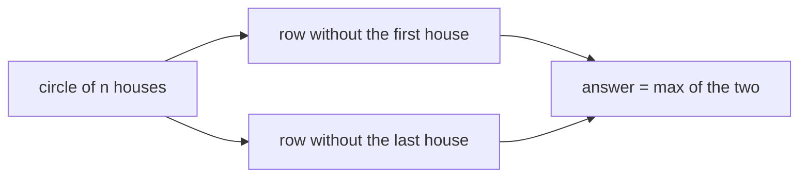
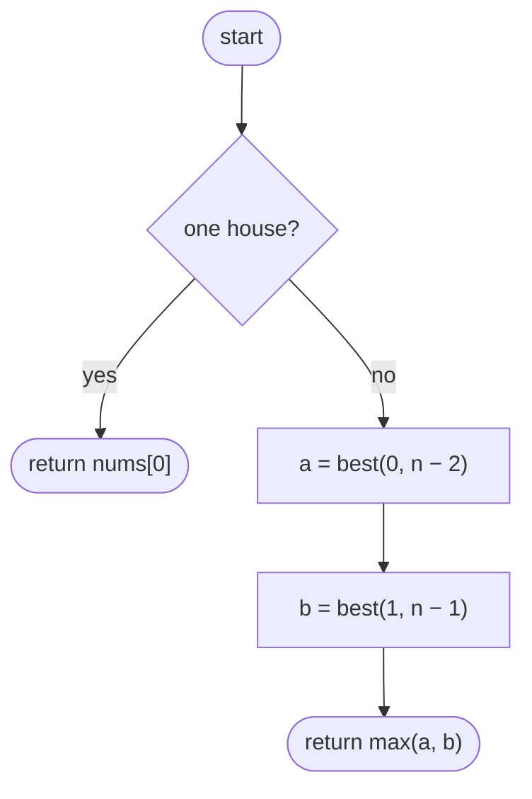
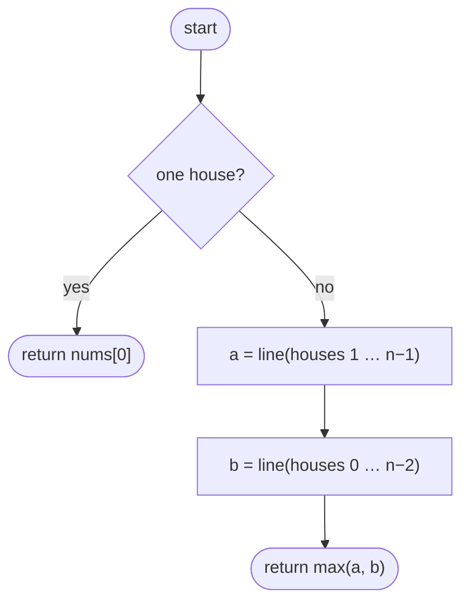

## How to think

**1. Restate the problem.** House Robber, but the houses form a circle, so the first and last houses are neighbours too.

**2. The circle only adds one rule.** You can't take both the first and the last house. Every valid choice therefore either:

- **leaves out the first house** → it's a normal row: houses `1 … n − 1`, or
- **leaves out the last house** → also a normal row: houses `0 … n − 2`.

(A choice that skips both ends fits either case.)



**3. Reuse the straight-line solution.** Run the House Robber algorithm on both rows and take the better result.

**4. Watch the edge cases.** With one house there's no neighbour, so take it; the two rows would both be empty. With two houses, take the richer one.

## Approach 1: Brute force — recursion on both rows
<!-- approach: brute_force | time: O(2ⁿ) | space: O(n) -->

Use the take-or-skip recursion from House Robber, once on each row. It's correct, but exponential.

**Dry run** on `[2, 3, 2]`:

| Row | Houses | Best |
|---|---|---|
| without the last | 2, 3 | 3 |
| without the first | 3, 2 | 3 |

Answer: **3**. Taking both 2s isn't allowed: they're neighbours around the circle.

### Code
```python
class Solution:
    def rob(self, nums: List[int]) -> int:
        n = len(nums)
        if n == 1:
            return nums[0]

        def best(i, end):
            if i > end:
                return 0
            return max(nums[i] + best(i + 2, end), best(i + 1, end))

        return max(best(0, n - 2), best(1, n - 1))
```

### Line by line
- `3-5` A single house has no neighbours.
- `7` `best(i, end)` is the most money from houses `i` to `end` in a straight row.
- `8-9` Past the end of the row, nothing is left.
- `10` Take house `i` and jump two, or skip it.
- `12` Without the last house, or without the first: one of these is optimal.

### Flowchart


## Approach 2: Optimized — straight-line DP on two rows
<!-- approach: optimized | time: O(n) | space: O(1) besides the slices -->

Run the O(n) two-total version of House Robber on houses `1 … n − 1` and on houses `0 … n − 2`.

**Dry run** on `[5, 1, 1, 5]`:

| Row | Houses | Best |
|---|---|---|
| without the first | 1, 1, 5 | 1 + 5 = 6 |
| without the last | 5, 1, 1 | 5 + 1 = 6 |

Answer: **6**. In a straight row it would be 10, but the two 5s are now neighbours.

### Code
```python
class Solution:
    def rob(self, nums: List[int]) -> int:
        def line(houses):
            take, skip = 0, 0
            for value in houses:
                take, skip = skip + value, max(take, skip)
            return max(take, skip)

        if len(nums) == 1:
            return nums[0]
        return max(line(nums[1:]), line(nums[:-1]))
```

### Line by line
- `3` `line` is the straight-row House Robber solution.
- `4-6` Best total if the current house is taken, and if it's skipped.
- `7` The better of the two after the last house.
- `9-10` A single house is its own answer; both rows would be empty.
- `11` Exclude the first house, or exclude the last one, whichever row gives more.

### Flowchart

