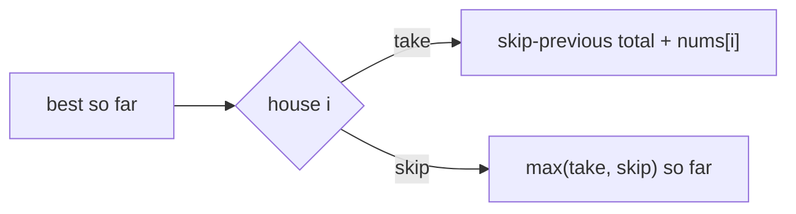
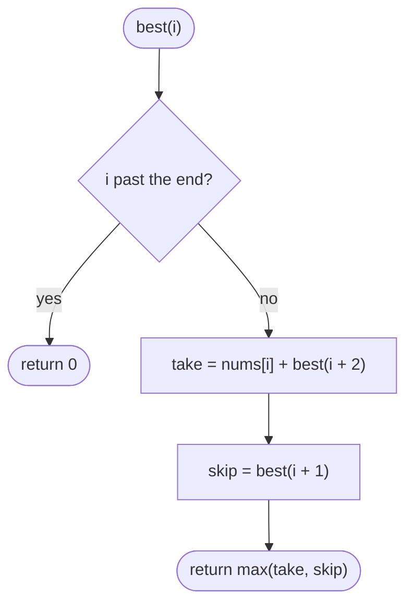
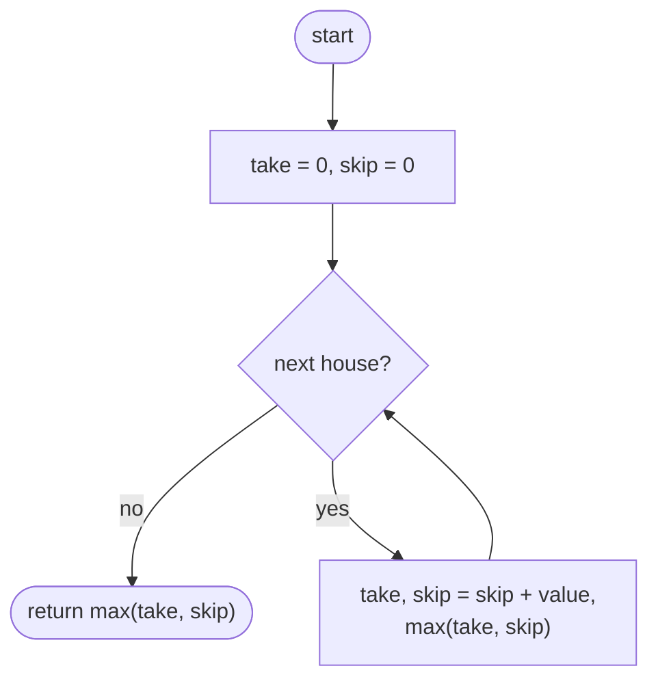

## How to think

**1. Restate the problem.** Choose houses with the largest total, never choosing two neighbours.

**2. Greedy doesn't work.** Taking every other house, or always the richest house, fails: in `[5, 1, 1, 5]` the best is the two ends (10), which neither rule finds reliably.

**3. One decision per house.** At each house there are two choices:

- **take it:** add its money to the best total that **skipped the previous house**;
- **skip it:** keep the best total so far, whether or not the previous house was taken.



**4. Only two numbers needed.** Keep `take` (best total if the current house is taken) and `skip` (best if it isn't). That's O(n) time and O(1) space.

**5. Watch the edge cases.** A single house: take it. All zeros give 0.

## Approach 1: Brute force — recursion: take or skip each house
<!-- approach: brute_force | time: O(2ⁿ) | space: O(n) -->

`best(i)` is the most you can take from houses `i` onward: either take house `i` and jump to `i + 2`, or skip to `i + 1`. Without memory, the calls double at each level.

**Dry run** on `[5, 1, 1, 5]`:

| Call | Take | Skip | Result |
|---|---|---|---|
| best(3) | 5 | 0 | 5 |
| best(2) | 1 + best(4) = 1 | best(3) = 5 | 5 |
| best(1) | 1 + best(3) = 6 | best(2) = 5 | 6 |
| best(0) | 5 + best(2) = 10 | best(1) = 6 | **10** |

### Code
```python
class Solution:
    def rob(self, nums: List[int]) -> int:
        def best(i):
            if i >= len(nums):
                return 0
            return max(nums[i] + best(i + 2), best(i + 1))

        return best(0)
```

### Line by line
- `3` `best(i)` is the most money from houses `i` to the end.
- `4-5` Past the last house there's nothing to take.
- `6` Take house `i` (and skip its neighbour), or skip it. The same `best` values are recomputed many times.
- `8` Start at the first house.

### Flowchart


## Approach 2: Optimized — two running totals
<!-- approach: optimized | time: O(n) | space: O(1) -->

Walk the houses once, updating the best total if this house is taken and the best if it's skipped.

**Dry run** on `[3, 10, 4, 6, 2]`:

| House | take (skip + value) | skip (max of both before) |
|---|---|---|
| 3 | 3 | 0 |
| 10 | 0 + 10 = 10 | 3 |
| 4 | 3 + 4 = 7 | 10 |
| 6 | 10 + 6 = 16 | 10 |
| 2 | 10 + 2 = 12 | 16 |

Answer: max(12, 16) = **16** (10 + 6).

### Code
```python
class Solution:
    def rob(self, nums: List[int]) -> int:
        take, skip = 0, 0
        for value in nums:
            take, skip = skip + value, max(take, skip)
        return max(take, skip)
```

### Line by line
- `3` Before any house, both totals are 0.
- `4` One decision per house.
- `5` Taking this house requires that the previous one was skipped. Skipping it keeps the better of the two previous totals. Both use the *old* values, thanks to the simultaneous assignment.
- `6` The last house may or may not be taken.

### Flowchart

