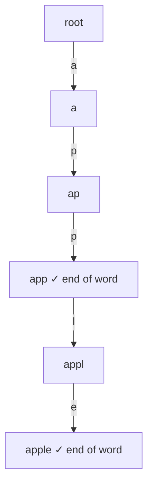
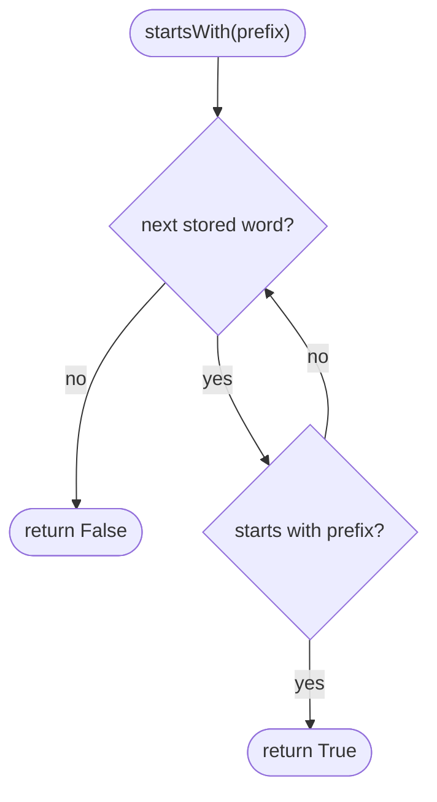
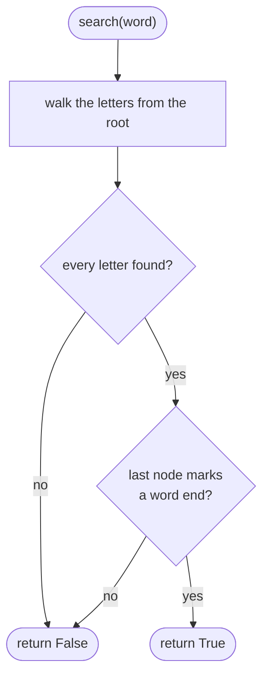

## How to think

**1. Restate the problem.** Store words so you can ask two things quickly: "was this exact word added?" and "does any added word start with this prefix?"

**2. A set handles exact words, but not prefixes.** Checking a prefix against a set means scanning every stored word.

**3. Share prefixes in a tree.** A **trie** stores words letter by letter: each node maps a letter to a child node, and words with a common beginning share the same path. A flag marks the nodes where a complete word ends.



Both questions become "walk down the letters". **search** needs the walk to succeed *and* end on a word-end flag; **startsWith** only needs the walk to succeed.

**4. Cost.** Each operation takes O(length of the word), however many words are stored.

**5. Watch the edge cases.** A word that's a prefix of another (`app` and `apple`) needs its own end flag. A word is a prefix of itself.

## Approach 1: Brute force — a set of words, scanned for prefixes
<!-- approach: brute_force | time: O(L) insert/search, O(total chars) startsWith | space: O(total characters) -->

Keep the words in a set. Exact search is fast, but `startsWith` has to check every word.

**Dry run** on insert `apple`, search `apple`, search `app`, startsWith `app`:

| Operation | Words | Result |
|---|---|---|
| insert apple | {apple} | |
| search apple | | true |
| search app | | false |
| startsWith app | scan: apple starts with app | true |

### Code
```python
class Trie:
    def __init__(self):
        self.words = set()

    def insert(self, word: str) -> None:
        self.words.add(word)

    def search(self, word: str) -> bool:
        return word in self.words

    def startsWith(self, prefix: str) -> bool:
        return any(word.startswith(prefix) for word in self.words)
```

### Line by line
- `3` Every inserted word.
- `5-6` Insert: add to the set.
- `8-9` Exact match: a set lookup.
- `11-12` Prefix: scan every stored word. This is the slow part.

### Flowchart


## Approach 2: Optimized — a trie of nested dictionaries
<!-- approach: optimized | time: O(L) per operation | space: O(total characters) -->

Each node is a dictionary from letter to child node, and the key `$` marks the end of a word. Insert creates missing nodes along the path; search and startsWith just walk it.

**Dry run** on insert `apple`, insert `app`, search `app`:

| Operation | Effect |
|---|---|
| insert apple | creates a → p → p → l → e, marks e with $ |
| insert app | the path a → p → p already exists; marks the second p with $ |
| search app | walk a, p, p: the node has $ → **true** |

### Code
```python
class Trie:
    def __init__(self):
        self.root = {}

    def insert(self, word: str) -> None:
        node = self.root
        for char in word:
            node = node.setdefault(char, {})
        node["$"] = True

    def search(self, word: str) -> bool:
        node = self._walk(word)
        return node is not None and "$" in node

    def startsWith(self, prefix: str) -> bool:
        return self._walk(prefix) is not None

    def _walk(self, text):
        node = self.root
        for char in text:
            if char not in node:
                return None
            node = node[char]
        return node
```

### Line by line
- `3` The root node: an empty dictionary.
- `5-8` Follow the word's letters, creating any missing child (`setdefault`).
- `9` Mark where a complete word ends. `$` can't clash with a lowercase letter.
- `11-13` The walk must succeed **and** stop at a word end.
- `15-16` For a prefix, a successful walk is enough.
- `18-24` `_walk` follows letters from the root; it returns `None` as soon as a letter is missing.

### Flowchart

