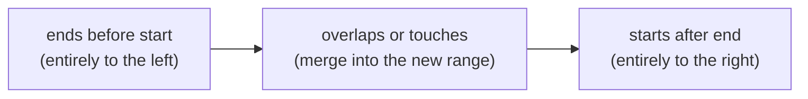
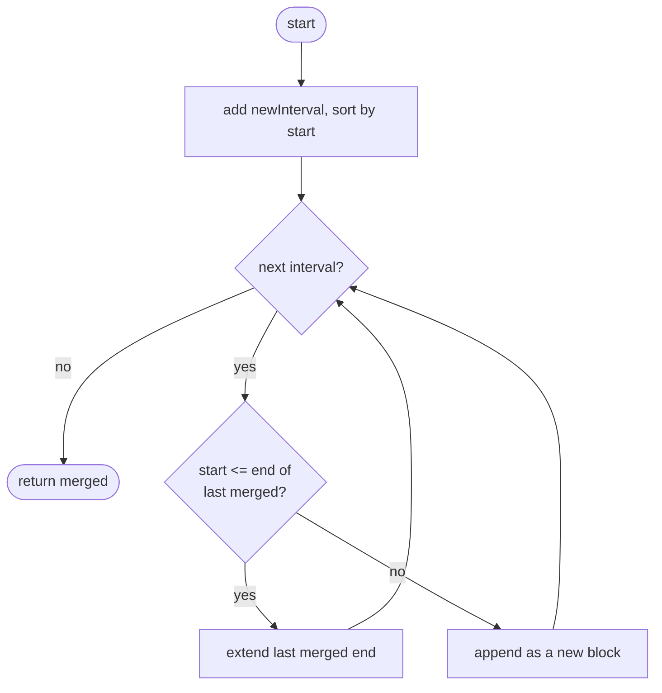
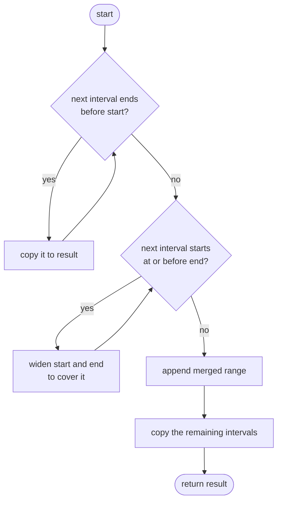

## How to think

**1. Restate the problem.** You have sorted, non-overlapping ranges and one new range. Add it, merging with anything it overlaps or touches, and keep the list sorted and non-overlapping.

**2. Use the fact that the input is already sorted.** Relative to the new range `[start, end]`, every existing interval falls into exactly one of three groups, and they appear in this order:



For example, inserting `[3, 6]` into `[[1,2], [5,7], [9,10]]`: `[1,2]` is left of it, `[5,7]` overlaps, `[9,10]` is to the right.

**3. One pass, three phases.** Copy the left group as it is. Fold every overlapping interval into the new range by widening it to the smallest start and the largest end. Append the merged range, then copy the right group. No sorting is needed, so it's O(n).

**4. Be precise about "touching".** In this problem `[1, 2]` and `[2, 3]` share the point 2, so they merge. That's why an interval is "to the left" only when its end is strictly less than the new start (`end < start`).

**5. Watch the edge cases.**

- An empty list: the answer is just the new range.
- The new range before everything, after everything, inside one interval, or covering all of them.

## Approach 1: Brute force — add it, sort, then merge
<!-- approach: brute_force | time: O(n log n) | space: O(n) -->

Ignore the existing order: put the new range in with the others, sort by start, and sweep left to right, merging each interval into the last result interval when they overlap. This is exactly **Merge Intervals**, so it's simple and clearly correct. But it pays O(n log n) for a sort the input already did for us.

**Dry run** inserting `[3, 6]` into `[[1,2], [5,7], [9,10]]`:

| Sorted interval | Overlaps the last merged? | Result so far |
|---|---|---|
| [1, 2] | (first) | [1,2] |
| [3, 6] | 3 ≤ 2? no | [1,2], [3,6] |
| [5, 7] | 5 ≤ 6? yes → widen to [3,7] | [1,2], [3,7] |
| [9, 10] | 9 ≤ 7? no | [1,2], [3,7], **[9,10]** |

### Code
```python
class Solution:
    def insert(self, intervals: List[List[int]], newInterval: List[int]) -> List[List[int]]:
        merged = []
        for start, end in sorted(intervals + [newInterval]):
            if merged and start <= merged[-1][1]:
                merged[-1][1] = max(merged[-1][1], end)
            else:
                merged.append([start, end])
        return merged
```

### Line by line
- `3` The merged result, built left to right.
- `4` Add the new range and sort everything by start (lists compare by their first element first). This sort is the O(n log n) step.
- `5-6` If this interval starts at or before the end of the last merged one, they overlap or touch: extend the last one's end.
- `7-8` Otherwise there's a gap, so this interval starts a new block.
- `9` The merged, sorted list.

### Flowchart


## Approach 2: Optimized — one pass in three phases
<!-- approach: optimized | time: O(n) | space: O(n) for the output -->

Walk the sorted list once: copy intervals that end before the new range starts, absorb intervals that overlap it, then append the merged range and everything after.

**Dry run** inserting `[2, 7]` into `[[1,3], [4,5], [6,8], [9,10]]`:

| Interval | Phase | Merged range afterwards | Result |
|---|---|---|---|
| [1, 3] | 3 < 2? no → overlaps | [1, 7] | |
| [4, 5] | 4 ≤ 7 → overlaps | [1, 7] | |
| [6, 8] | 6 ≤ 7 → overlaps | [1, 8] | |
| [9, 10] | 9 ≤ 8? no → right group | | [1,8] |
| | copy the rest | | [1,8], **[9,10]** |

### Code
```python
class Solution:
    def insert(self, intervals: List[List[int]], newInterval: List[int]) -> List[List[int]]:
        result = []
        start, end = newInterval
        i, n = 0, len(intervals)
        while i < n and intervals[i][1] < start:
            result.append(intervals[i])
            i += 1
        while i < n and intervals[i][0] <= end:
            start = min(start, intervals[i][0])
            end = max(end, intervals[i][1])
            i += 1
        result.append([start, end])
        result.extend(intervals[i:])
        return result
```

### Line by line
- `3` The output list.
- `4` The range being inserted; it widens as overlapping intervals are absorbed.
- `5` `i` walks through the input once.
- `6-8` **Left group:** an interval that ends strictly before the new start can't touch it, so copy it unchanged.
- `9` **Overlap group:** an interval starting at or before the (growing) end overlaps or touches. Earlier ones were all handled above, so this is the only check needed.
- `10-12` Widen the new range to cover the interval, then move on.
- `13` The merged range goes in exactly once, in the right position.
- `14` **Right group:** everything left starts after the merged end, so copy it as it is.
- `15` Still sorted and non-overlapping.

### Flowchart

