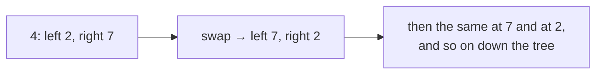
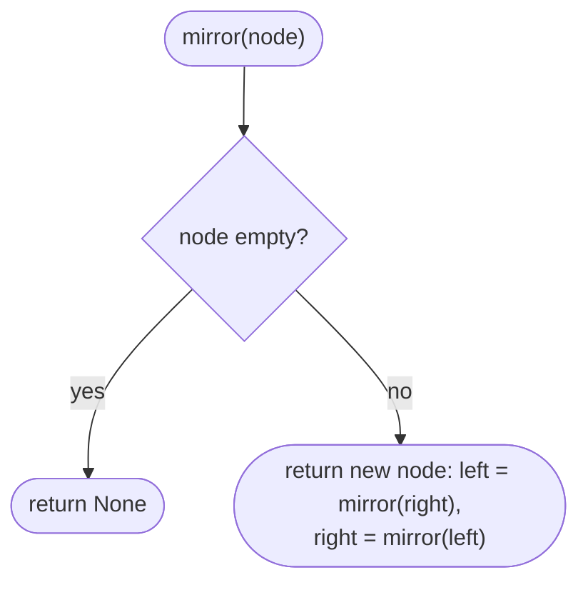
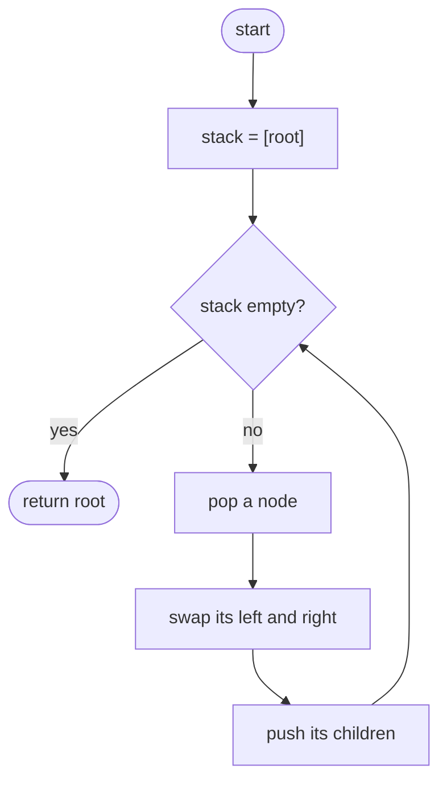

## How to think

**1. Restate the problem.** Mirror the tree left-to-right: every node's left and right children trade places.

**2. One swap per node is enough.** Mirroring the whole tree means mirroring every subtree too. If every node swaps its own two children, then every subtree ends up mirrored, so the whole tree is mirrored.



**3. Any visiting order works.** Preorder, postorder or level order: each node is swapped exactly once, and the swaps don't interfere with each other.

**4. In place or a copy?** You can build a new mirrored tree (simple, but it uses O(n) extra memory) or swap the children of the existing nodes (O(h) memory for the traversal).

**5. Watch the edge cases.** An empty tree stays empty; a single node is unchanged.

## Approach 1: Brute force — build a mirrored copy
<!-- approach: brute_force | time: O(n) | space: O(n) -->

Create a new node for every original node, with its children built from the original's children **in swapped order**. Correct and simple, but it allocates a second tree.

**Dry run** on `[2, 1]`: `mirror(2)` creates node 2 with left = `mirror(None)` = empty and right = `mirror(1)` = a new 1. Result: **[2, null, 1]**.

### Code
```python
class Solution:
    def invertTree(self, root: Optional[TreeNode]) -> Optional[TreeNode]:
        def mirror(node):
            if node is None:
                return None
            return TreeNode(node.val, mirror(node.right), mirror(node.left))

        return mirror(root)
```

### Line by line
- `3` `mirror` returns a new tree that's the mirror image of `node`'s subtree.
- `4-5` The mirror of nothing is nothing.
- `6` A new node whose left child is the mirrored *right* subtree and whose right child is the mirrored *left* subtree.
- `8` Mirror from the root.

### Flowchart


## Approach 2: Optimized — swap children in place
<!-- approach: optimized | time: O(n) | space: O(h) -->

Visit every node with an explicit stack and swap its two children. No new nodes are created.

**Dry run** on `[4, 2, 7, 1, 3, 6, 9]`:

| Node | Children before | Children after |
|---|---|---|
| 4 | 2, 7 | 7, 2 |
| 2 | 1, 3 | 3, 1 |
| 7 | 6, 9 | 9, 6 |

Result: **[4, 7, 2, 9, 6, 3, 1]**.

### Code
```python
class Solution:
    def invertTree(self, root: Optional[TreeNode]) -> Optional[TreeNode]:
        stack = [root] if root else []
        while stack:
            node = stack.pop()
            node.left, node.right = node.right, node.left
            stack.extend(child for child in (node.left, node.right) if child)
        return root
```

### Line by line
- `3` Nodes still to process; nothing for an empty tree.
- `4-5` Take any unprocessed node; the order doesn't matter.
- `6` Swap its children: one line, thanks to tuple assignment.
- `7` Queue its children to be swapped too.
- `8` The same root, now heading a mirrored tree.

### Flowchart

