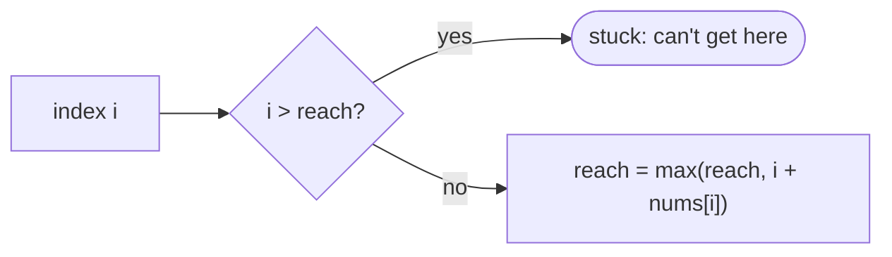
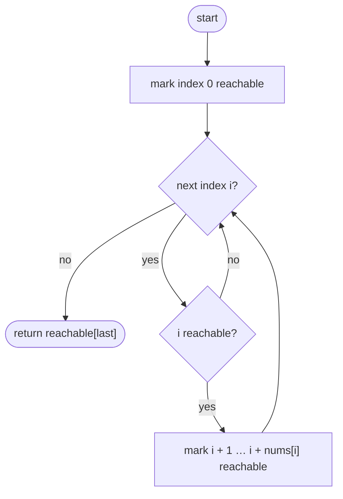
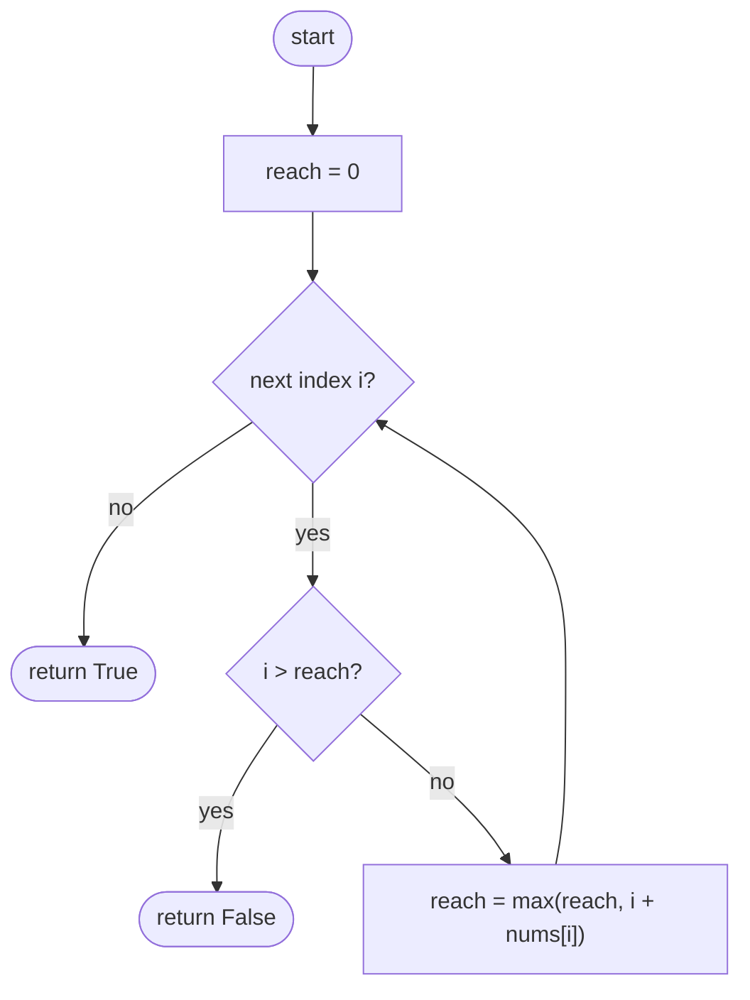

## How to think

**1. Restate the problem.** From index `i` you can jump up to `nums[i]` steps forward. Starting at index 0, can you reach the last index?

**2. What matters is how far you can get.** If you can stand on index `i`, you can also stand on every index between 0 and `i`: jumps can always be shorter. So the set of reachable indices is always a solid block starting at 0, and it's described by a single number: the **furthest reachable index**.

**3. Grow the reach as you walk.** Walk left to right. Every index you can stand on extends the reach to at least `i + nums[i]`. If you ever arrive at an index **beyond** the current reach, there's a gap you can't cross.



**4. Why this greedy is safe.** We never decide *which* jump to take; we only track the furthest point any sequence of jumps can reach. That loses no possibilities, so it's exact.

**5. Watch the edge cases.** A single element: you're already at the end. A 0 at index 0 with more elements: stuck immediately.

## Approach 1: Brute force — mark every reachable index
<!-- approach: brute_force | time: O(n × max jump) | space: O(n) -->

Mark index 0 reachable. For each reachable index, mark every index it can jump to. At the end, check the last index.

**Dry run** on `[1, 1, 0, 4]`:

| i | Reachable? | Marks |
|---|---|---|
| 0 | yes | 1 |
| 1 | yes | 2 |
| 2 | yes | none (jump 0) |
| 3 | **no** | |

Answer: **false**.

### Code
```python
class Solution:
    def canJump(self, nums: List[int]) -> bool:
        reachable = [False] * len(nums)
        reachable[0] = True
        for i in range(len(nums)):
            if not reachable[i]:
                continue
            for step in range(1, nums[i] + 1):
                if i + step < len(nums):
                    reachable[i + step] = True
        return reachable[-1]
```

### Line by line
- `3-4` Only the start is reachable at first.
- `5-7` Indices you can't stand on can't launch any jumps.
- `8-10` Mark every landing spot within jump range. Long jumps make this slow: up to `nums[i]` steps per index.
- `11` Whether the last index was ever marked.

### Flowchart


## Approach 2: Optimized — greedy furthest reach
<!-- approach: optimized | time: O(n) | space: O(1) -->

Track the furthest reachable index. Walk forward; if the current index is beyond it, fail. Otherwise extend it.

**Dry run** on `[2, 0, 3, 1, 0]`:

| i | nums[i] | i > reach? | reach afterwards |
|---|---|---|---|
| 0 | 2 | no (0) | 2 |
| 1 | 0 | no | 2 |
| 2 | 3 | no | 5 |
| 3 | 1 | no | 5 |
| 4 | 0 | no | 5 → **true** |

### Code
```python
class Solution:
    def canJump(self, nums: List[int]) -> bool:
        reach = 0
        for i, jump in enumerate(nums):
            if i > reach:
                return False
            reach = max(reach, i + jump)
        return True
```

### Line by line
- `3` Furthest index reachable so far; at the start that's index 0.
- `4` Visit each index in order.
- `5-6` This index lies past every reachable point: there's a gap, so the end can't be reached.
- `7` Standing here, you can reach up to `i + jump`.
- `8` The loop reached the last index without finding a gap.

### Flowchart

