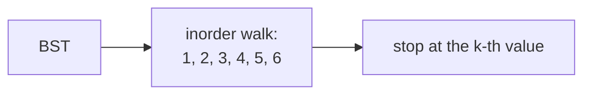
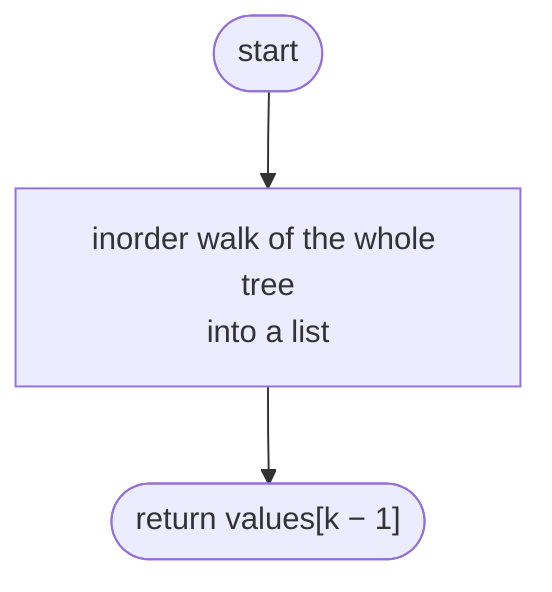
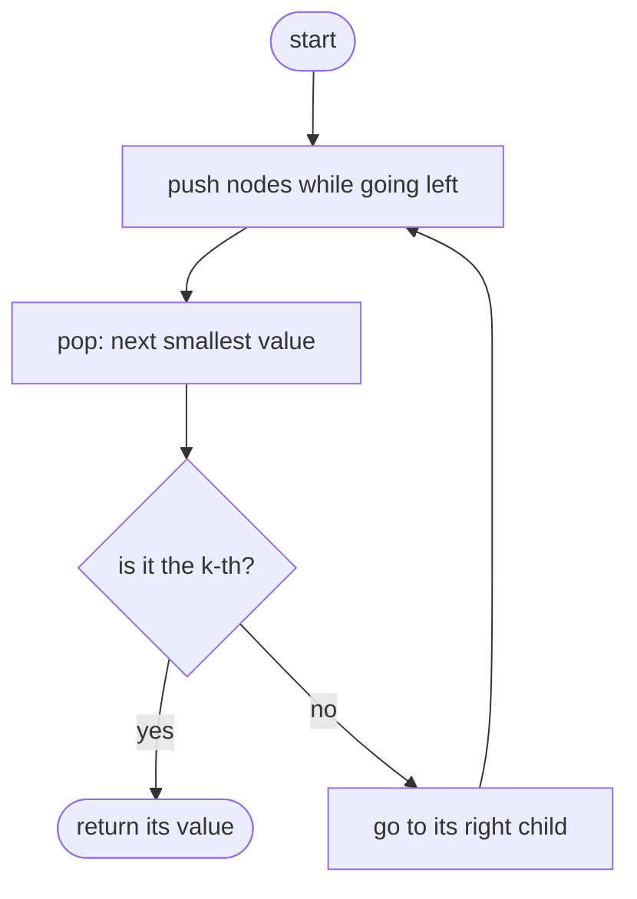

## How to think

**1. Restate the problem.** Return the k-th smallest value in a binary search tree.

**2. In a BST, inorder is sorted.** Visiting left subtree, node, right subtree lists the values in increasing order. So the k-th value visited in an inorder traversal is the answer.



**3. Stop early.** There's no need to list all n values. An iterative inorder walk with a stack lets you count as you go and return the moment you reach the k-th: O(h + k) instead of O(n).

**4. The iterative inorder pattern.** Go left as far as possible, pushing nodes on the way down. Pop one: that's the next value in sorted order. Then continue from its right child.

**5. Watch the edge cases.** k = 1 (the leftmost node), k = n (the rightmost), and a tree shaped like a chain, where the stack gets as deep as the tree.

## Approach 1: Brute force — list every value in order
<!-- approach: brute_force | time: O(n) | space: O(n) -->

Do a full inorder traversal into a list, then index it. Simple, but it always visits every node and stores every value, even when k is 1.

**Dry run** on `[5, 3, 6, 2, 4, null, null, 1]`, `k = 3`: the list is `[1, 2, 3, 4, 5, 6]`, and position 3 holds **3**.

### Code
```python
class Solution:
    def kthSmallest(self, root: Optional[TreeNode], k: int) -> int:
        values = []

        def inorder(node):
            if node:
                inorder(node.left)
                values.append(node.val)
                inorder(node.right)

        inorder(root)
        return values[k - 1]
```

### Line by line
- `3` Every value, in sorted order.
- `5-9` Left subtree, then the node, then the right subtree: in a BST this appends values smallest first.
- `11-12` Walk the whole tree, then take the k-th (k is 1-based).

### Flowchart


## Approach 2: Optimized — iterative inorder, stop at k
<!-- approach: optimized | time: O(h + k) | space: O(h) -->

Walk inorder with an explicit stack, counting nodes as they're popped, and return as soon as the count reaches k.

**Dry run** on `[5, 3, 6, 2, 4, null, null, 1]`, `k = 3`:

| Action | Stack | Popped (in order) | k left |
|---|---|---|---|
| go left from 5 | 5, 3, 2, 1 | | 3 |
| pop | 5, 3, 2 | 1 | 2 |
| pop | 5, 3 | 2 | 1 |
| pop | 5 | **3** | 0 → return 3 |

### Code
```python
class Solution:
    def kthSmallest(self, root: Optional[TreeNode], k: int) -> int:
        stack, node = [], root
        while True:
            while node:
                stack.append(node)
                node = node.left
            node = stack.pop()
            k -= 1
            if k == 0:
                return node.val
            node = node.right
```

### Line by line
- `3` Ancestors waiting to be visited, and the current position.
- `4` Valid input guarantees we reach the k-th node.
- `5-7` Slide down to the smallest node not yet visited, saving the path.
- `8` The next value in sorted order.
- `9-11` Count it; return when it's the k-th.
- `12` Values larger than this node and smaller than its ancestors are in its right subtree.

### Flowchart

