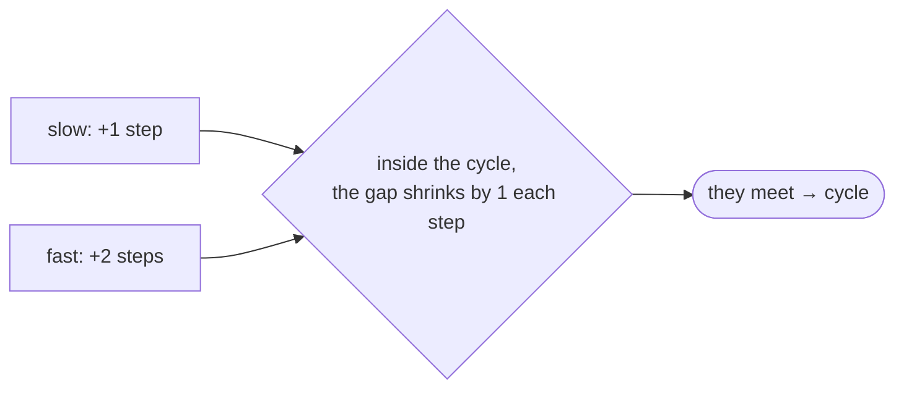
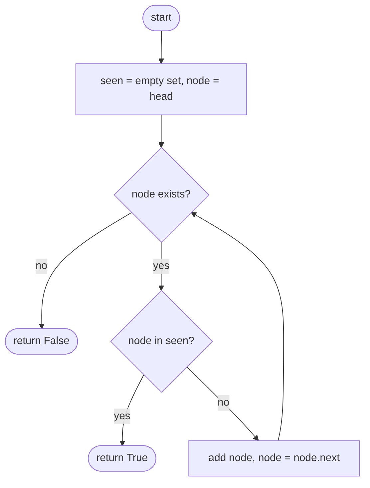
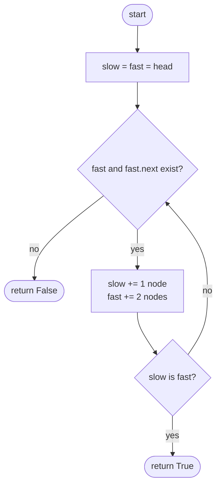

## How to think

**1. Restate the problem.** Walking a list normally ends at `None`. In a list with a cycle, the walk loops forever. Detect which case you're in.

**2. You can't just walk until the end,** because with a cycle there is no end. You need a way to notice that you're going round in circles.

**3. Two ideas.**

- **Remember every node you've visited.** Meeting one again means a cycle. Simple, but it needs O(n) memory.
- **Two runners on a circular track.** Move `slow` one step and `fast` two steps at a time. Without a cycle, `fast` reaches the end. With a cycle, both end up inside it, and `fast` gains one node per step on `slow`, so it must eventually land exactly on it.



This is **Floyd's cycle detection**, and it needs O(1) memory.

**4. Compare nodes, not values.** Two different nodes can hold the same value. Check whether they're the *same node* (`is` in Python).

**5. Watch the edge cases.** An empty list, a single node with no cycle, and a node pointing to itself.

## Approach 1: Brute force — remember visited nodes
<!-- approach: brute_force | time: O(n) | space: O(n) -->

Walk the list, adding each node to a set. Reaching a node that's already in the set means the walk came back around.

**Dry run** on `3 → 8 → 1 → 6 → (back to 8)`:

| Step | Node | Seen before? | Set afterwards |
|---|---|---|---|
| 1 | 3 | no | {3} |
| 2 | 8 | no | {3, 8} |
| 3 | 1 | no | {3, 8, 1} |
| 4 | 6 | no | {3, 8, 1, 6} |
| 5 | 8 | **yes → true** | |

(The set holds the node objects; values are shown for readability.)

### Code
```python
class Solution:
    def hasCycle(self, head: Optional[ListNode]) -> bool:
        seen = set()
        node = head
        while node:
            if node in seen:
                return True
            seen.add(node)
            node = node.next
        return False
```

### Line by line
- `3` Nodes visited so far. Nodes are hashed by identity, so equal values don't collide.
- `4-5` Walk from the head until the list ends.
- `6-7` Revisiting a node means the walk has looped.
- `8-9` Remember this node and move on.
- `10` The walk reached `None`: no cycle.

### Flowchart


## Approach 2: Optimized — Floyd's slow and fast pointers
<!-- approach: optimized | time: O(n) | space: O(1) -->

Move `slow` one node and `fast` two nodes per step. If `fast` runs off the end, there's no cycle. If they ever point at the same node, there is one.

**Dry run** on `3 → 8 → 1 → 6 → (back to 8)`:

| Step | slow | fast |
|---|---|---|
| start | 3 | 3 |
| 1 | 8 | 1 |
| 2 | 1 | 8 (6 → 8) |
| 3 | 6 | 6 (1 → 6) → **same node: true** |

### Code
```python
class Solution:
    def hasCycle(self, head: Optional[ListNode]) -> bool:
        slow = fast = head
        while fast and fast.next:
            slow = slow.next
            fast = fast.next.next
            if slow is fast:
                return True
        return False
```

### Line by line
- `3` Both runners start at the head.
- `4` `fast` needs two more nodes to take a double step; if either is missing, the list has an end.
- `5-6` One step for `slow`, two for `fast`.
- `7-8` Same node (not just the same value): `fast` has lapped `slow` inside a cycle.
- `9` `fast` reached the end of the list.

### Flowchart

