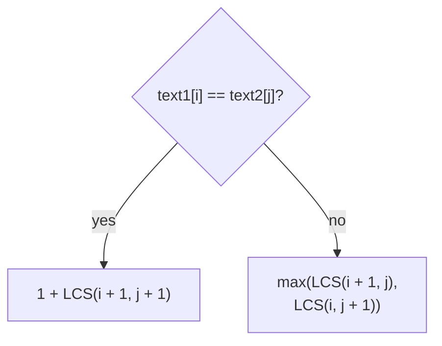
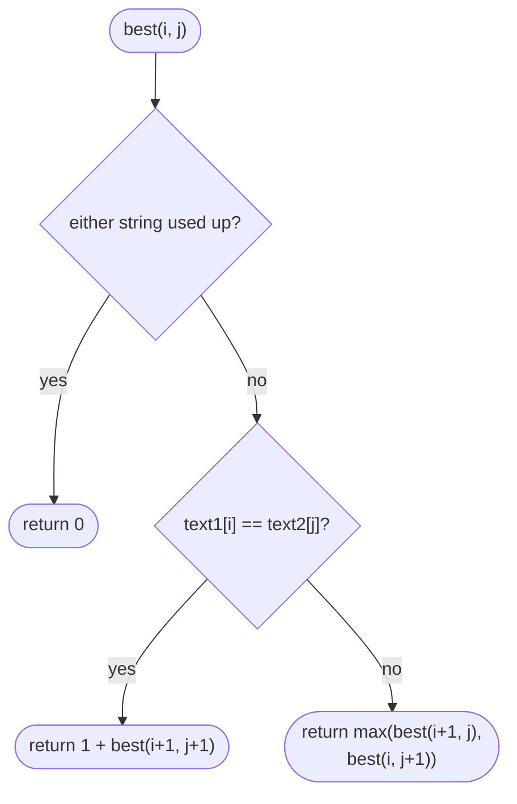
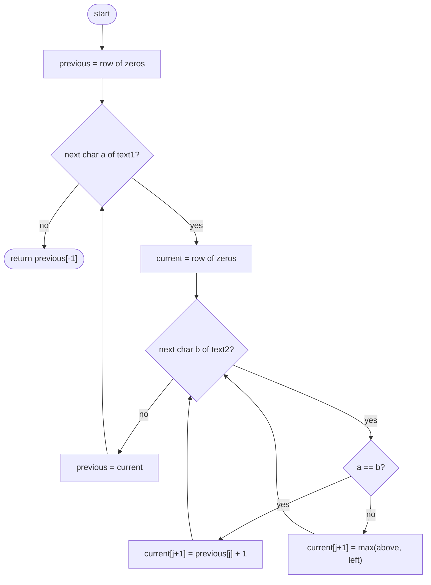

## How to think

**1. Restate the problem.** Find the longest sequence of characters that appears in order, gaps allowed, in both strings. For `"pancake"` and `"planet"`, that's `"pane"`: 4.

**2. Look at the first characters.** Compare `text1[i]` and `text2[j]`:

- **They match:** use them both. The answer is 1 + the answer for the rest of both strings.
- **They differ:** at least one of them isn't in the common subsequence. Try dropping each and keep the better result.



**3. Overlapping subproblems.** The state is just the pair `(i, j)`, so there are only (n + 1) × (m + 1) different subproblems. Plain recursion revisits them exponentially often. A table solves each one once: O(n × m).

**4. Keep only one row.** Each cell needs only the row above and the cell to its left, so two rows (or one) of memory are enough.

**5. Watch the edge cases.** An empty suffix has LCS 0. Strings with nothing in common give 0.

## Approach 1: Brute force — recursion that tries both options
<!-- approach: brute_force | time: O(2^(n + m)) | space: O(n + m) -->

Translate the rule directly into recursion without remembering answers. It's correct but explodes: the same `(i, j)` pairs are recomputed again and again.

**Dry run** on `"abc"` and `"ac"` (a few calls):

| Call | Characters | Result |
|---|---|---|
| best(0, 0) | a = a | 1 + best(1, 1) |
| best(1, 1) | b ≠ c | max(best(2, 1), best(1, 2)) |
| best(2, 1) | c = c | 1 + best(3, 2) = 1 |
| best(1, 2) | end of text2 | 0 |

So best(1, 1) = 1 and best(0, 0) = **2** ("ac").

### Code
```python
class Solution:
    def longestCommonSubsequence(self, text1: str, text2: str) -> int:
        def best(i, j):
            if i == len(text1) or j == len(text2):
                return 0
            if text1[i] == text2[j]:
                return 1 + best(i + 1, j + 1)
            return max(best(i + 1, j), best(i, j + 1))

        return best(0, 0)
```

### Line by line
- `3` `best(i, j)` is the LCS of `text1[i:]` and `text2[j:]`.
- `4-5` One string is used up: nothing more in common.
- `6-7` Matching characters can both be used.
- `8` Otherwise, skip a character from one string or the other and keep the better result. Nothing is cached, which is the exponential part.
- `10` Start from the beginnings of both strings.

### Flowchart


## Approach 2: Optimized — bottom-up table, one row at a time
<!-- approach: optimized | time: O(n × m) | space: O(m) -->

Fill a table where cell `(i, j)` is the LCS of the first `i` characters of `text1` and the first `j` of `text2`. Each row only needs the previous one.

**Dry run** for `"abcde"` (rows) and `"ace"` (columns):

| | "" | a | c | e |
|---|---|---|---|---|
| "" | 0 | 0 | 0 | 0 |
| a | 0 | **1** | 1 | 1 |
| b | 0 | 1 | 1 | 1 |
| c | 0 | 1 | **2** | 2 |
| d | 0 | 1 | 2 | 2 |
| e | 0 | 1 | 2 | **3** |

Bold cells are matches: diagonal + 1. Every other cell copies the larger of the cell above and the cell to the left.

### Code
```python
class Solution:
    def longestCommonSubsequence(self, text1: str, text2: str) -> int:
        previous = [0] * (len(text2) + 1)
        for a in text1:
            current = [0] * (len(text2) + 1)
            for j, b in enumerate(text2):
                if a == b:
                    current[j + 1] = previous[j] + 1
                else:
                    current[j + 1] = max(previous[j + 1], current[j])
            previous = current
        return previous[-1]
```

### Line by line
- `3` The row for zero characters of `text1`: every LCS is 0.
- `4-5` Build the row for one more character of `text1`. Column 0 (empty `text2` prefix) stays 0.
- `6` Each character of `text2`.
- `7-8` A match extends the LCS of both shorter prefixes: the diagonal cell + 1.
- `9-10` No match: drop the last character of one prefix or the other and keep the better (the cell above or the cell to the left).
- `11` This row becomes the previous row for the next character.
- `12` The bottom-right cell: LCS of the full strings.

### Flowchart

