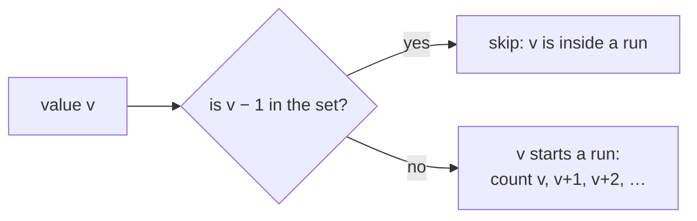
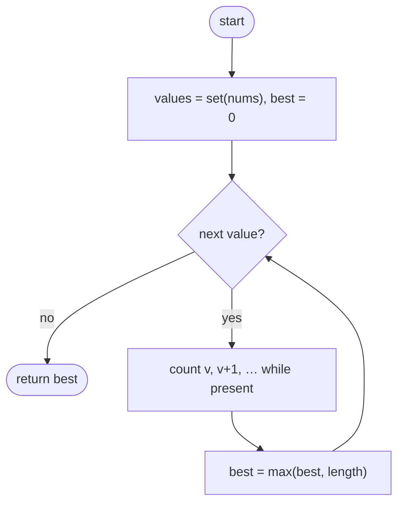
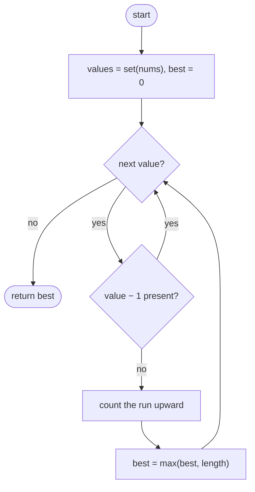

## How to think

**1. Restate the problem.** Among the values present, find the longest run of consecutive integers, like 1, 2, 3, 4. Their positions in the list don't matter.

**2. Sorting works, but isn't allowed to be the answer.** Sorting brings each run together, and one scan counts it: O(n log n). The problem asks for O(n).

**3. Use a set for O(1) lookups.** With all values in a set, "is `v + 1` present?" costs O(1). From any value you can walk upward counting the run.

**4. Only start counting at the beginning of a run.** Walking up from every value counts the same run many times: from 1, from 2, from 3… A value `v` **starts** a run exactly when `v − 1` is missing. Count only from those starts, and every value is stepped over once in total: O(n).



**5. Watch the edge cases.** An empty list gives 0. Duplicates count once, which iterating over the set handles.

## Approach 1: Brute force — count upward from every value
<!-- approach: brute_force | time: O(n²) worst case | space: O(n) -->

Put the values in a set, then from every value count how far the run continues upward. It's correct, but for one long run of n values it does about n²/2 steps.

**Dry run** on `[10, 4, 20, 1, 3, 2]`:

| Start value | Counted run | Length |
|---|---|---|
| 10 | 10 | 1 |
| 4 | 4 | 1 |
| 1 | 1 2 3 4 | **4** |
| 3 | 3 4 | 2 (repeats work) |
| 2 | 2 3 4 | 3 (repeats work) |

### Code
```python
class Solution:
    def longestConsecutive(self, nums: List[int]) -> int:
        values = set(nums)
        best = 0
        for value in nums:
            length = 1
            while value + length in values:
                length += 1
            best = max(best, length)
        return best
```

### Line by line
- `3` O(1) membership checks.
- `4` 0 handles an empty list.
- `5-8` From every value, count how far the run continues upward. Values in the middle of a run recount the rest of it.
- `9` Keep the longest.
- `10` The longest run.

### Flowchart


## Approach 2: Optimized — count only from the start of each run
<!-- approach: optimized | time: O(n) | space: O(n) -->

Same as before, but skip any value whose predecessor is present. Each run is counted once, from its smallest value.

**Dry run** on `[10, 4, 20, 1, 3, 2]`:

| Value | v − 1 present? | Action | best |
|---|---|---|---|
| 10 | no | run 10 → length 1 | 1 |
| 4 | yes (3) | skip | 1 |
| 20 | no | length 1 | 1 |
| 1 | no | run 1, 2, 3, 4 → length 4 | **4** |
| 3 | yes | skip | 4 |
| 2 | yes | skip | 4 |

### Code
```python
class Solution:
    def longestConsecutive(self, nums: List[int]) -> int:
        values = set(nums)
        best = 0
        for value in values:
            if value - 1 in values:
                continue
            length = 1
            while value + length in values:
                length += 1
            best = max(best, length)
        return best
```

### Line by line
- `3` A set: O(1) lookups and no duplicates.
- `4` 0 for an empty list.
- `5` Iterate over distinct values.
- `6-7` `value` is inside a run that starts lower; that run is counted from its start instead.
- `8-10` Count the run from its start. Across the whole loop, each value is stepped over once.
- `11` Keep the longest.
- `12` The longest run.

### Flowchart

