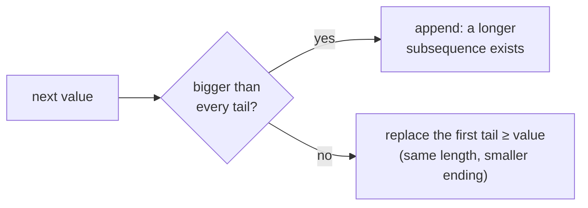
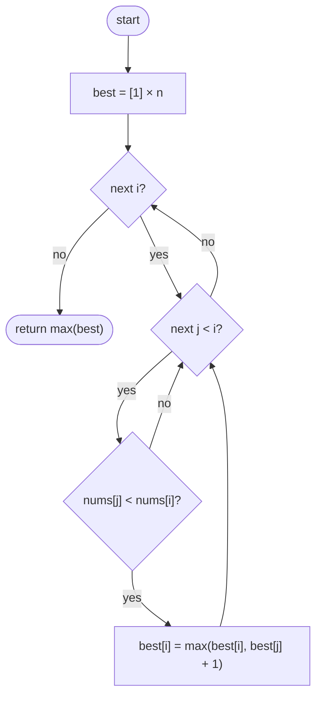
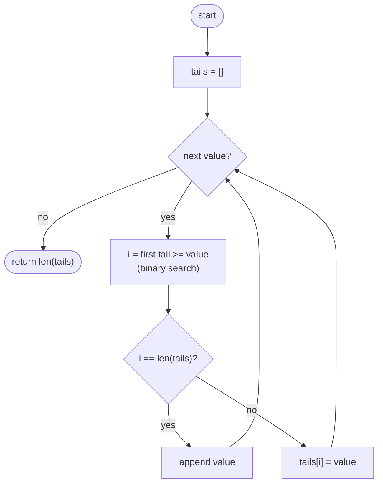

## How to think

**1. Restate the problem.** Keep some elements in their original order so they strictly increase. How many can you keep at most?

**2. Smaller question first.** "What's the longest increasing subsequence **ending at index i**?" It's 1 (just `nums[i]`), or one more than the best ending at some earlier `j` with a smaller value. That's an O(n²) DP.

**3. A faster view: keep the best possible tails.** For each length L, remember the **smallest value that can end** an increasing subsequence of length L. Smaller tails are better, because they leave more room to extend. These tails are always sorted, so each new value can find its place with **binary search**:

- larger than every tail → it extends the longest subsequence (append);
- otherwise → it replaces the first tail that's ≥ it, giving that length a smaller ending.



The number of tails is the answer. (The tails list itself isn't necessarily a real subsequence, only its length is meaningful.)

**4. Watch the edge cases.** Equal values can't both be used, so use `bisect_left`: an equal value replaces its twin instead of extending.

## Approach 1: Brute force — best length ending at each index (O(n²) DP)
<!-- approach: brute_force | time: O(n²) | space: O(n) -->

`best[i]` is the longest increasing subsequence ending exactly at `i`. Look back at every earlier smaller value and extend the best one.

**Dry run** on `[5, 2, 8, 6, 3, 6, 9, 7]`:

| i | value | Earlier smaller values and their best | best[i] |
|---|---|---|---|
| 0 | 5 | none | 1 |
| 1 | 2 | none | 1 |
| 2 | 8 | 5 (1), 2 (1) | 2 |
| 3 | 6 | 5 (1), 2 (1) | 2 |
| 4 | 3 | 2 (1) | 2 |
| 5 | 6 | 5, 2, 3 (2) | 3 |
| 6 | 9 | …, 6 (3) | **4** |
| 7 | 7 | …, 6 (3) | 4 |

### Code
```python
class Solution:
    def lengthOfLIS(self, nums: List[int]) -> int:
        best = [1] * len(nums)
        for i in range(len(nums)):
            for j in range(i):
                if nums[j] < nums[i]:
                    best[i] = max(best[i], best[j] + 1)
        return max(best)
```

### Line by line
- `3` Every element on its own is an increasing subsequence of length 1.
- `4-5` For each index, look at every earlier index.
- `6-7` A smaller earlier value can be followed by `nums[i]`, extending its subsequence by one.
- `8` The longest subsequence can end anywhere, so take the maximum.

### Flowchart


## Approach 2: Optimized — smallest tails with binary search
<!-- approach: optimized | time: O(n log n) | space: O(n) -->

Keep `tails`, where `tails[L]` is the smallest value ending an increasing subsequence of length L + 1. For each value, binary-search its position: append it, or replace the first tail that's ≥ it.

**Dry run** on `[5, 2, 8, 6, 3, 6, 9, 7]`:

| value | Position found | tails afterwards |
|---|---|---|
| 5 | end | [5] |
| 2 | 0 | [2] |
| 8 | end | [2, 8] |
| 6 | 1 | [2, 6] |
| 3 | 1 | [2, 3] |
| 6 | end | [2, 3, 6] |
| 9 | end | [2, 3, 6, 9] |
| 7 | 3 | [2, 3, 6, 7] → length **4** |

### Code
```python
class Solution:
    def lengthOfLIS(self, nums: List[int]) -> int:
        tails = []
        for value in nums:
            i = bisect.bisect_left(tails, value)
            if i == len(tails):
                tails.append(value)
            else:
                tails[i] = value
        return len(tails)
```

### Line by line
- `3` `tails[L]` is the smallest possible last value of an increasing subsequence of length L + 1. It stays sorted.
- `4` Process values in order.
- `5` Binary search for the first tail ≥ `value`. `bisect_left` means an equal value replaces rather than extends, which keeps the sequence strictly increasing.
- `6-7` Bigger than every tail: some subsequence of the current maximum length can be extended by one.
- `8-9` Otherwise, a subsequence of length `i + 1` can now end with a smaller value: keep the smaller one.
- `10` The number of tails is the longest length achieved.

### Flowchart

