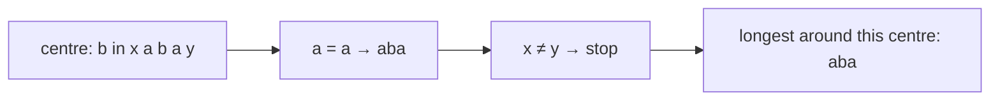
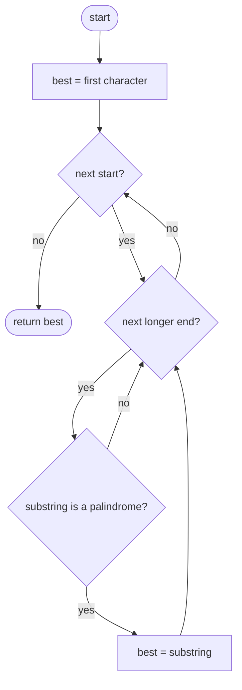
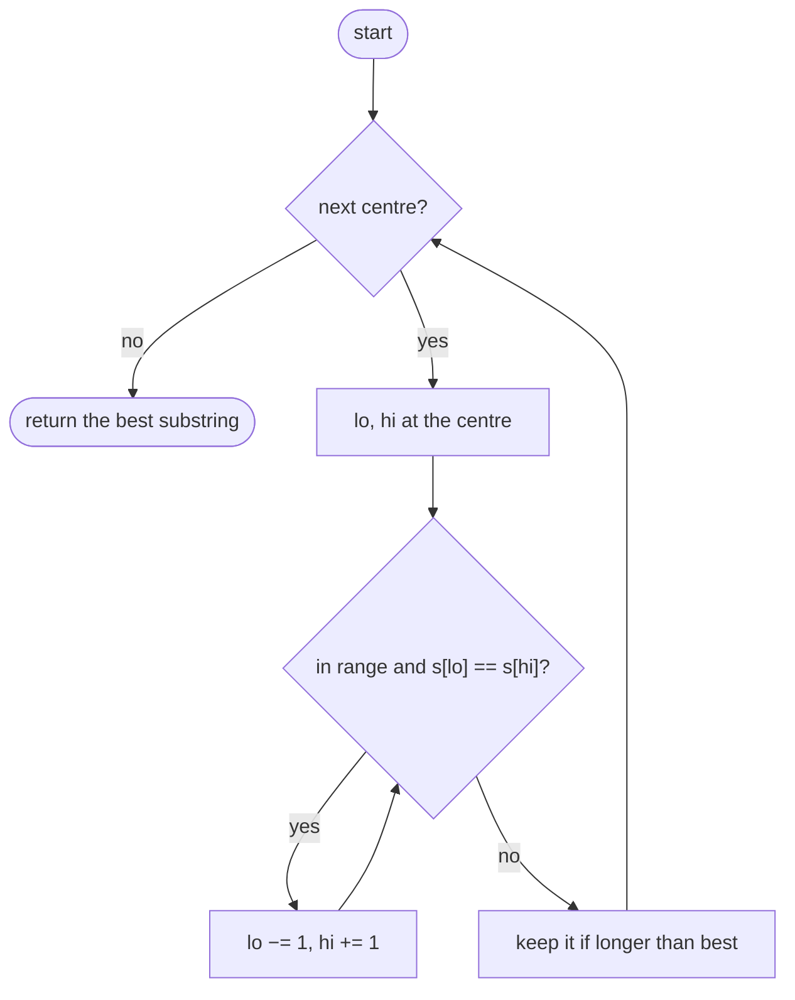

## How to think

**1. Restate the problem.** Find the longest contiguous piece of `s` that reads the same both ways; the earliest one wins ties.

**2. Checking every substring is expensive.** There are about n²/2 substrings, and checking each costs up to O(n): O(n³) in total, which is 10⁹ for n = 1000.

**3. Grow palindromes from their centre.** Every palindrome is symmetric around a centre. Pick a centre and expand outward while the two ends match: each expansion step reveals a longer palindrome. A centre is either **a character** (odd length, like `aba`) or **the gap between two characters** (even length, like `abba`), so there are 2n − 1 centres.



Each centre expands at most n/2 times: O(n²) in total, with O(1) extra space.

**4. One loop for both kinds of centre.** Number the centres `0 … 2n − 2`. Centre `c` starts with `lo = c // 2` and `hi = lo + c % 2`: equal for a character centre, neighbours for a gap.

**5. Watch the edge cases.** A single character is a palindrome of length 1. Even-length palindromes (`"bb"`) are easy to miss if you only expand around characters.

## Approach 1: Brute force — check every substring
<!-- approach: brute_force | time: O(n³) | space: O(n) -->

Try every start, and for each start every longer end. Keep a substring when it's a palindrome and strictly longer than the best so far.

**Dry run** on `"cbbd"`:

| Substring | Palindrome? | best |
|---|---|---|
| c | yes | c |
| cb, cbb, cbbd | no | c |
| bb | **yes** | bb |
| bbd, bd, … | no | bb |

### Code
```python
class Solution:
    def longestPalindrome(self, s: str) -> str:
        best = s[0]
        for start in range(len(s)):
            for end in range(start + len(best), len(s)):
                piece = s[start:end + 1]
                if piece == piece[::-1]:
                    best = piece
        return best
```

### Line by line
- `3` Any single character is a palindrome.
- `4` Each possible start.
- `5` Only lengths longer than the current best are worth checking, which also keeps the earliest start among ties.
- `6-8` Copy and reverse the substring: O(n) per check, O(n³) overall.
- `9` The longest palindrome found.

### Flowchart


## Approach 2: Optimized — expand around every centre
<!-- approach: optimized | time: O(n²) | space: O(1) -->

For each of the 2n − 1 centres, expand outward while the characters match, and keep the longest palindrome found.

**Dry run** on `"xabay"` (centres that matter):

| Centre | Expansion | Palindrome |
|---|---|---|
| a (index 1) | x ≠ b | a |
| b (index 2) | a = a, then x ≠ y | **aba** |
| gap a\|b | a ≠ b | (none) |

### Code
```python
class Solution:
    def longestPalindrome(self, s: str) -> str:
        best_lo, best_hi = 0, 0
        for center in range(2 * len(s) - 1):
            lo, hi = center // 2, center // 2 + center % 2
            while lo >= 0 and hi < len(s) and s[lo] == s[hi]:
                lo, hi = lo - 1, hi + 1
            if hi - lo - 1 > best_hi - best_lo + 1:
                best_lo, best_hi = lo + 1, hi - 1
        return s[best_lo:best_hi + 1]
```

### Line by line
- `3` The best palindrome's ends: initially just the first character.
- `4` Even centres sit on a character; odd centres sit in the gap between two.
- `5` Start both ends on the character, or on the two characters around the gap.
- `6-7` Expand while the ends match.
- `8-9` The loop stopped one step too far on each side, so the palindrome is `lo + 1 … hi − 1`, of length `hi − lo − 1`. Keep it if strictly longer (earlier centres win ties).
- `10` Slice out the best palindrome.

### Flowchart

