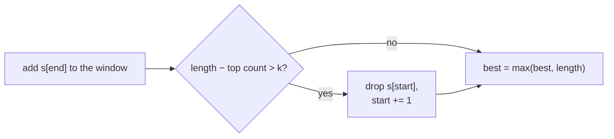
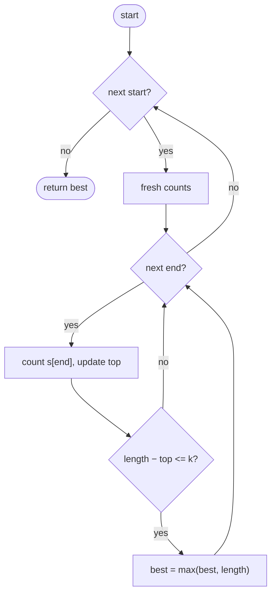
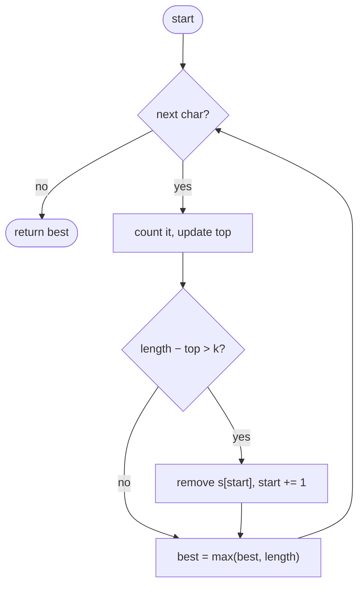

## How to think

**1. Restate the problem.** Find the longest substring that can become all one letter by changing at most `k` of its characters.

**2. What does a window need?** In any window, the cheapest fix keeps its **most frequent letter** and changes everything else. So a window works exactly when:

```
window length − count of its most common letter <= k
```

**3. Slide a window.** Grow the window to the right one character at a time. When it stops working, move its left edge forward by one. Each character enters once and leaves at most once: O(n).



**4. A subtle shortcut.** `top` (the highest letter count seen) is never decreased when the window shrinks. That's safe: the answer can only improve when some letter's count beats the old `top`, so a stale, too-high `top` never produces a wrong larger answer. It only stops the window from shrinking more than needed.

**5. Watch the edge cases.** `k = 0` means the longest run of one letter. `k >= length` means the whole string.

## Approach 1: Brute force — every start, extend while counting
<!-- approach: brute_force | time: O(n²) | space: O(26) -->

For each start, extend the end while keeping letter counts and the top count, and record every window that needs at most `k` changes.

**Dry run** on `"AABABBA"`, `k = 1` (best window per start):

| start | Longest valid window | Length |
|---|---|---|
| 0 | AABA (one B to change) | 4 |
| 1 | ABA? → ABAB needs 2 → ABA | 3 |
| 2 | BABB (one A) | 4 |
| 3 | ABBA? needs 2 → ABB | 3 |

Best: **4**.

### Code
```python
class Solution:
    def characterReplacement(self, s: str, k: int) -> int:
        best = 0
        for start in range(len(s)):
            counts = Counter()
            top = 0
            for end in range(start, len(s)):
                counts[s[end]] += 1
                top = max(top, counts[s[end]])
                if end - start + 1 - top <= k:
                    best = max(best, end - start + 1)
        return best
```

### Line by line
- `3` Longest valid window found.
- `4-6` Each start gets fresh letter counts.
- `7-9` Extend the window, tracking its most common letter's count.
- `10-11` Changing every other letter takes `length − top` changes; if that's within `k`, the window works.
- `12` The best over all windows.

### Flowchart


## Approach 2: Optimized — sliding window with the top count
<!-- approach: optimized | time: O(n) | space: O(26) -->

Grow the window by one each step; if it needs more than `k` changes, slide its start forward by one. The window never gets shorter than the best found, so its final size history gives the answer.

**Dry run** on `"AABABBA"`, `k = 1`:

| end | char | top | window | length − top | Action | best |
|---|---|---|---|---|---|---|
| 0 | A | 1 | A | 0 | | 1 |
| 1 | A | 2 | AA | 0 | | 2 |
| 2 | B | 2 | AAB | 1 | | 3 |
| 3 | A | 3 | AABA | 1 | | **4** |
| 4 | B | 3 | AABAB | 2 > 1 | slide: ABAB | 4 |
| 5 | B | 3 | ABABB | 2 > 1 | slide: BABB | 4 |
| 6 | A | 3 | BABBA | 2 > 1 | slide: ABBA | 4 |

### Code
```python
class Solution:
    def characterReplacement(self, s: str, k: int) -> int:
        counts = Counter()
        start = top = best = 0
        for end, char in enumerate(s):
            counts[char] += 1
            top = max(top, counts[char])
            if end - start + 1 - top > k:
                counts[s[start]] -= 1
                start += 1
            best = max(best, end - start + 1)
        return best
```

### Line by line
- `3` Letter counts inside the current window.
- `4` Window start, highest letter count seen, best length.
- `5-7` Add the new character and update the top count.
- `8-10` Too many changes needed: slide the start forward one step. The length stays the same, so the window never shrinks below the best so far.
- `11` Record the window's length.
- `12` The longest valid window.

### Flowchart

