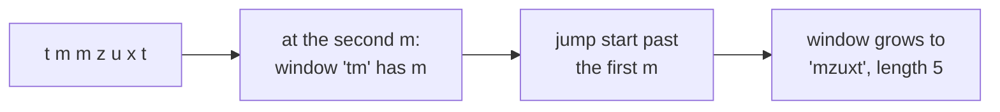
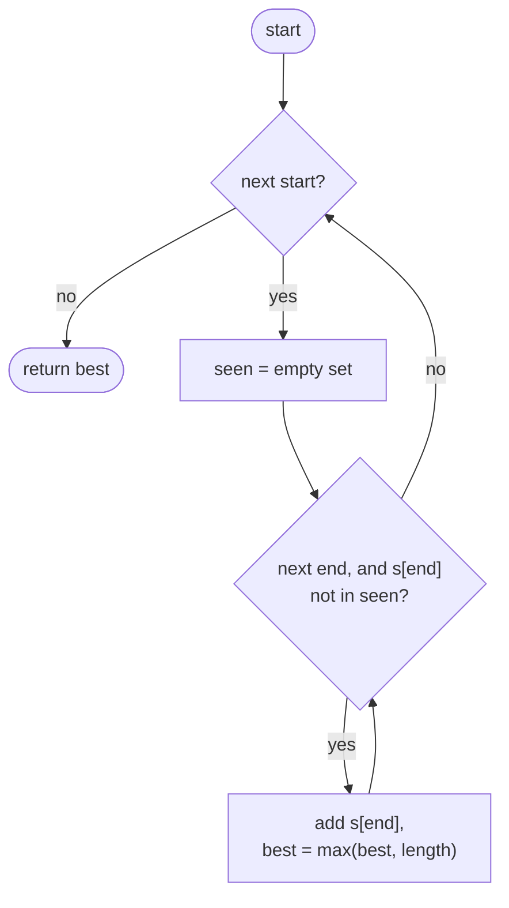
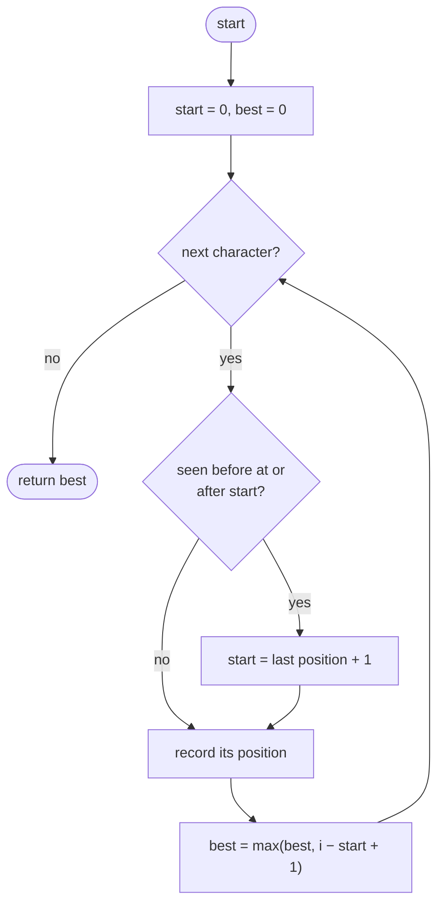

## How to think

**1. Restate the problem.** Find the longest stretch of *consecutive* characters in which no character repeats, and return its length.

**2. Let the constraints guide you.** `s` can be 5 × 10⁴ characters long. Checking every substring separately is O(n²) substrings, each needing a check, which is too slow. We want one pass.

**3. Picture a window.** Keep a window `[start, i]` that currently has no repeats. Move `i` right one character at a time. If the new character is already inside the window, the window is broken, and the only way to fix it is to move `start` to just past the earlier copy of that character.



**4. Jump instead of crawl.** Remembering the **last index** of every character lets `start` jump straight to the right place, instead of moving one step at a time. Each character is then handled once: O(n).

**5. Watch the edge cases.**

- `"abba"`: at the final `a`, the last `a` was at index 0, but the window already starts at 2 (after the second `b`). Moving `start` back to 1 would be wrong. Only move `start` when the earlier copy is *inside* the window.
- Empty string: the answer is 0.
- Spaces and symbols count as characters too.

## Approach 1: Brute force — every start, extend until a repeat
<!-- approach: brute_force | time: O(n × k) for alphabet size k | space: O(k) -->

For each start position, extend to the right, collecting characters in a set, and stop at the first repeat. The window from any start can never be longer than the number of distinct characters, so this is O(n²) for long runs of distinct characters but often faster in practice.

**Dry run** on `"abba"`:

| start | Characters added before a repeat | Length |
|---|---|---|
| 0 | a, b (then b repeats) | 2 |
| 1 | b (then b repeats) | 1 |
| 2 | b, a | 2 |
| 3 | a | 1 |

Answer: 2.

### Code
```python
class Solution:
    def lengthOfLongestSubstring(self, s: str) -> int:
        best = 0
        for start in range(len(s)):
            seen = set()
            for end in range(start, len(s)):
                if s[end] in seen:
                    break
                seen.add(s[end])
                best = max(best, end - start + 1)
        return best
```

### Line by line
- `3` Longest length found so far; 0 also covers the empty string.
- `4` Try every possible start.
- `5` Characters in the current substring, for O(1) repeat checks.
- `6-8` Extend the end; stop at the first repeated character, since every longer substring from this start contains it too.
- `9-10` The character is new: add it and record the length.
- `11` The best over all starts.

### Flowchart


## Approach 2: Optimized — sliding window with last positions
<!-- approach: optimized | time: O(n) | space: O(k) -->

Move `i` across the string once. For each character, if its last position is inside the current window, move `start` just past it. Then record this position and update the best length.

**Dry run** on `"abba"`:

| i | char | last seen at | Inside window? | start | Window | best |
|---|---|---|---|---|---|---|
| 0 | a | (never) | | 0 | a | 1 |
| 1 | b | (never) | | 0 | ab | 2 |
| 2 | b | 1 | 1 ≥ 0 yes | 2 | b | 2 |
| 3 | a | 0 | 0 ≥ 2? **no** | 2 | ba | 2 |

At `i = 3`, ignoring the "inside window" check would move `start` back to 1 and wrongly count "bba" as length 3.

### Code
```python
class Solution:
    def lengthOfLongestSubstring(self, s: str) -> int:
        last_seen = {}
        start = best = 0
        for i, char in enumerate(s):
            if char in last_seen and last_seen[char] >= start:
                start = last_seen[char] + 1
            last_seen[char] = i
            best = max(best, i - start + 1)
        return best
```

### Line by line
- `3` The most recent index of each character.
- `4` The window begins at index 0; the best length so far is 0.
- `5` Extend the window by one character each step.
- `6-7` A repeat *inside* the window breaks it, so move `start` just past the earlier copy. The `>= start` check ignores copies that are already outside the window (the `"abba"` case), which also guarantees `start` never moves backwards.
- `8` Record where this character was last seen.
- `9` The window `[start, i]` now has no repeats; check its length.
- `10` The longest window seen.

### Flowchart

