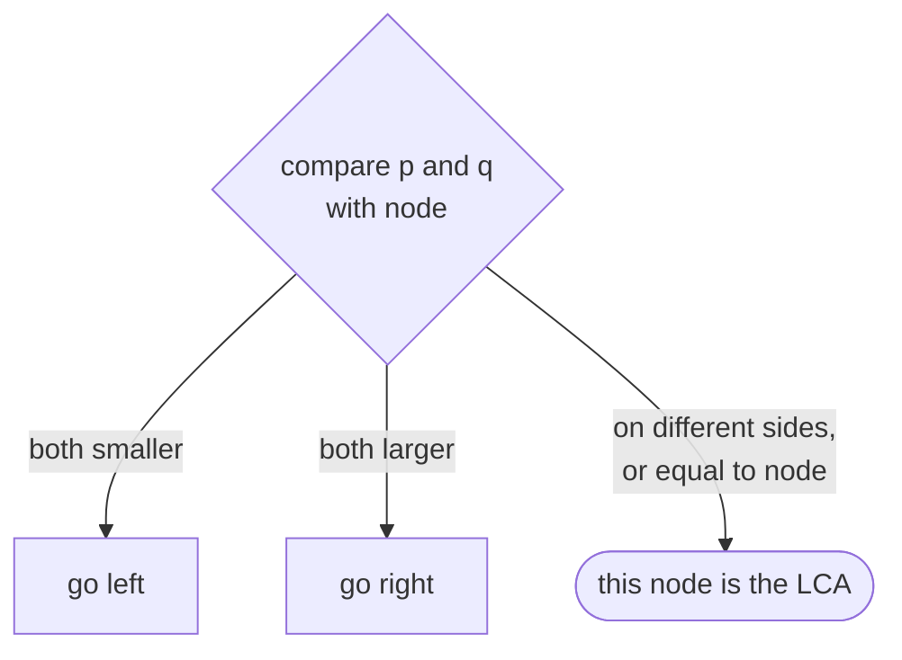
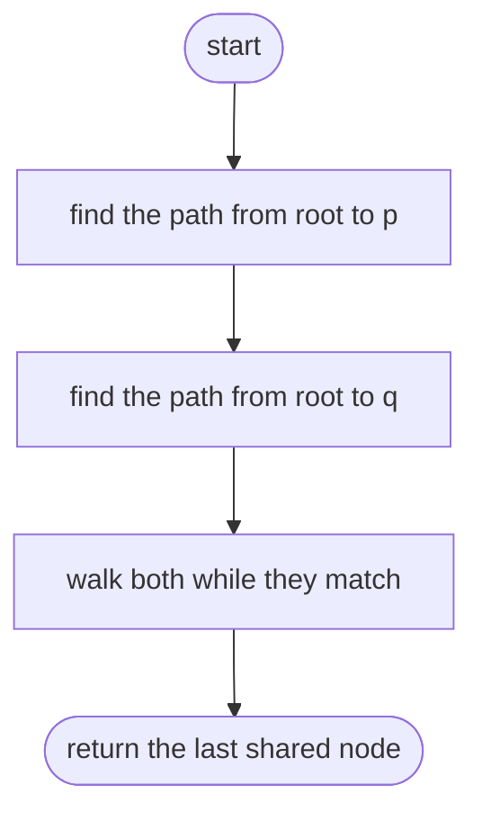
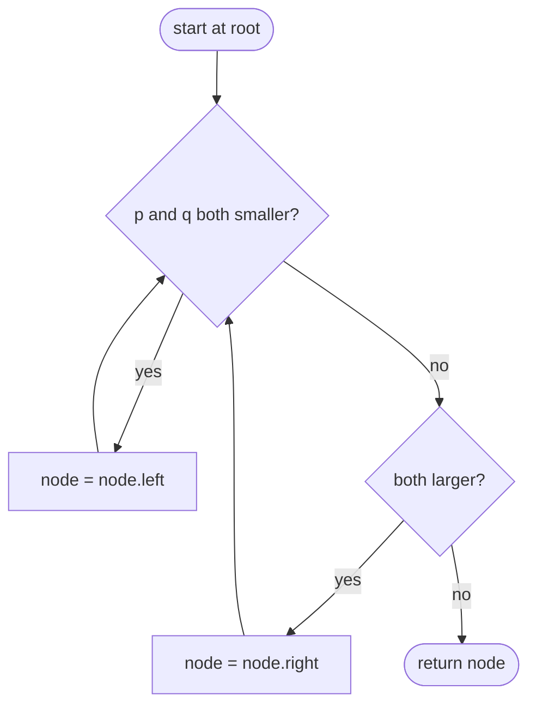

## How to think

**1. Restate the problem.** Find the deepest node that has both `p` and `q` in its subtree (a node is in its own subtree).

**2. In any binary tree.** Find the path from the root to `p` and the path to `q`. They agree for a while and then split; the last node they share is the answer. That works for every tree but walks a lot of nodes.

**3. A BST tells you which way to go.** Compare `p` and `q` with the current node:

- both smaller → both are in the **left** subtree, so the answer is down there;
- both larger → both are in the **right** subtree;
- otherwise they **split here** (or one of them *is* this node), so this node is the answer.



**4. One path, no extra memory.** You walk a single path from the root: O(h) time and O(1) space.

**5. Watch the edge cases.** One node is an ancestor of the other (`p = 2`, `q = 4` gives 2). The root itself can be the answer.

## Approach 1: Brute force — compare root-to-node paths
<!-- approach: brute_force | time: O(n × h) | space: O(n × h) -->

Ignore the BST ordering: search the whole tree for the path to `p` and the path to `q`, then walk both paths together until they diverge.

**Dry run** on `[6, 2, 8, 0, 4, 7, 9, null, null, 3, 5]`, `p = 2`, `q = 8`:

| Path to 2 | Path to 8 | Last shared |
|---|---|---|
| 6 → 2 | 6 → 8 | **6** |

### Code
```python
class Solution:
    def lowestCommonAncestor(self, root: TreeNode, p: TreeNode, q: TreeNode) -> TreeNode:
        def path_to(target):
            stack = [(root, [root])]
            while stack:
                node, path = stack.pop()
                if node is target:
                    return path
                for child in (node.left, node.right):
                    if child:
                        stack.append((child, path + [child]))
            return []

        common = None
        for a, b in zip(path_to(p), path_to(q)):
            if a is not b:
                break
            common = a
        return common
```

### Line by line
- `3-11` Search the whole tree (no ordering used), carrying the path from the root to each node. Copying paths is the O(h) cost per node.
- `13` The deepest shared node so far.
- `14-17` Walk both paths in step; stop where they first differ.
- `18` The last node common to both paths.

### Flowchart


## Approach 2: Optimized — walk down using the BST ordering
<!-- approach: optimized | time: O(h) | space: O(1) -->

From the root, move left while both values are smaller, right while both are larger, and stop at the first node where they split.

**Dry run** on the same tree with `p = 3`, `q = 5`:

| Node | p, q versus node | Move |
|---|---|---|
| 6 | both smaller | left |
| 2 | both larger | right |
| 4 | 3 < 4 < 5: split | return **4** |

### Code
```python
class Solution:
    def lowestCommonAncestor(self, root: TreeNode, p: TreeNode, q: TreeNode) -> TreeNode:
        node = root
        while True:
            if p.val < node.val and q.val < node.val:
                node = node.left
            elif p.val > node.val and q.val > node.val:
                node = node.right
            else:
                return node
```

### Line by line
- `3` Start at the root, which is a common ancestor of everything.
- `4` Both nodes exist in the tree, so the loop always ends at the answer.
- `5-6` Both are smaller: the lowest common ancestor is in the left subtree.
- `7-8` Both are larger: it's in the right subtree.
- `9-10` They're on different sides, or one of them is this node: going lower would lose one of them.

### Flowchart

