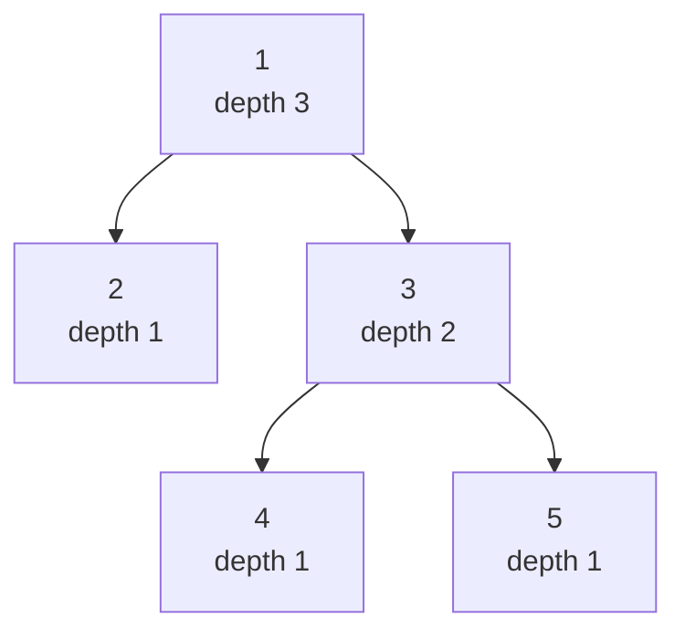
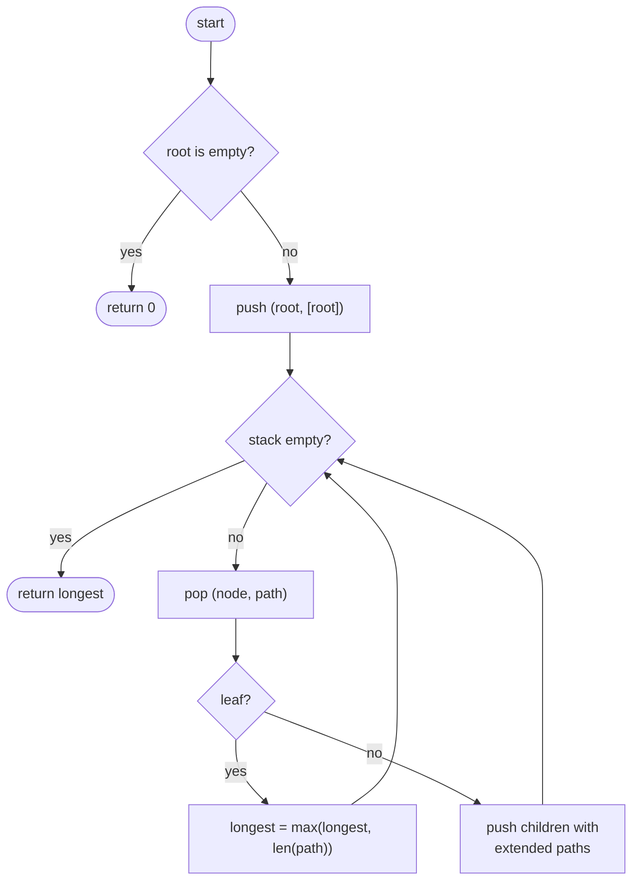
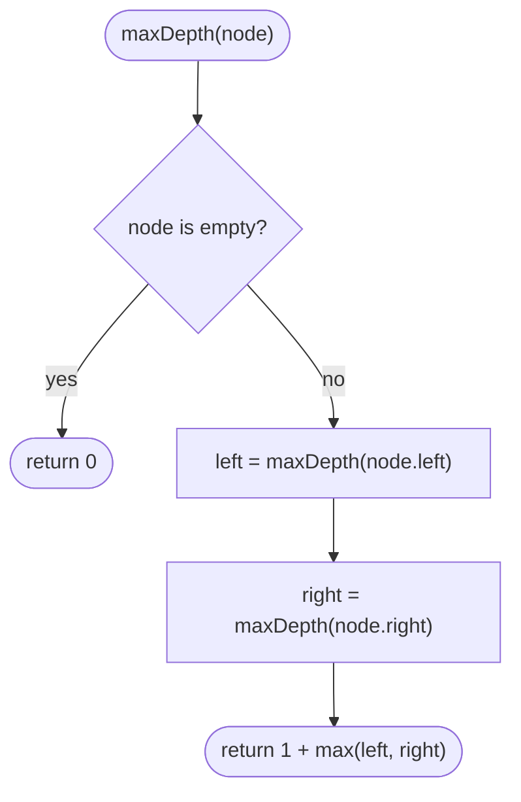

## How to think

**1. Restate the problem.** The depth of a tree is the number of nodes on its longest root-to-leaf path. An empty tree has depth 0.

**2. Look at one node and trust the recursion.** A tree is a root plus two smaller trees. If you already knew the depth of the left subtree and of the right subtree, the whole tree's depth would be:

```
depth(node) = 1 + max(depth(node.left), depth(node.right))
depth(empty) = 0
```

**3. Picture it on the first example**, `[1, 2, 3, null, null, 4, 5]`, with each node labelled by the depth of the subtree below it:



Leaves have depth 1. Node 3 is `1 + max(1, 1) = 2`, and the root is `1 + max(1, 2) = 3`.

**4. Why recursion is natural here.** Each subtree's answer is computed once and combined once, so every node is visited exactly once: O(n). Writing out whole paths instead (the brute force) repeats work, because nodes near the root appear in many paths.

**5. Watch the edge cases.**

- An empty tree returns 0, not 1.
- A tree shaped like a long chain is as deep as it has nodes, so a recursive solution goes that deep too. Our tests include a 1,000-deep chain.

## Approach 1: Brute force — list every root-to-leaf path
<!-- approach: brute_force | time: O(n × h) | space: O(n × h) -->

Explore the tree with a stack, carrying the full path from the root to each node. At every leaf, record the path's length. The longest path is the answer. Copying the path at every step is what makes this slower than it needs to be.

**Dry run** on `[1, 2, 3, null, null, 4, 5]`:

| Leaf reached | Path | Length |
|---|---|---|
| 5 | 1 → 3 → 5 | 3 |
| 4 | 1 → 3 → 4 | 3 |
| 2 | 1 → 2 | 2 |

Longest: **3**.

### Code
```python
class Solution:
    def maxDepth(self, root: Optional[TreeNode]) -> int:
        if root is None:
            return 0
        longest = 0
        stack = [(root, [root.val])]
        while stack:
            node, path = stack.pop()
            if node.left is None and node.right is None:
                longest = max(longest, len(path))
            for child in (node.left, node.right):
                if child:
                    stack.append((child, path + [child.val]))
        return longest
```

### Line by line
- `3-4` An empty tree has depth 0.
- `5` Longest root-to-leaf path found so far.
- `6` Each stack entry is a node plus the full path from the root to it.
- `7-8` Take the next node to explore.
- `9-10` A node with no children is a leaf, so its path is a complete root-to-leaf path.
- `11-13` Push each child with the path extended by that child. `path + [child.val]` copies the whole path, which is the O(h) cost per node.
- `14` The longest path's length is the depth.

### Flowchart


## Approach 2: Optimized — recursion: 1 + deeper subtree
<!-- approach: optimized | time: O(n) | space: O(h) -->

Return 0 for an empty tree; otherwise return 1 plus the larger of the two subtree depths. Each node is visited once, and the only extra memory is the recursion stack, one frame per level.

**Dry run** on `[1, 2, 3, null, null, 4, 5]`, in the order calls finish:

| Call | Left depth | Right depth | Returns |
|---|---|---|---|
| maxDepth(2) | 0 | 0 | 1 |
| maxDepth(4) | 0 | 0 | 1 |
| maxDepth(5) | 0 | 0 | 1 |
| maxDepth(3) | 1 | 1 | 2 |
| maxDepth(1) | 1 | 2 | **3** |

### Code
```python
class Solution:
    def maxDepth(self, root: Optional[TreeNode]) -> int:
        if root is None:
            return 0
        return 1 + max(self.maxDepth(root.left), self.maxDepth(root.right))
```

### Line by line
- `3-4` Base case: an empty subtree adds no depth. This also handles leaves, whose children are both empty.
- `5` This node counts as 1, plus whichever subtree goes deeper. Each node makes this one decision exactly once.

### Flowchart

