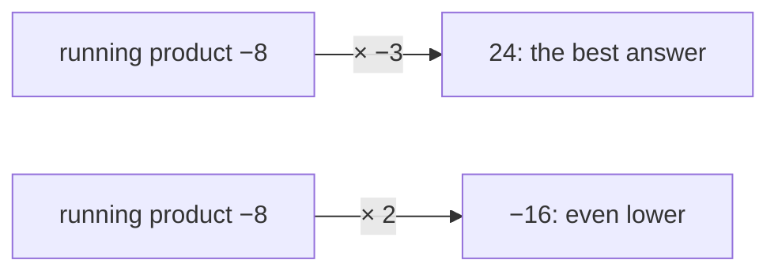
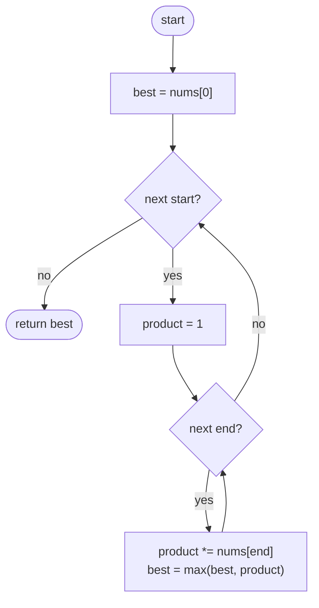
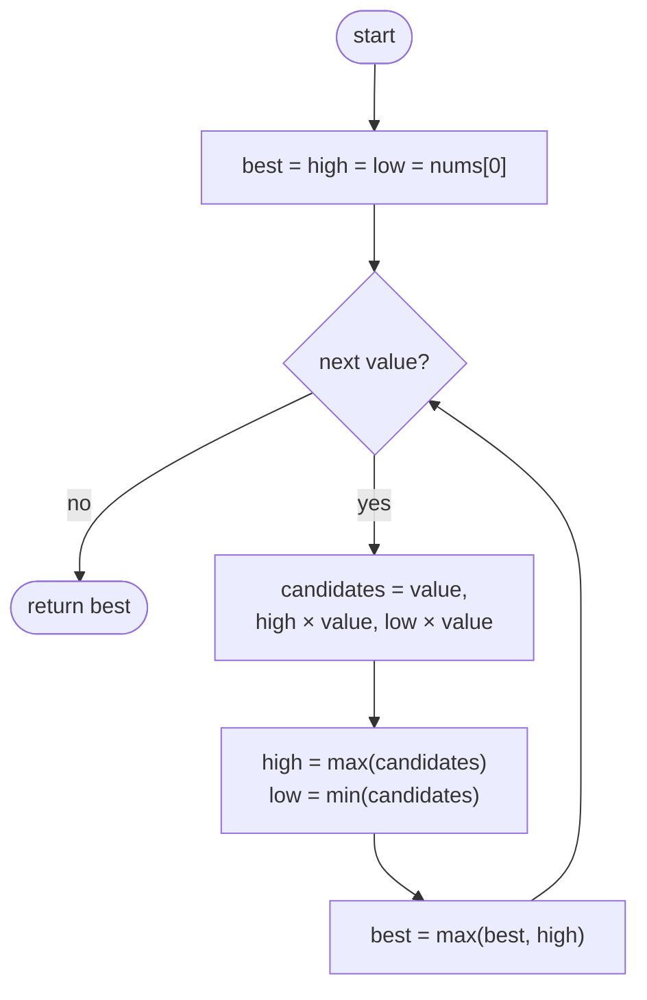

## How to think

**1. Restate the problem.** Like Maximum Subarray, but with a **product** instead of a sum: find the consecutive run whose product is largest.

**2. Why Kadane's trick isn't enough.** For sums, a bad (negative) running total is simply dropped. With products, a very *negative* running product is valuable: one more negative number turns it into a very large positive one.



**3. Track both extremes.** At every position, keep the **largest** and the **smallest** product of a run ending here. The new values come from three candidates:

- start fresh: `value`
- extend the largest: `high × value`
- extend the smallest: `low × value` (a negative times a negative can become the new largest)

**4. Zeros reset everything.** Any run through a 0 has product 0, and the "start fresh" candidate handles restarting after it automatically.

**5. Watch the edge cases.** A single negative number is its own answer. An odd count of negatives with no zeros means dropping one end of the array.

## Approach 1: Brute force — every run, with a running product
<!-- approach: brute_force | time: O(n²) | space: O(1) -->

Fix a start, extend the end one element at a time, keep a running product, and track the best.

**Dry run** on `[2, -4, -3, 1]`:

| start | Running products as the end moves right | Best so far |
|---|---|---|
| 0 | 2, −8, 24, 24 | 24 |
| 1 | −4, 12, 12 | 24 |
| 2 | −3, −3 | 24 |
| 3 | 1 | **24** |

### Code
```python
class Solution:
    def maxProduct(self, nums: List[int]) -> int:
        best = nums[0]
        for start in range(len(nums)):
            product = 1
            for end in range(start, len(nums)):
                product *= nums[end]
                best = max(best, product)
        return best
```

### Line by line
- `3` A real run's product; starting at 0 would be wrong for `[-5]`.
- `4` Fix where the run begins.
- `5` Reset the product for this start.
- `6-7` Extend one element at a time; the product updates in O(1).
- `8` Track the largest product of any run.
- `9` The best over all runs.

### Flowchart


## Approach 2: Optimized — track the largest and smallest product ending here
<!-- approach: optimized | time: O(n) | space: O(1) -->

At each element, the new largest and smallest products ending here are the max and min of: the element alone, the old largest times it, and the old smallest times it.

**Dry run** on `[2, -4, -3, 1]`:

| value | candidates (value, high × value, low × value) | high | low | best |
|---|---|---|---|---|
| 2 | | 2 | 2 | 2 |
| −4 | −4, −8, −8 | −4 | −8 | 2 |
| −3 | −3, 12, **24** | 24 | −3 | **24** |
| 1 | 1, 24, −3 | 24 | −3 | 24 |

At −3, the *smallest* product so far (−8) became the largest (24): that's why `low` is tracked.

### Code
```python
class Solution:
    def maxProduct(self, nums: List[int]) -> int:
        best = high = low = nums[0]
        for i in range(1, len(nums)):
            value = nums[i]
            candidates = (value, high * value, low * value)
            high, low = max(candidates), min(candidates)
            best = max(best, high)
        return best
```

### Line by line
- `3` The only run ending at index 0 is `[nums[0]]`, so it's the largest, the smallest and the best.
- `4-5` Visit each later element.
- `6` The three ways a run can end here: start fresh, extend the largest, or extend the smallest.
- `7` Update both extremes together from the *old* values. Updating `high` first and then using it for `low` would be a bug.
- `8` The answer is the largest product ending anywhere.
- `9` Return it.

### Flowchart

