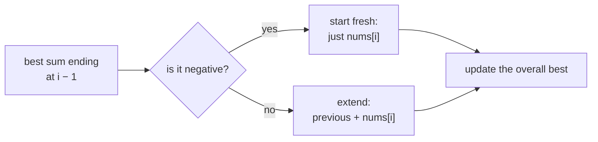
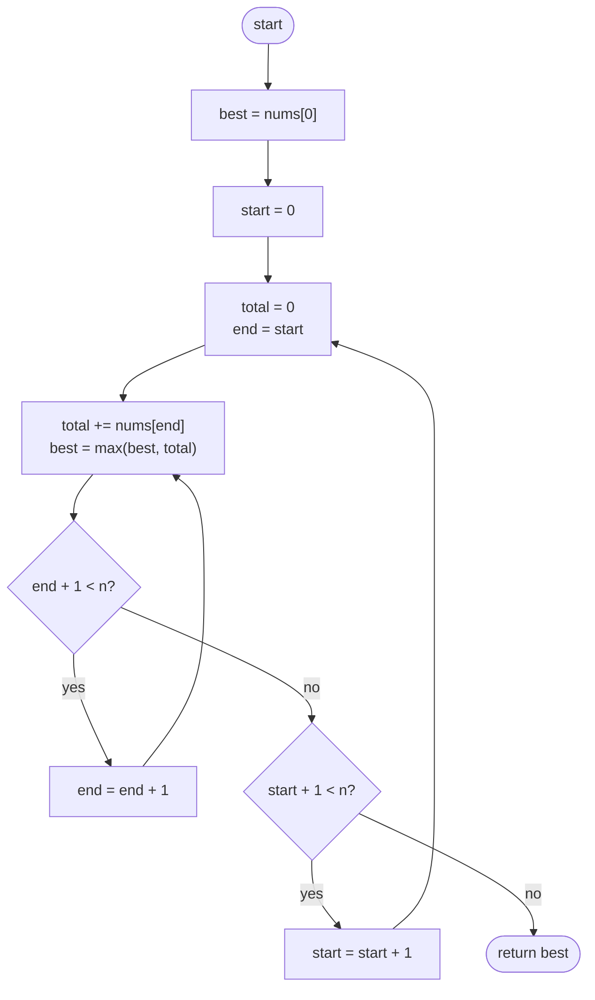
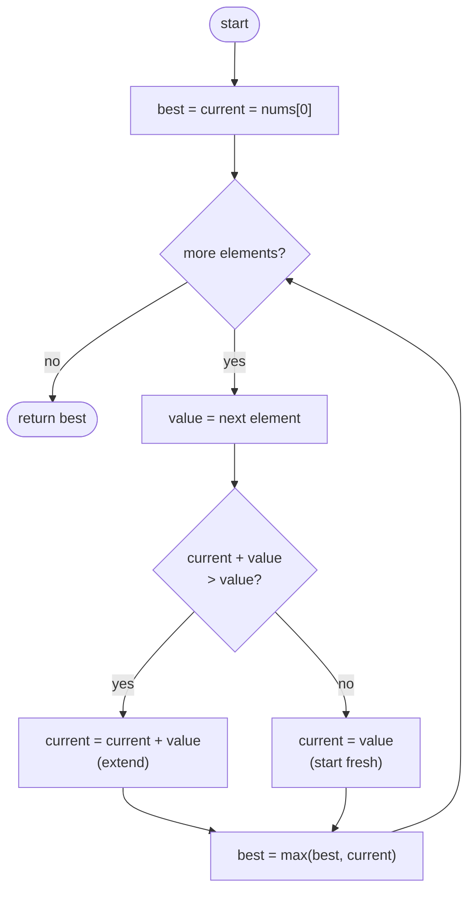

## How to think

**1. Restate the problem.** Choose a run of *consecutive* elements (at least one) whose total is as large as possible, and return that total.

**2. Let the constraints guide you.** With 10⁵ elements there are about 5 × 10⁹ subarrays, so listing them all is too slow. We want a single pass.

**3. Ask a smaller question at each position.** Instead of "what is the best subarray anywhere?", ask:

> What is the best subarray that **ends exactly here**?

Every subarray ends somewhere, so the overall answer is the best of these per-position answers.

**4. Find how one position's answer builds on the previous one.** A subarray ending at position `i` either:

- **extends** the best subarray ending at `i − 1` by adding `nums[i]`, or
- **starts fresh** at `i`, containing only `nums[i]`.

Starting fresh is better exactly when the best sum ending at `i − 1` is negative: a negative running total only drags down whatever comes after it. So:

```
best_ending_here = max(nums[i], best_ending_here + nums[i])
```

This rule is known as **Kadane's algorithm**. It's a tiny dynamic program where the state is "best sum ending here".



**5. Watch the edge cases.**

- **All negative**, such as `[-8, -3, -6]`: the answer is the largest single element, −3, not 0. Starting `best` at 0 is a classic bug, because the subarray can't be empty.
- **A single element** is its own answer.

## Approach 1: Brute force — every start, extend to every end
<!-- approach: brute_force | time: O(n²) | space: O(1) -->

Fix a starting index, then extend the end one element at a time, keeping a running total. That visits every subarray once without re-adding from scratch. (Re-adding each subarray from scratch would be O(n³).)

**Dry run** on `nums = [3, -7, 4, -1, 5]`. A few of the running totals:

| start | Running totals as the end moves right | Best so far |
|---|---|---|
| 0 | 3, −4, 0, −1, 4 | 4 |
| 1 | −7, −3, −4, 1 | 4 |
| 2 | 4, 3, **8** | 8 |
| 3 | −1, 4 | 8 |
| 4 | 5 | 8 |

The answer is 8, from `[4, -1, 5]`. Correct, but about n²/2 steps is too slow for 10⁵ elements.

### Code
```python
class Solution:
    def maxSubArray(self, nums: List[int]) -> int:
        best = nums[0]
        for start in range(len(nums)):
            total = 0
            for end in range(start, len(nums)):
                total += nums[end]
                best = max(best, total)
        return best
```

### Line by line
- `3` Start with a real subarray's total, `[nums[0]]`. Starting at 0 would be wrong when every number is negative.
- `4` Fix where the subarray begins.
- `5` Reset the running total for this new start.
- `6-7` Extend the end one step at a time; adding the new element gives the next subarray's total in O(1).
- `8` Keep the largest total seen across every (start, end) pair.
- `9` After all subarrays, `best` is the answer.

### Flowchart


## Approach 2: Optimized — Kadane's algorithm
<!-- approach: optimized | time: O(n) | space: O(1) -->

Keep two numbers while walking left to right: `current`, the best sum of a subarray ending at the current position, and `best`, the best seen anywhere. At each element choose between extending and starting fresh, as worked out in *How to think*.

**Dry run** on `nums = [3, -7, 4, -1, 5, -9, 2]`:

| i | value | extend = current + value | start fresh | current = max | best |
|---|---|---|---|---|---|
| 0 | 3 | | | 3 | 3 |
| 1 | −7 | 3 − 7 = −4 | −7 | −4 | 3 |
| 2 | 4 | −4 + 4 = 0 | 4 | **4** (fresh) | 4 |
| 3 | −1 | 4 − 1 = 3 | −1 | 3 | 4 |
| 4 | 5 | 3 + 5 = 8 | 5 | 8 | **8** |
| 5 | −9 | 8 − 9 = −1 | −9 | −1 | 8 |
| 6 | 2 | −1 + 2 = 1 | 2 | 2 (fresh) | 8 |

At index 2 the running sum was −4, so starting fresh at 4 wins. That's where the best subarray `[4, -1, 5]` begins.

### Code
```python
class Solution:
    def maxSubArray(self, nums: List[int]) -> int:
        best = current = nums[0]
        for i in range(1, len(nums)):
            value = nums[i]
            current = max(value, current + value)
            best = max(best, current)
        return best
```

### Line by line
- `3` Both start at the first element: the only subarray ending at index 0 is `[nums[0]]`.
- `4-5` Visit the remaining elements by index. (Looping over `nums[1:]` would copy the list and cost O(n) extra memory.)
- `6` The heart of Kadane: either start fresh with `value`, or extend the best subarray ending at the previous position. A negative `current` makes starting fresh win.
- `7` The answer is the best `current` seen at any position.
- `8` Return the best total.

### Flowchart

